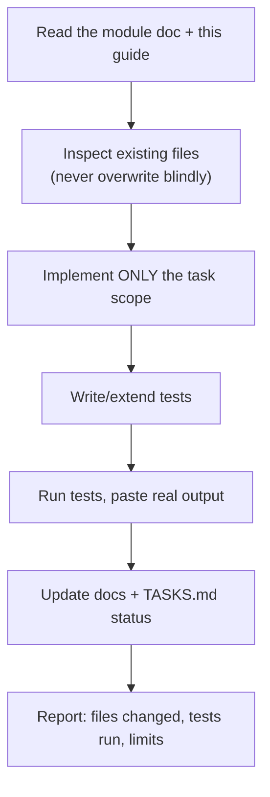

# Antigravity Implementation Guide

**Status:** Planned

## 1. Full workflow diagram (one task cycle)



## 2. Required tech stack and technologies
Python 3.12, FastAPI, SQLAlchemy 2, Alembic, PostgreSQL 16, React 18 + TypeScript, Vite, Tailwind, TanStack Query, Docker Compose.

## 3. System architecture (repo layout)

```
gurukul-ai/
  docker-compose.yml  .env.example  README.md
  docs/                      (these files)
  backend/
    pyproject.toml  Dockerfile  alembic.ini  alembic/versions/
    app/
      main.py
      core/        config, security, permissions, exceptions, logging
      db/          base, session
      models/      one file per table group
      schemas/
      repositories/
      services/    auth, audit, knowledge, review, voice, assistant
      api/v1/      router.py, endpoints/
      integrations/{storage,llm,speech}/
      tests/
  frontend/
    package.json  Dockerfile  vite.config.ts
    src/{app,routes,layouts,components,features,lib/api,hooks,types,tests}
  infrastructure/scripts/    seed.py
```

## 4. Tech flow (commands)
```
docker compose up --build              # start db, backend, frontend
docker compose exec backend alembic upgrade head
docker compose exec backend python -m infrastructure.scripts.seed   # path may differ; confirm in task
docker compose exec backend pytest
docker compose exec frontend npm test
```
Frontend: http://localhost:5173  ·  API docs: http://localhost:8000/docs

## 5. Steps / rules
1. One bounded task per prompt. Do not rewrite the project.
2. Inspect existing files first. Preserve working code. No duplicate models, routes or services.
3. Business logic in services, not routers. Only repositories touch the ORM.
4. Every protected route has a permission dependency. Every object access has an ownership or visibility check.
5. Schema changes only via Alembic migrations.
6. No secrets in code or logs. No tokens in localStorage.
7. Placeholders are labelled "Planned, not implemented". Never fake AI results or save pretend data.
8. Report only tests you actually ran.

**Task prompt template (8 parts):** Objective · Prerequisites · Files to create/modify · Requirements · Acceptance criteria · Tests to run · Expected result · Docs to update.

## 6. Other information
Files not to overwrite without inspection: `docker-compose.yml`, `.env`, anything in `alembic/versions/`, `core/security.py`, `core/permissions.py`.
