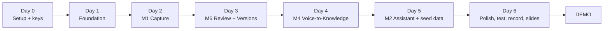
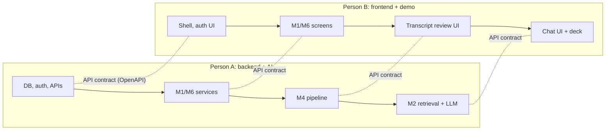
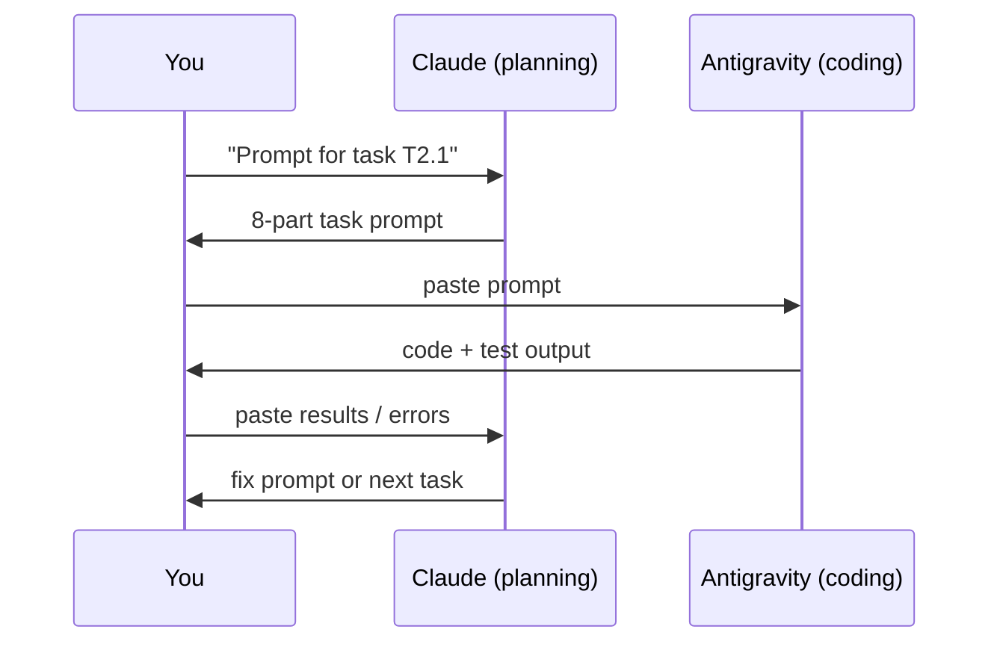

# Hackathon Plan (6 days, 2 people)

**Status:** Planned

## 1. Full workflow diagram (6-day build)

## 2. Required tech stack and technologies
Docker Desktop, Git, Antigravity, a code editor. Python and Node do **not** need to be installed locally because everything runs in containers.

**Keys needed before Day 2:**
| Key | Used for | Required |
|---|---|---|
| `ANTHROPIC_API_KEY` | Structuring (M4) and answers (M2) | Yes |
| `OPENAI_API_KEY` | Hosted Whisper transcription | Optional |
| none | Local `faster-whisper` fallback (CPU, slower, downloads a model on first run) | Fallback |

## 3. System architecture of the delivery
Two people, parallel tracks that meet on API contracts.

Rule: agree the request/response shape (FastAPI's `/docs` OpenAPI page) at the start of each day, then work in parallel. Merge to `main` at the end of each day.

## 4. Tech flow of the daily loop

## 5. Steps (day by day)

| Day | Person A (backend + AI) | Person B (frontend + demo) | End-of-day check |
|---|---|---|---|
| 0 | Install Git/Docker check, create keys | Create repo structure, get Antigravity working | `docker compose version` works |
| 1 | Compose, backend skeleton, DB, migration 001, seed, auth + permissions | Vite app, Tailwind, router, login/register UI, layout, role-aware sidebar | Log in as Expert and Trainee, 403 works |
| 2 | M1 APIs: machines, knowledge items, drafts, steps, media upload | M1 screens: library, create/edit form, steps editor, upload/record | Expert creates and saves a draft |
| 3 | M6 APIs: submit, approve, reject, request changes, versions, audit | Review queue, review page, version history, status badges | Expert B approves Expert A's draft; trainee sees it |
| 4 | M4: media to STT to Claude structuring, jobs | Record/upload page, job status, transcript review editor, step draft review | Audio becomes a draft with flagged gaps |
| 5 | M2: chunking at publish, search, Claude answer, citations, "no source" | Chat UI, sources panel, dashboards, placeholder pages, seed data | Trainee gets a cited answer and a "no source" answer |
| 6 | Bug fixes, test pass, `docker compose up` from clean | Recording, slide deck, rehearsal | Full run-through twice |

## 6. Other information

**Cut lines (drop in this order if behind):** 1) Version comparison view, 2) conversation history list, 3) transcript segment click-to-seek, 4) video input (keep audio only), 5) dashboard polish. **Never cut:** auth, approve-before-publish, citations, "no source found".

**Deliberate hackathon simplifications (labelled, not hidden):**
- No password reset flow, no email.
- Rate limiting is in-memory (single process).
- `BackgroundTasks` instead of Redis workers.
- Full-text search instead of vectors.
- Steps stored as JSONB inside each version snapshot.
- Approve publishes immediately.
- No virus scanning of uploads. Type and size checks only.

**Demo script (about 5 minutes):**
1. Show the problem in 20 seconds.
2. Expert A records a short narration about a sample inspection (clearly labelled demo content).
3. Transcript appears. AI proposes steps and flags a missing value instead of inventing it.
4. Expert A corrects it and submits. Show that the trainee cannot see it yet.
5. Expert B approves. It is published as v1.
6. Trainee asks a question. Answer cites the approved version.
7. Trainee asks an uncovered question. System says no approved source and offers escalation.
8. Show the placeholder map of the other 7 modules (roadmap slide).

**Deliverables for Day 6:** live demo build, a 3 to 5 minute screen recording (backup), a slide deck.

**Slide deck outline (10 slides):** Problem · Why now · Solution · Core loop diagram · Live demo screenshots · Architecture · AI safety (draft vs approved) · Roadmap (11 modules) · Risks and limits · Team and ask.

**Risks:** API outage or slow transcription (mitigate: keep clips under 2 minutes, keep a recording); scope creep (use cut lines); demo data mistaken for real procedures (label it "Demo data" in the UI).
