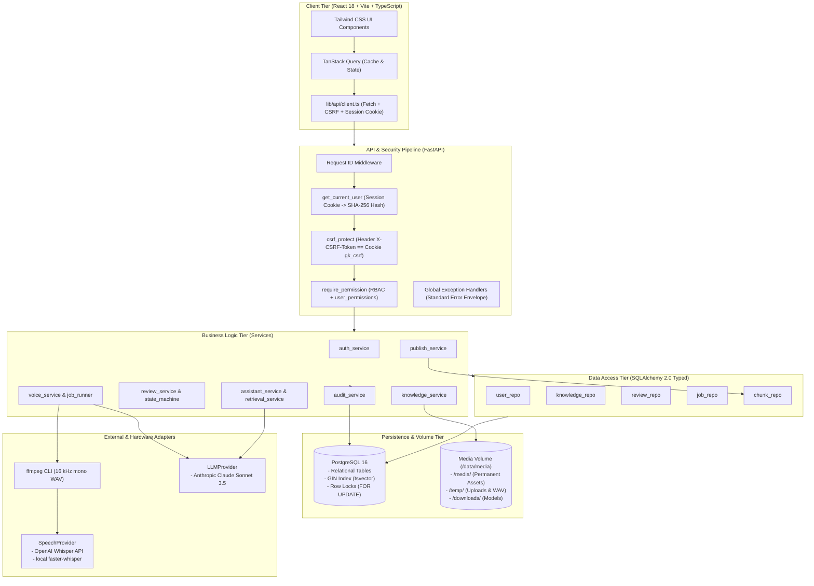
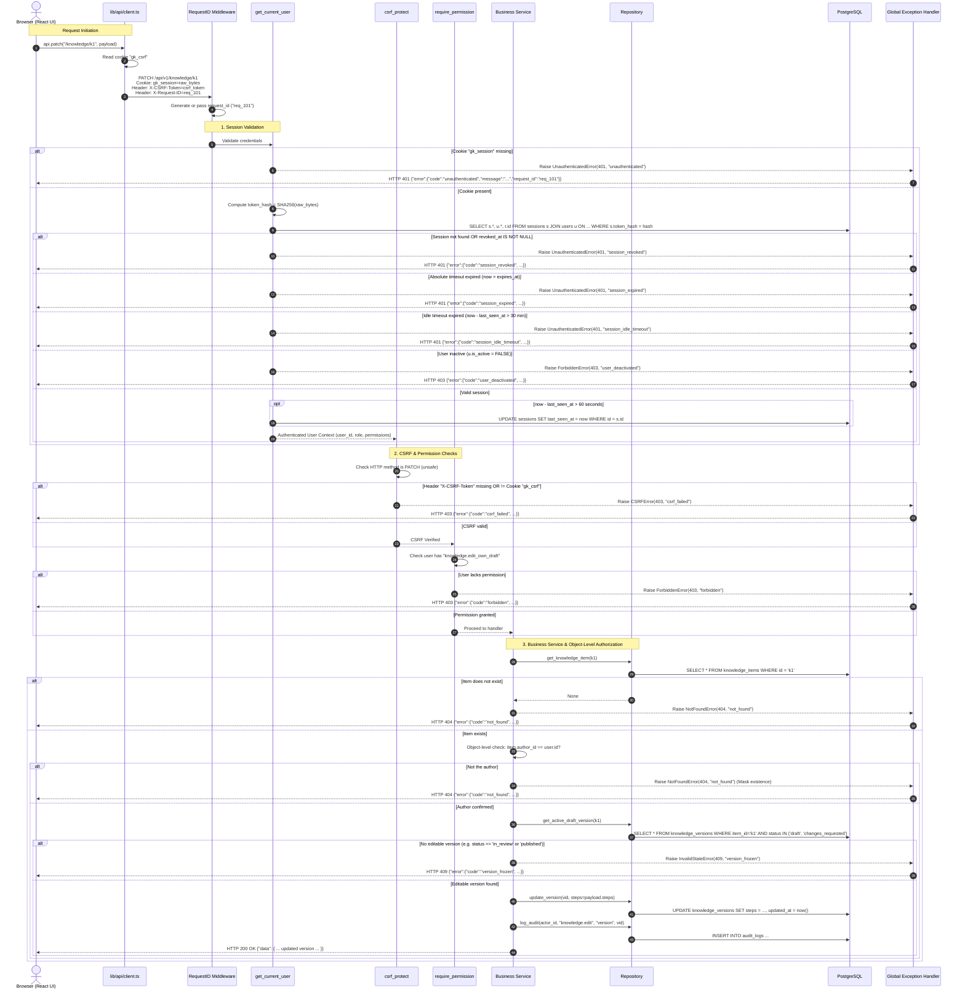
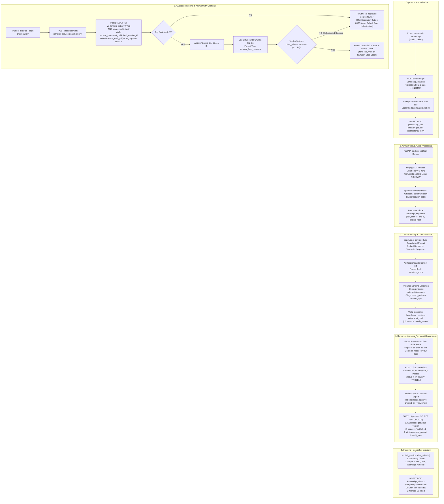
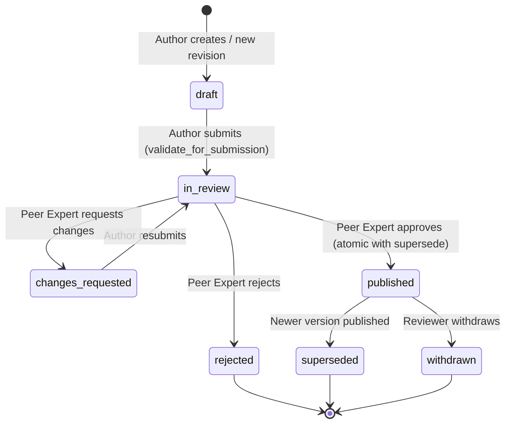
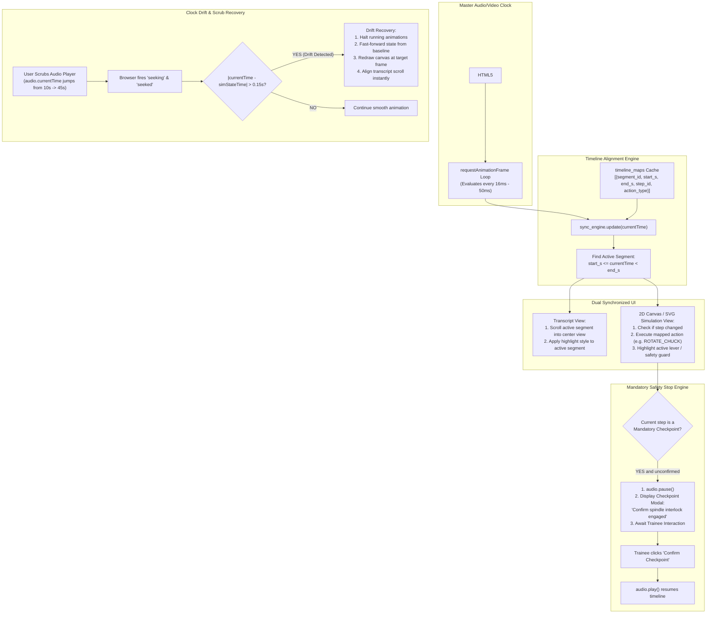
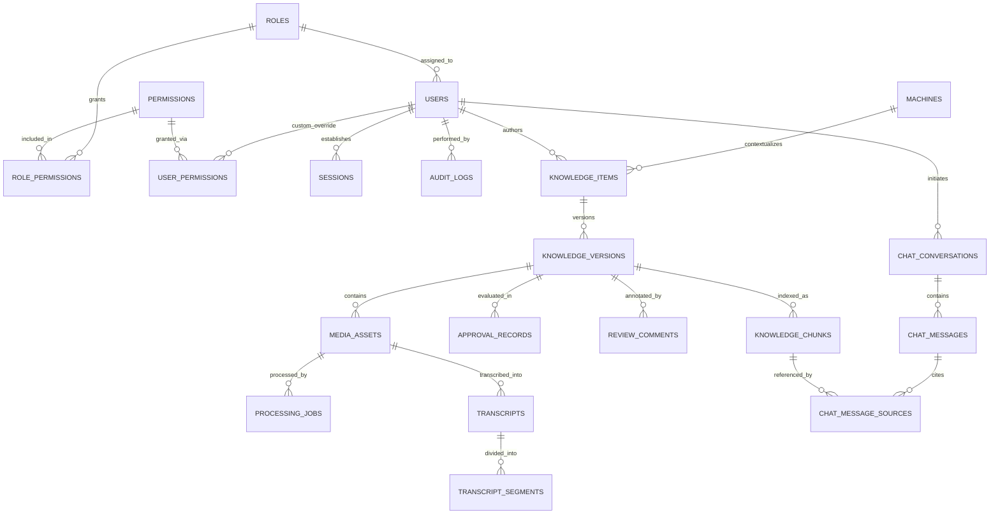
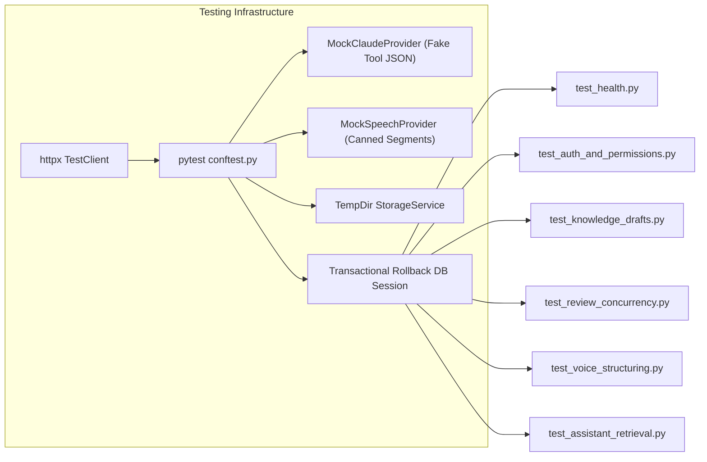

# Gurukul AI — Master Low-Level System Design (LLD) Reference

**System Name:** Gurukul AI (Manufacturing Knowledge Capture, Validation, and Training Platform)  
**Document Type:** Master Technical Low-Level Design (LLD) & Architectural Reference  
**Version:** 3.0 (Consolidated Master Baseline)  
**Status:** Approved Reference Standard · Engineering Baseline  

---

## 1. Executive Summary & Architectural Invariants

Gurukul AI is a specialized industrial knowledge capture, peer-review governance, and training platform. It addresses the systemic problem of tribal knowledge loss on the factory floor by capturing expert audio/video narration, structuring it into standardized SOPs via constrained AI, enforcing peer-review governance, and serving verified knowledge to trainees via an air-gapped, cited AI assistant.

### The Five Non-Negotiable System Invariants
1. **AI Generates Drafts Only:** AI can never publish, approve, or promote content to authoritative status. AI output begins with origin `ai_draft` and requires human expert editing (`ai_draft_edited`) before review submission.
2. **Zero Hallucination of Parameters & Tolerances:** Prompts strictly forbid the LLM from inventing parameters, tool designations, or safety limits. Gaps are explicitly flagged with `needs_review: true`.
3. **Strict Peer Review & Anti-Self-Approval:** The system strictly prohibits authors from approving their own revisions (`403 self_review_forbidden`), enforced at the database transaction and service layer with row-level locks.
4. **Immutable Published Versions & Single Live Pointer:** Published versions are immutable historical snapshots. Any edit spawns a new draft version. Retrieval and trainee views strictly query active chunks belonging to `current_published_version_id`.
5. **Air-Gapped from Machine Actuation:** The platform interfaces exclusively with humans for training and guidance; it has zero hardware control interfaces and cannot command physical machinery.

---

## 2. System Architecture & Modular Monolith Topology



---

## 3. Domain 1: Authentication and Request Lifecycle

### 3.1 End-to-End Request Pipeline & Failure Paths



### 3.2 Security Parameters & Implementation Contracts
* **Password Hashing:** Argon2id via `argon2-cffi` (`time_cost=3`, `memory_cost=65536` KiB, `parallelism=4`).
* **Session Lifecycle:**
  * Raw 32-byte cryptographically secure token (`secrets.token_bytes(32)`) set in `gk_session` cookie (`HttpOnly`, `SameSite=Lax`).
  * Only the hex-encoded SHA-256 hash is persisted in `sessions.token_hash`.
  * **Idle Expiration:** 30 minutes (updated in DB at most once per minute to avoid write thrashing).
  * **Absolute Expiration:** 8 hours from creation.
  * **Revocation:** `POST /api/v1/auth/logout` sets `revoked_at = NOW()`.
* **CSRF Protection:** Double-submit cookie pattern. Unsafe HTTP methods (`POST`, `PUT`, `PATCH`, `DELETE`) require header `X-CSRF-Token` matching the readable `gk_csrf` cookie.
* **Standard Error Body (`API_CONVENTIONS.md`):**
```json
{
  "error": {
    "code": "self_review_forbidden",
    "message": "Author cannot approve their own knowledge version.",
    "details": null,
    "request_id": "req_01HP8T7K9YZ"
  }
}
```

---

## 4. Domain 2: Knowledge and AI Pipeline

### 4.1 Complete Pipeline Flowchart



### 4.2 LLM Tool Calling Contract & Structuring Schema
```python
class StepDraftSchema(BaseModel):
    order: int
    title: str = Field(description="Action-oriented step name")
    instruction: str = Field(description="Clear directive instruction")
    tools: list[str] = Field(default_factory=list, description="Explicit tools stated in narration")
    safety_warning: str = Field(default="", description="PPE or hazard warning")
    expected_result: str = Field(default="", description="Verifiable outcome")
    stop_condition: str = Field(default="", description="Condition requiring immediate stop")
    source_segment_ids: list[int] = Field(description="IDs of source segments from transcript")
    needs_review: bool = Field(description="True if value/tool is mentioned but unspecified")
    note: str = Field(default="", description="Explanation of what is missing or unclear")

class StructuringOutputSchema(BaseModel):
    summary: str
    keywords: list[str]
    steps: list[StepDraftSchema]
    unclear_segments: list[int]
```

### 4.3 Governance State Machine Transitions


---

## 5. Domain 3: Media and Sound Processing

### 5.1 Media Pipeline & Acoustic Processing Sequence

```mermaid
sequenceDiagram
    autonumber
    actor Trainee as Trainee / Expert
    participant API as FastAPI Router
    participant Stor as StorageService
    participant Vol as Protected Disk (/data/media)
    participant Worker as BackgroundTask Runner
    participant AudioEng as librosa Audio Engine
    participant DB as PostgreSQL

    Note over Trainee,Vol: 1. Stream Validation & Protected Storage
    Trainee->>API: POST /api/v1/sound-analysis/recordings (multipart audio file)
    API->>API: Stream meter: chunk-by-chunk size check (abort if > MAX_UPLOAD_MB)
    API->>API: Sniff magic bytes: verify audio format (WAV, MP3, WebM, OGG)
    API->>Stor: save_stream(upload_file.file, subfolder="temp")
    Stor->>Stor: Generate isolated path: /data/media/temp/{uuid}.wav
    Stor->>Vol: Write to disk (mode 0600)
    Stor-->>API: Return storage_key

    Note over API,DB: 2. Job Queue & Polling
    API->>DB: INSERT INTO processing_jobs (type='sound_analysis', status='queued')
    API-->>Trainee: HTTP 202 Accepted {job_id: "job_99", status: "queued"}

    Note over Worker,DB: 3. Acoustic Feature Extraction & Quality Checks
    Worker->>DB: UPDATE processing_jobs SET status='processing', progress=20
    Worker->>AudioEng: load_audio(storage_key, target_sr=22050)
    
    AudioEng->>AudioEng: Quality Check 1: Calculate SNR (Signal-to-Noise Ratio)
    AudioEng->>AudioEng: Quality Check 2: Check for digital clipping (> 99% peak)
    AudioEng->>AudioEng: Quality Check 3: Check minimum length (>= 2.0s)
    
    alt Audio Quality Test Fails (e.g. Excessive Background Noise / Clipping)
        AudioEng-->>Worker: QualityFail(reason="Low SNR (< 12dB) or severe clipping")
        Worker->>DB: UPDATE processing_jobs SET status='failed', error_safe='Audio quality too low for analysis. Ensure microphone is near machine.'
    else Audio Quality Passes
        Worker->>DB: UPDATE processing_jobs SET progress=50
        AudioEng->>AudioEng: Compute 20 MFCCs (Mel-Frequency Cepstral Coefficients)
        AudioEng->>AudioEng: Compute Spectral Centroid, Rolloff, & Zero-Crossing Rate
        AudioEng->>AudioEng: Aggregate mean and standard deviation vector (dim: 46)
        
        Note over Worker,DB: 4. Vector Similarity Comparison vs Approved References
        Worker->>DB: SELECT id, title, label, feature_vector FROM sound_references WHERE machine_id = m1 AND status = 'approved'
        Worker->>Worker: Calculate Cosine Similarity for each approved reference:<br/>sim = (u · v) / (||u|| ||v||)
        Worker->>Worker: Sort matches descending; select top match
        
        alt Highest Similarity < 0.70 (Inconclusive Match)
            Worker->>DB: INSERT INTO analysis_runs (is_match=false, similarity=sim, status='inconclusive')
            Worker->>DB: UPDATE processing_jobs SET status='completed', progress=100
            Worker->>DB: Create escalation record for Expert Review
        else Strong Match (Similarity >= 0.70)
            Worker->>DB: INSERT INTO analysis_runs (is_match=true, similarity=sim, ref_id=matched_id)
            Worker->>DB: UPDATE processing_jobs SET status='completed', progress=100
        end
    end

    Note over Trainee,API: 5. Protected Streaming & Retrieval
    Trainee->>API: GET /api/v1/media/{media_id} (Header: Range: bytes=0-1048576)
    API->>DB: Verify user has permission to view parent version
    API->>Stor: get_stream(storage_key, range)
    Stor->>Vol: Open file descriptor
    Stor-->>API: Stream byte chunks
    API-->>Trainee: HTTP 206 Partial Content (Content-Range: bytes 0-1048576/3145728)
```

### 5.2 Acoustic Feature Scoring Formulation
The Sound Analysis output delivers **four independent, unmerged metrics**:
1. **Audio Quality Score ($Q \in [0, 100]$):**
   $$Q = 100 \cdot \left(1 - \min\left(1, \frac{\text{clipping\_samples}}{\text{total\_samples}} \cdot 10\right)\right) \cdot \text{clamp}\left(\frac{\text{SNR}_{\text{dB}}}{30}, 0, 1\right)$$
2. **Reference Similarity ($S_{\text{cos}} \in [0, 1]$):**
   $$S_{\text{cos}} = \frac{\vec{F}_{\text{sample}} \cdot \vec{F}_{\text{ref}}}{\|\vec{F}_{\text{sample}}\| \|\vec{F}_{\text{ref}}\|}$$
3. **Statistical Confidence ($C \in [0, 100]$):** Margin of separation between top match and runner-up reference.
4. **Verified Expert Outcome:** Explicit disclaimer stating: *"Acoustic pattern matches Reference #4 (Bearing Roller Wear); this is a similarity match, NOT a confirmed mechanical diagnosis."*

---

## 6. Domain 4: Synchronized Simulation Engine

### 6.1 Master Clock & Drift Recovery Architecture



### 6.2 Whitelisted Simulation Primitives
* `HIGHLIGHT_COMPONENT(target_id: str, color: str)`
* `DISPLAY_CALLOUT(title: str, text: str, warning_level: str)`
* `ANIMATE_ROTATION(target_id: str, rpm: float, duration_s: float)`
* `SET_INDICATOR(target_id: str, value: float, unit: str, tolerance_ok: bool)`
* `TRIGGER_SAFETY_BARRIER(engaged: bool)`

---

## 7. Domain 5: Database and Transaction Design

### 7.1 Comprehensive Relational ER Schema



### 7.2 Full PostgreSQL 16 DDL Scripts

```sql
-- Migration 001: Foundation
CREATE TABLE roles (
    id VARCHAR(32) PRIMARY KEY,
    name VARCHAR(64) NOT NULL,
    description TEXT
);

CREATE TABLE permissions (
    id VARCHAR(64) PRIMARY KEY,
    description TEXT
);

CREATE TABLE role_permissions (
    role_id VARCHAR(32) REFERENCES roles(id) ON DELETE CASCADE,
    permission_id VARCHAR(64) REFERENCES permissions(id) ON DELETE CASCADE,
    PRIMARY KEY (role_id, permission_id)
);

CREATE TABLE users (
    id UUID PRIMARY KEY DEFAULT gen_random_uuid(),
    email VARCHAR(255) UNIQUE NOT NULL,
    name VARCHAR(128) NOT NULL,
    password_hash VARCHAR(255) NOT NULL,
    role_id VARCHAR(32) NOT NULL REFERENCES roles(id) ON DELETE RESTRICT,
    is_active BOOLEAN NOT NULL DEFAULT TRUE,
    created_at TIMESTAMPTZ NOT NULL DEFAULT NOW(),
    updated_at TIMESTAMPTZ NOT NULL DEFAULT NOW()
);

CREATE TABLE user_permissions (
    user_id UUID REFERENCES users(id) ON DELETE CASCADE,
    permission_id VARCHAR(64) REFERENCES permissions(id) ON DELETE CASCADE,
    PRIMARY KEY (user_id, permission_id)
);

CREATE TABLE sessions (
    id UUID PRIMARY KEY DEFAULT gen_random_uuid(),
    user_id UUID NOT NULL REFERENCES users(id) ON DELETE CASCADE,
    token_hash CHAR(64) UNIQUE NOT NULL,
    created_at TIMESTAMPTZ NOT NULL DEFAULT NOW(),
    last_seen_at TIMESTAMPTZ NOT NULL DEFAULT NOW(),
    expires_at TIMESTAMPTZ NOT NULL,
    revoked_at TIMESTAMPTZ NULL
);
CREATE INDEX idx_sessions_active ON sessions(token_hash) WHERE revoked_at IS NULL;

CREATE TABLE audit_logs (
    id UUID PRIMARY KEY DEFAULT gen_random_uuid(),
    actor_id UUID NULL REFERENCES users(id) ON DELETE SET NULL,
    action VARCHAR(64) NOT NULL,
    entity_type VARCHAR(64) NOT NULL,
    entity_id VARCHAR(64) NOT NULL,
    detail JSONB NOT NULL DEFAULT '{}'::jsonb,
    ip_address VARCHAR(45) NULL,
    created_at TIMESTAMPTZ NOT NULL DEFAULT NOW()
);
CREATE INDEX idx_audit_entity ON audit_logs(entity_type, entity_id);

-- Migration 002: Knowledge & Governance
CREATE TABLE machines (
    id UUID PRIMARY KEY DEFAULT gen_random_uuid(),
    name VARCHAR(128) NOT NULL,
    code VARCHAR(64) UNIQUE NOT NULL,
    category VARCHAR(64) NOT NULL,
    is_demo BOOLEAN NOT NULL DEFAULT FALSE,
    created_at TIMESTAMPTZ NOT NULL DEFAULT NOW()
);

CREATE TABLE knowledge_items (
    id UUID PRIMARY KEY DEFAULT gen_random_uuid(),
    title VARCHAR(255) NOT NULL,
    machine_id UUID NULL REFERENCES machines(id) ON DELETE SET NULL,
    author_id UUID NOT NULL REFERENCES users(id) ON DELETE RESTRICT,
    current_published_version_id UUID NULL,
    is_demo BOOLEAN NOT NULL DEFAULT FALSE,
    created_at TIMESTAMPTZ NOT NULL DEFAULT NOW(),
    updated_at TIMESTAMPTZ NOT NULL DEFAULT NOW()
);

CREATE TABLE knowledge_versions (
    id UUID PRIMARY KEY DEFAULT gen_random_uuid(),
    item_id UUID NOT NULL REFERENCES knowledge_items(id) ON DELETE CASCADE,
    version_no INTEGER NOT NULL,
    status VARCHAR(32) NOT NULL,
    origin VARCHAR(32) NOT NULL,
    summary TEXT NULL,
    steps JSONB NOT NULL DEFAULT '[]'::jsonb,
    revision_reason TEXT NULL,
    created_by UUID NOT NULL REFERENCES users(id),
    submitted_at TIMESTAMPTZ NULL,
    published_at TIMESTAMPTZ NULL,
    created_at TIMESTAMPTZ NOT NULL DEFAULT NOW(),
    updated_at TIMESTAMPTZ NOT NULL DEFAULT NOW(),
    CONSTRAINT uq_item_version UNIQUE (item_id, version_no)
);

ALTER TABLE knowledge_items 
ADD CONSTRAINT fk_current_version 
FOREIGN KEY (current_published_version_id) REFERENCES knowledge_versions(id) ON DELETE SET NULL;

CREATE INDEX idx_versions_item_status ON knowledge_versions(item_id, status);

CREATE TABLE approval_records (
    id UUID PRIMARY KEY DEFAULT gen_random_uuid(),
    version_id UUID NOT NULL REFERENCES knowledge_versions(id) ON DELETE CASCADE,
    reviewer_id UUID NOT NULL REFERENCES users(id) ON DELETE RESTRICT,
    decision VARCHAR(32) NOT NULL,
    comment TEXT NULL,
    created_at TIMESTAMPTZ NOT NULL DEFAULT NOW()
);

CREATE TABLE review_comments (
    id UUID PRIMARY KEY DEFAULT gen_random_uuid(),
    version_id UUID NOT NULL REFERENCES knowledge_versions(id) ON DELETE CASCADE,
    author_id UUID NOT NULL REFERENCES users(id),
    body TEXT NOT NULL,
    step_order INTEGER NULL,
    created_at TIMESTAMPTZ NOT NULL DEFAULT NOW()
);

CREATE TABLE media_assets (
    id UUID PRIMARY KEY DEFAULT gen_random_uuid(),
    version_id UUID NOT NULL REFERENCES knowledge_versions(id) ON DELETE CASCADE,
    kind VARCHAR(32) NOT NULL,
    storage_key VARCHAR(255) NOT NULL UNIQUE,
    original_name VARCHAR(255) NOT NULL,
    mime VARCHAR(128) NOT NULL,
    size_bytes BIGINT NOT NULL,
    uploaded_by UUID NOT NULL REFERENCES users(id),
    created_at TIMESTAMPTZ NOT NULL DEFAULT NOW()
);

-- Migration 003: Voice-to-Knowledge Pipeline
CREATE TABLE processing_jobs (
    id UUID PRIMARY KEY DEFAULT gen_random_uuid(),
    type VARCHAR(64) NOT NULL,
    media_id UUID NOT NULL REFERENCES media_assets(id) ON DELETE CASCADE,
    version_id UUID NOT NULL REFERENCES knowledge_versions(id) ON DELETE CASCADE,
    status VARCHAR(32) NOT NULL,
    progress INTEGER DEFAULT 0,
    error_safe TEXT NULL,
    attempts INTEGER DEFAULT 0,
    idempotency_key VARCHAR(128) UNIQUE NOT NULL,
    created_by UUID NOT NULL REFERENCES users(id),
    created_at TIMESTAMPTZ NOT NULL DEFAULT NOW(),
    updated_at TIMESTAMPTZ NOT NULL DEFAULT NOW()
);

CREATE TABLE transcripts (
    id UUID PRIMARY KEY DEFAULT gen_random_uuid(),
    media_id UUID NOT NULL REFERENCES media_assets(id) ON DELETE CASCADE,
    version_id UUID NOT NULL REFERENCES knowledge_versions(id) ON DELETE CASCADE,
    language VARCHAR(16) DEFAULT 'en',
    provider VARCHAR(32) NOT NULL,
    status VARCHAR(32) NOT NULL,
    created_at TIMESTAMPTZ NOT NULL DEFAULT NOW()
);

CREATE TABLE transcript_segments (
    id UUID PRIMARY KEY DEFAULT gen_random_uuid(),
    transcript_id UUID NOT NULL REFERENCES transcripts(id) ON DELETE CASCADE,
    idx INTEGER NOT NULL,
    start_s REAL NOT NULL,
    end_s REAL NOT NULL,
    original_text TEXT NOT NULL,
    edited_text TEXT NULL,
    needs_review BOOLEAN DEFAULT FALSE,
    CONSTRAINT uq_transcript_idx UNIQUE (transcript_id, idx)
);

-- Migration 004: Assistant & Retrieval Engine
CREATE TABLE knowledge_chunks (
    id UUID PRIMARY KEY DEFAULT gen_random_uuid(),
    item_id UUID NOT NULL REFERENCES knowledge_items(id) ON DELETE CASCADE,
    version_id UUID NOT NULL REFERENCES knowledge_versions(id) ON DELETE CASCADE,
    machine_id UUID NULL REFERENCES machines(id) ON DELETE SET NULL,
    step_order INTEGER NULL,
    chunk_type VARCHAR(32) NOT NULL,
    title VARCHAR(255) NOT NULL,
    text TEXT NOT NULL,
    is_active BOOLEAN NOT NULL DEFAULT TRUE,
    tsv tsvector GENERATED ALWAYS AS (
        to_tsvector('english', coalesce(title, '') || ' ' || text)
    ) STORED,
    created_at TIMESTAMPTZ NOT NULL DEFAULT NOW()
);

CREATE INDEX idx_chunks_tsv ON knowledge_chunks USING GIN(tsv);
CREATE INDEX idx_chunks_active_version ON knowledge_chunks(version_id) WHERE is_active = TRUE;

CREATE TABLE chat_conversations (
    id UUID PRIMARY KEY DEFAULT gen_random_uuid(),
    user_id UUID NOT NULL REFERENCES users(id) ON DELETE CASCADE,
    title VARCHAR(255) NOT NULL,
    created_at TIMESTAMPTZ NOT NULL DEFAULT NOW(),
    updated_at TIMESTAMPTZ NOT NULL DEFAULT NOW()
);

CREATE TABLE chat_messages (
    id UUID PRIMARY KEY DEFAULT gen_random_uuid(),
    conversation_id UUID NOT NULL REFERENCES chat_conversations(id) ON DELETE CASCADE,
    role VARCHAR(16) NOT NULL,
    content TEXT NOT NULL,
    insufficient_evidence BOOLEAN DEFAULT FALSE,
    feedback VARCHAR(16) NULL,
    feedback_note TEXT NULL,
    model VARCHAR(64) NULL,
    created_at TIMESTAMPTZ NOT NULL DEFAULT NOW()
);

CREATE TABLE chat_message_sources (
    message_id UUID NOT NULL REFERENCES chat_messages(id) ON DELETE CASCADE,
    chunk_id UUID NOT NULL REFERENCES knowledge_chunks(id) ON DELETE CASCADE,
    version_id UUID NOT NULL REFERENCES knowledge_versions(id) ON DELETE CASCADE,
    alias VARCHAR(16) NOT NULL,
    PRIMARY KEY (message_id, chunk_id)
);
```

### 7.3 Atomic Publishing Transaction Execution Plan
All publishing actions execute within a single transaction with row-level locks:
1. `SELECT ... FROM knowledge_versions WHERE id = :vid FOR UPDATE` locks version.
2. Invariant checks: verify `status == 'in_review'` and `created_by != :current_user_id`. Failure raises exception, rolling back immediately.
3. `SELECT ... FROM knowledge_items WHERE id = :item_id FOR UPDATE` locks parent item.
4. If `item.current_published_version_id` is set:
   * `UPDATE knowledge_versions SET status = 'superseded' WHERE id = :old_vid`
   * `UPDATE knowledge_chunks SET is_active = FALSE WHERE version_id = :old_vid`
5. `UPDATE knowledge_versions SET status = 'published', published_at = NOW() WHERE id = :vid`
6. `UPDATE knowledge_items SET current_published_version_id = :vid WHERE id = :item_id`
7. `INSERT INTO approval_records (version_id, reviewer_id, decision, comment) VALUES (...)`
8. `INSERT INTO knowledge_chunks (item_id, version_id, chunk_type, title, text) VALUES (...)`
9. `INSERT INTO audit_logs (actor_id, action, entity_type, entity_id, detail) VALUES (...)`
10. `COMMIT` atomically releases all locks.

---

## 8. REST API Endpoint Catalog

All endpoints are prefixed with `/api/v1`. Unsafe methods require header `X-CSRF-Token`.

| Domain | Method | Path | Permission | Status Codes | Description |
|---|---|---|---|---|---|
| **Health** | `GET` | `/health` | Public | `200`, `503` | Reports overall app & PostgreSQL database health |
| **Auth** | `POST` | `/auth/login` | Public | `200`, `401`, `422` | Verifies Argon2id hash, issues session & csrf cookies |
| | `POST` | `/auth/register` | Public | `201`, `409`, `422` | Self-registration (creates `TRAINEE` role only) |
| | `POST` | `/auth/logout` | Session | `200`, `401` | Revokes current session token in database |
| | `GET` | `/auth/me` | Session | `200`, `401` | Returns profile, assigned role, and permissions set |
| **Machines** | `GET` | `/machines` | Session | `200`, `401` | Lists manufacturing machines |
| | `POST` | `/machines` | `machine.manage` | `201`, `403`, `422` | Registers new manufacturing machine asset |
| **Knowledge** | `GET` | `/knowledge` | Session | `200`, `401` | Paginated knowledge items filtered by visibility |
| | `POST` | `/knowledge` | `knowledge.create` | `201`, `403`, `422` | Creates knowledge item and version 1 draft |
| | `GET` | `/knowledge/{id}` | Session | `200`, `404` | Retrieves item details & accessible version |
| | `PATCH` | `/knowledge/{id}` | `knowledge.create` | `200`, `404`, `409` | Updates author's draft summary and steps |
| | `POST` | `/knowledge/{id}/versions` | `knowledge.create` | `201`, `404`, `409` | Spawns new draft version from published current |
| **Governance**| `POST` | `/knowledge-versions/{vid}/submit-review` | `knowledge.submit_review` | `200`, `403`, `422` | Validates checklist & transitions to `in_review` |
| | `GET` | `/reviews/queue` | `knowledge.approve` | `200`, `403` | Review queue (excludes caller's authored drafts) |
| | `POST` | `/knowledge-versions/{vid}/approve` | `knowledge.approve` | `200`, `403`, `409` | Approves and publishes version (peer only) |
| | `POST` | `/knowledge-versions/{vid}/request-changes` | `knowledge.approve` | `200`, `403`, `409` | Reverts version to `changes_requested` |
| | `POST` | `/knowledge-versions/{vid}/reject` | `knowledge.approve` | `200`, `403`, `409` | Permanently marks version `rejected` |
| | `POST` | `/knowledge-versions/{vid}/withdraw` | `knowledge.approve` | `200`, `403`, `409` | Withdraws version and deactivates chunks |
| | `GET` | `/knowledge/{id}/versions/compare` | Session | `200`, `404` | Computes step & text diff between two versions |
| **Media/Voice**| `POST`| `/knowledge-versions/{vid}/media` | `knowledge.create` | `201`, `413`, `415` | Uploads binary attachment (audio, video, PDF) |
| | `POST` | `/knowledge-versions/{vid}/voice` | `knowledge.create` | `202`, `409`, `422` | Enqueues background narration transcription |
| | `GET` | `/processing-jobs/{id}` | `knowledge.create` | `200`, `404` | Polls asynchronous job processing status |
| | `PATCH`| `/transcripts/{id}/segments/{sid}` | `knowledge.create` | `200`, `404`, `409` | Edits transcript text segment |
| **Assistant** | `POST` | `/assistant/chat` | `assistant.use` | `200`, `403`, `422` | Grounded RAG query with validated citations |
| | `GET` | `/assistant/conversations` | `assistant.use` | `200`, `401` | Lists authenticated user's conversations |
| | `GET` | `/assistant/conversations/{id}` | `assistant.use` | `200`, `404` | Retrieves message thread and source cards |
| | `POST` | `/assistant/feedback` | `assistant.use` | `200`, `404` | Submits feedback on assistant message |

---

## 9. Automated Testing & Verification Matrices

Tests run against an isolated PostgreSQL database (`gurukul_test`), replacing real AI and speech APIs with deterministic mocks.



### Critical Verification Cases
1. **Security & Session Invariants:**
   * Generic `401 unauthenticated` on wrong password (no user enumeration).
   * Missing `X-CSRF-Token` on unsafe methods yields `403 csrf_failed`.
   * Public registration cannot specify `role = 'EXPERT'`.
2. **Peer Review Governance:**
   * Author attempting to approve own version yields `403 self_review_forbidden`.
   * Trainee attempting approval yields `403 forbidden`.
   * Two concurrent approvals result in exactly one `200 OK` and one `409 invalid_state`.
   * Version withdrawal immediately deactivates chunks (`is_active = FALSE`).
3. **AI Guardrails & Citations:**
   * Unindexed or irrelevant queries return `"No approved source found"` without calling the LLM.
   * If the model hallucinates a citation alias outside the retrieved set, the server rejects it and falls back to the refusal response.
   * Chunks belonging to drafts, in-review versions, or superseded versions are never retrieved.

---

## 10. Roadmap to Post-Hackathon Modules (03, 05, 07–11)

| Module | Core Responsibility | Technical Implementation Strategy |
|---|---|---|
| **M3: Guided Workflows** | Sequential procedural execution with checkpoints | Reuses M6 versions. Enforces linear step progression with server-side completion timestamps. |
| **M5: Troubleshooting** | Symptom-based root cause decision trees | Deterministic pure-Python DAG engine; traversal enforced by server. React Flow visual editor. |
| **M7: Sound Analysis** | Acoustic anomaly similarity matching | `librosa` MFCC & spectral feature extraction; cosine distance vs approved reference audio; waveSurfer UI. |
| **M8: Knowledge Graph** | Relational equipment ontology | PostgreSQL recursive CTEs (`depth <= 2`) linking machines, failure modes, and SOPs; Cytoscape.js. |
| **M9: Failure Simulator** | Interactive scenario assessments | Deterministic state transitions, safety-critical error scoring separated from numeric scores. |
| **M10: Skill Verification** | Vision-based procedural adherence | OpenCV & MediaPipe landmark extraction; Dynamic Time Warping (DTW) comparison vs expert demo. |
| **M11: Synchronized Simulation**| Audio-timeline driven 2D interactive training | HTML5 audio master clock dispatching events to transcript highlights and interactive 2D canvas simulation. |

---
*Consolidated Master Reference Document for Gurukul AI.*
