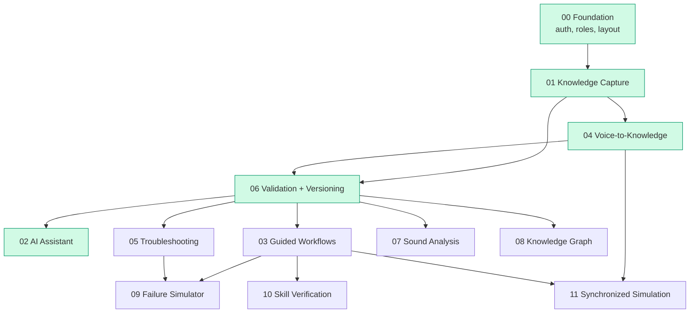

# Module Registry

**Status:** Active implementation registry

## 1. Full workflow diagram (module dependencies)

## 2. Required tech stack
See each module file. Shared stack: React/TS, FastAPI, PostgreSQL, SQLAlchemy/Alembic, Docker.

## 3. System architecture
Modular monolith. Each module owns routers, schemas, services, models and a frontend feature folder. Shared: auth, permissions, audit, storage, jobs, AI adapters.

## 4. Tech flow
Modules talk through services and database foreign keys, never by importing another module's repository.

## 5. Registry

| # | Module | Doc | Phase | Hackathon | Status |
|---|---|---|---|---|---|
| 00 | Foundation | modules/00-foundation.md | 1 | Build | Tested |
| 01 | Expert Knowledge Capture | modules/01-expert-knowledge-capture.md | 2 | Build | Planned |
| 06 | Knowledge Validation and Versioning | modules/06-knowledge-validation.md | 2 | Build | Planned |
| 04 | Voice-to-Knowledge | modules/04-voice-to-knowledge.md | 3 | Build ("wow") | Planned |
| 02 | AI Knowledge Assistant | modules/02-ai-assistant.md | 3 | Build + Chunk 10 handoffs | Tested |
| 03 | Guided Workflows | modules/03-guided-workflows.md | 3 | Chunk 5 implemented | Implemented |
| 05 | Troubleshooting | modules/05-troubleshooting.md | 4 | Chunk 6 implemented | Evidence-grounded sessions and safe escalation |
| 09 | Failure Simulator | modules/09-failure-simulator.md | 4 | Chunk 7 implemented | Deterministic, revision-pinned scenarios |
| 07 | Machine Sound Matching | modules/07-machine-sound-analysis.md | 5 | Chunk 8 implemented | WAV/FLAC feature matching against approved, version-linked references |
| 08 | Knowledge Graph | modules/08-manufacturing-knowledge-graph.md | 5 | Placeholder | Planned |
| 11 | Synchronized Simulation | modules/11-synchronized-training-simulation.md | 6 | Placeholder | Planned |
| 10 | Practical Skill Verification | modules/10-practical-skill-verification.md | 6 | Placeholder | Planned |

## 6. Other information
Update this table and `TASKS.md` after every completed task. A module is "Implemented" only when its real frontend-to-backend flow works, and "Tested" only when tests were actually run.
