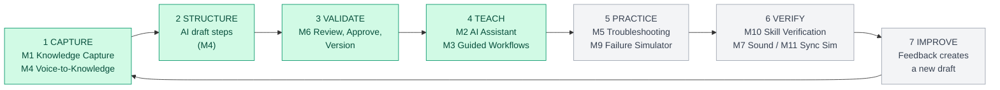
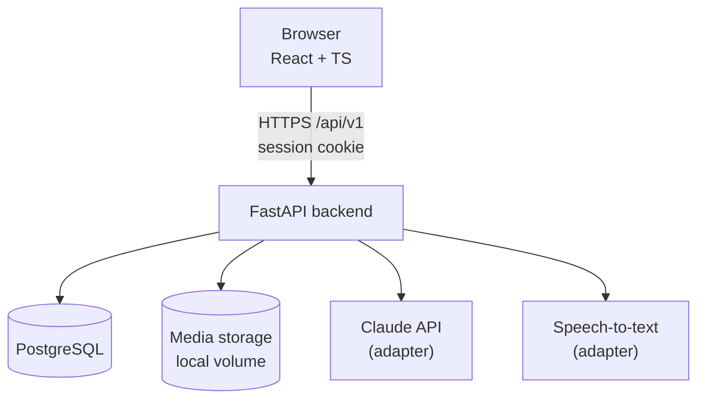
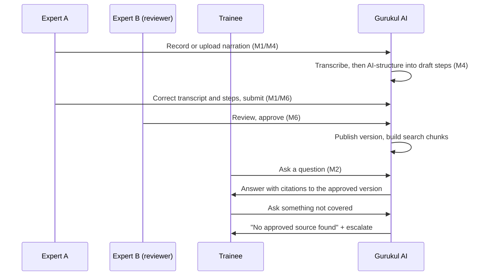

# Project Overview — Gurukul AI

**Status:** Planned (nothing implemented yet)

## 1. Full workflow diagram

Green = in hackathon scope (M1, M4, M6, M2). Grey = planned after the hackathon (shown as labelled placeholders).

## 2. Required tech stack and technologies (whole product)

| Layer | Technology | Hackathon? |
|---|---|---|
| Frontend | React, TypeScript, Vite, React Router, Tailwind CSS, TanStack Query | Yes |
| Backend | Python 3.12, FastAPI, Pydantic v2, SQLAlchemy 2, Alembic | Yes |
| Database | PostgreSQL 16 (full-text search) | Yes |
| Auth | Server-side sessions, HTTP-only cookie, Argon2id (argon2-cffi) | Yes |
| LLM | Claude API behind a provider adapter | Yes |
| Speech-to-text | Adapter: OpenAI Whisper API or local faster-whisper | Yes |
| Media | ffmpeg, browser MediaRecorder, local disk behind a storage interface | Yes |
| Containers | Docker + Docker Compose | Yes |
| Vector search (pgvector), Redis workers | — | Later |
| OpenCV, MediaPipe, librosa, NetworkX, React Flow, Cytoscape.js | — | Later (M5, M7–M11) |

## 3. System architecture (summary)

Details: `SYSTEM_ARCHITECTURE.md`.

## 4. Tech flow (hackathon demo story, end to end)

## 5. Steps
1. Build the foundation (auth, roles, layout).
2. Build M1 (capture) and M6 (review) as one connected flow.
3. Add M4 (voice) as the "wow" feature.
4. Add M2 (assistant) on top of published knowledge only.
5. Add labelled placeholders for the other modules.
6. Seed clearly labelled demo data, test, record, present.

## 6. Other information
- **Core rules:** AI creates drafts only. Only expert-approved, versioned content is shown as authoritative. Nothing can control a real machine.
- **Naming:** the product is **Gurukul AI**. Old documents say "SUJANA AI"; ignore that name.
- **Roles:** two roles, Expert and Trainee. "Reviewer" is a permission (`knowledge.approve`) given to selected Experts.
- **Limits:** see `HACKATHON_PLAN.md` for what is deliberately skipped.
