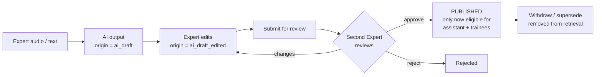
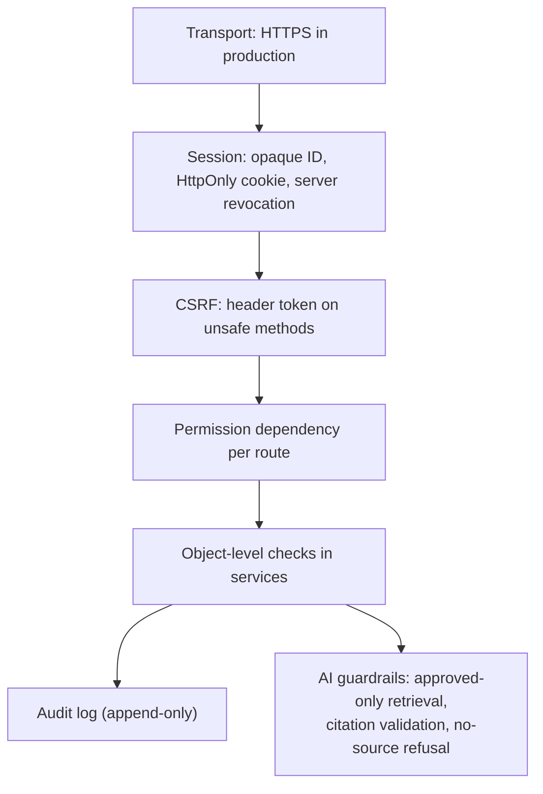
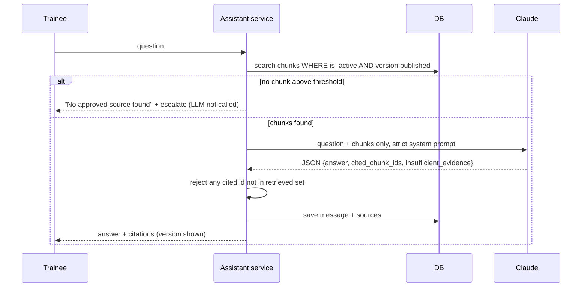

# Security and AI Governance

**Status:** Planned

## 1. Full workflow diagram (AI content to trusted content)

## 2. Required tech stack and technologies
Argon2id (argon2-cffi), server-side sessions in PostgreSQL, SameSite cookies, CSRF header check, Pydantic validation, structured logging with redaction, pytest security tests.

## 3. System architecture (security layers)

## 4. Tech flow (assistant guardrail path)

## 5. Steps (rules to implement)
**Security**
1. Passwords: Argon2id. Never log passwords, tokens or API keys.
2. Session: random 32-byte token in an HttpOnly, SameSite=Lax cookie; store only its hash; 30 min idle and 8 h absolute timeout (proposed defaults, not company policy); logout revokes server-side.
3. CSRF: double-submit token, header `X-CSRF-Token` required on POST/PATCH/PUT/DELETE.
4. Registration creates Trainee only. Experts come from the seed script.
5. Block self-approval in the service, not just the UI.
6. Uploads: allow-list of MIME types, magic-byte header verification, size limit layers, random storage keys, never trust filenames.
7. Media downloads go through an authorized endpoint with chunked streaming and HTTP Range support.
8. Keys only in environment variables. Nothing in localStorage.

### Media Security Controls (Module 01 - T2.2)

1. **Storage Path and Key Isolation**:
   - Storage keys are generated server-side using random UUIDs with two-level hex fan-out (`ab/cd/<uuid>.<ext>`). User-supplied filenames or extensions are NEVER used to construct filesystem paths.
   - All keys are validated against strict regex (`^[a-f0-9]{2}/[a-f0-9]{2}/[a-f0-9]{32}(?:\.[a-z0-9]+)?$`).
   - Paths are resolved and strictly validated to prevent directory traversal or symlink escapes.
   - Storage directories are created with restrictive permissions (`0o750`) and files are never marked executable (`0o640`).
   - Neither `storage_key` nor local filesystem paths are ever exposed in API responses or audit logs.

2. **MIME and Signature Verification**:
   - Strict allow-list: audio (`audio/webm`, `audio/mpeg`, `audio/wav`, `audio/mp4`, `audio/ogg`), video (`video/mp4`, `video/webm`), image (`image/png`, `image/jpeg`), and document (`application/pdf`).
   - SVG (`image/svg+xml`), HTML (`text/html`), and executable formats are explicitly rejected with `415 Unsupported Media Type`.
   - Magic bytes / file signatures are checked on the initial 512 bytes (EBML header for WebM, `ftyp` for MP4, `RIFF...WAVE` for WAV, `ID3`/frame sync for MP3, `OggS` for Ogg, PNG header, JPEG SOI, `%PDF-`). Mismatches return 415.
   - For container ambiguity (WebM and MP4), declared audio vs video is accepted if the signature matches the container.

3. **Multi-Layer Body-Size Enforcement**:
   - **Layer A (Early HTTP Header)**: Requests exceeding `MAX_UPLOAD_BYTES + 64KB` (multipart allowance) via `Content-Length` are rejected with `413 Payload Too Large` immediately before body spooling.
   - **Layer B (ASGI Streaming Receive Wrapper)**: Streamed chunks are byte-counted in an ASGI middleware wrapper; exceeding the limit raises 413 immediately during transfer.
   - **Layer C (Authoritative Storage Count)**: `LocalStorageService.save` monitors bytes written to disk; exceeding the limit unlinks the temporary `.part` file and raises 413.
   - **Reverse Proxy Recommendation**: In production environments, reverse proxies (e.g., Nginx) should also configure `client_max_body_size 100M;` to block oversized uploads at the perimeter.

4. **Authorization and 404/403 Policy**:
   - Unauthorized attempts by foreign experts or trainees to access someone else's draft or draft media return `404 Not Found` with the exact same response body as nonexistent objects, completely preventing draft existence enumeration.
   - Unauthenticated requests return `401 Unauthenticated`.
   - Trainees attempting write actions receive `403 Forbidden`.
   - Frozen versions reject modifications with `409 Conflict`.
   - Trainees can only view and stream media attached to the item's currently published version.

5. **Same-Origin Cookie Authentication Finding**:
   - Browser `<audio>`, `<video>`, ``, and `<iframe>` elements automatically send `HttpOnly` session cookies on same-origin requests (`SameSite=Lax`, `Secure=false` in local HTTP development, `Secure=true` in production HTTPS). No token-in-URL or signed URLs are required or permitted in this phase.

6. **Storage Reconciliation**:
   - `app/scripts/reconcile_media.py` detects storage/database drift by flagging orphaned files (unindexed files older than a safety threshold) and missing files (DB records whose files do not exist on disk). Dry-run mode by default; `--delete-orphans` removes aged disk orphans without modifying DB rows.

7. **Client-Side Checks as UX Convenience Only (T2.4)**:
   - Client-side MIME validation, size boundary checking, and asset count checks are provided solely for prompt user feedback and avoiding unnecessary network bandwidth. They are NEVER considered a security control. The backend remains the authoritative boundary.
   - User-supplied filenames and metadata are rendered strictly as text nodes in the DOM (no `dangerouslySetInnerHTML`), preventing XSS. External document links use `target="_blank"` with `rel="noopener noreferrer"`.

8. **Microphone Access & Permissions Policy (T2.4)**:
   - Microphone access is requested only upon explicit user gesture (clicking "Start Recording").
   - Browser capability checks enforce `window.isSecureContext` (recording blocked on insecure HTTP origins).
   - All tracks on the live `MediaStream` are explicitly stopped immediately when recording stops, is discarded, encounters an error, or the component unmounts. No active microphone handle remains open after recording.
   - Dev proxy and backend configurations verified: no restrictive `Permissions-Policy` header blocks microphone usage on the application origin.

**AI governance**
1. AI output is stored with `origin` and provider/model name.
2. AI cannot move content to published. Only the approval endpoint can.
3. Prompts forbid inventing values. Missing values must be flagged `needs_review`.
4. Retrieval uses only published, active, non-withdrawn chunks.
5. The server validates citations. The model cannot cite a source it was not given.
6. No machine control exists anywhere in the product.
7. Demo data is labelled "Demo data" in the UI.

## 6. Other information
Not covered in the hackathon: password reset, rate-limit persistence, upload malware scanning, retention policy, e-signatures or regulatory validation (these need the company's quality team). Do not claim compliance.
