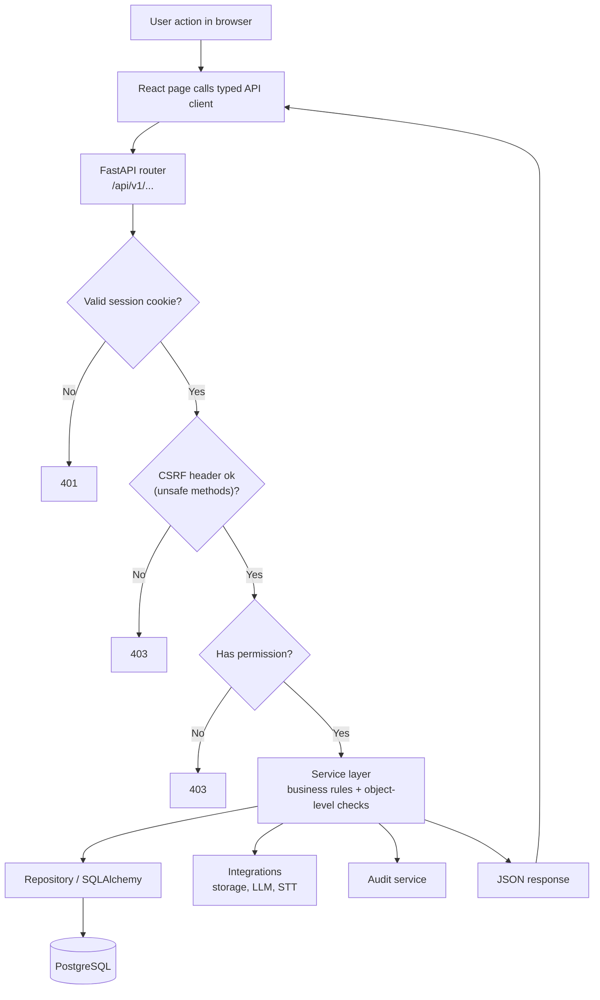
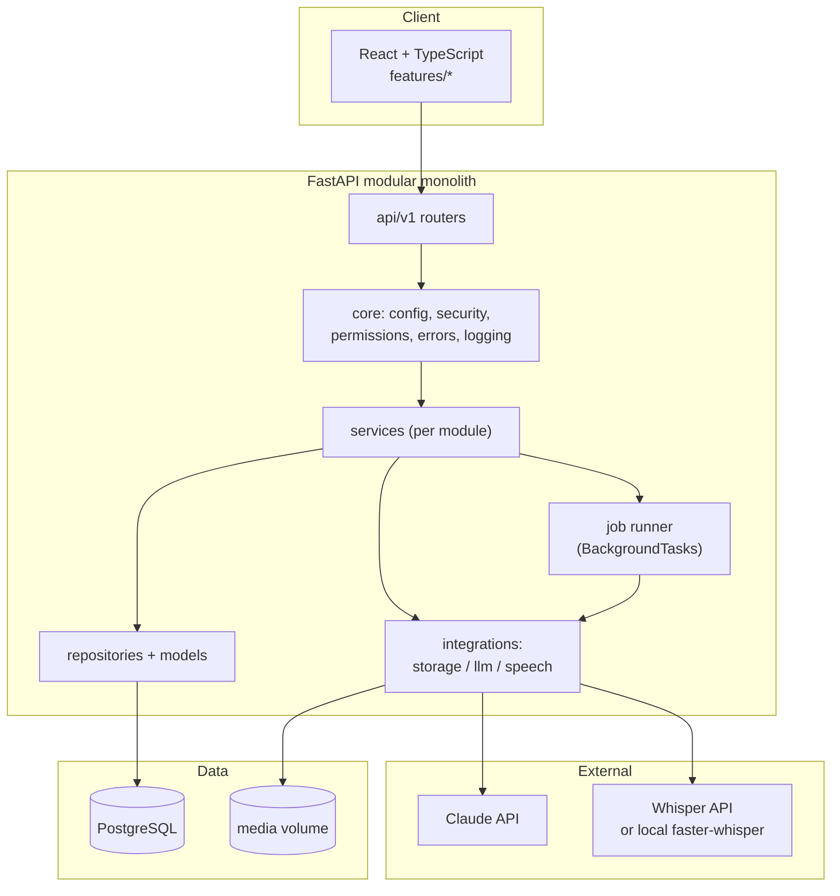
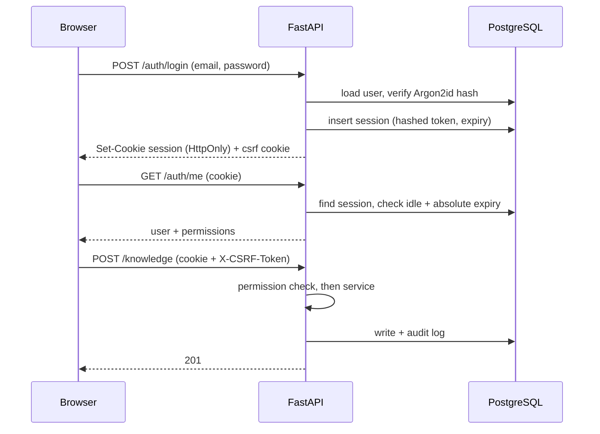

# System Architecture

**Status:** Planned

## 1. Full workflow diagram (a request through the system)

## 2. Required tech stack and technologies

| Concern | Choice |
|---|---|
| Container orchestration | Docker Compose: `db`, `backend`, `frontend` |
| Frontend dev server | Vite, with a proxy for `/api` to the backend (same origin, so cookies and CSRF stay simple) |
| Backend server | Uvicorn running FastAPI |
| Background work | FastAPI `BackgroundTasks` plus a `processing_jobs` table (**hackathon simplification**; Redis worker later) |
| Search | PostgreSQL `tsvector` full-text search (**pgvector later**) |
| Storage | `StorageService` interface with a local-disk implementation (S3-compatible later) |
| AI | `LLMProvider` and `SpeechProvider` interfaces with swappable implementations |

## 3. System architecture

Rules: routers stay thin; business logic lives in services; only repositories touch SQLAlchemy; modules share `core/`, `db/`, `integrations/` and never import each other's repositories.

## 4. Tech flow: login and protected call

## 5. Steps
1. Compose file with 3 services and a Postgres volume.
2. Backend skeleton and `/health` (checks DB).
3. Alembic baseline migration.
4. Session auth and permission dependency.
5. Frontend shell with proxy and API client.
6. Add modules one at a time using the shared services.

## 6. Other information
- **Environment:** `.env` holds `DATABASE_URL`, `SESSION_SECRET`, `ANTHROPIC_API_KEY`, `ANTHROPIC_MODEL`, `STT_PROVIDER`, `OPENAI_API_KEY` (optional), `MEDIA_DIR`, `MAX_UPLOAD_MB`.
- **Production later:** nginx in front, HTTPS, `Secure` cookies, Redis workers, S3 storage, pgvector.
