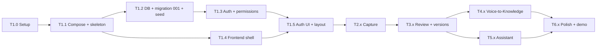

# Task List (hackathon)

**Status key:** Not started · In progress · Implemented · Tested · Blocked.
Owner A = backend + AI. Owner B = frontend + demo.

## 1. Full workflow diagram (task dependency)

## 2. Required tech stack
See `ANTIGRAVITY_IMPLEMENTATION_GUIDE.md`.

## 3. System architecture
Each task touches one layer of one module so it can be reviewed and tested alone.

## 4. Tech flow
Claude writes the task prompt, Antigravity implements, you run the tests, and results go back to Claude.

## 5. Task table

| ID | Day | Owner | Task | Status |
|---|---|---|---|---|
| T1.0 | 0 | both | Verify Docker/Git, get API keys, create repo layout | Tested |
| T1.1 | 1 | A | docker-compose, backend skeleton, `/health` with DB check | Tested |
| T1.2 | 1 | A | Alembic + migration 001 + seed (roles, permissions, 2 Experts, 1 Trainee) | Tested |
| T1.3 | 1 | A | Auth: register(Trainee), login, logout, me, sessions, CSRF, permission dependency, audit service | Tested |
| T1.4 | 1 | B | Frontend skeleton: Vite, TS, Tailwind, router, API client | Tested |
| T1.5 | 1 | B | Login/register UI, protected routes, layout, sidebar, 403/404, dashboards, placeholders for all modules | Tested |
| T1.6 | 1 | A | Auth + permission tests, run and record results | Tested |
| T2.1 | 2 | A | Migration 002, machines and knowledge item/version APIs | Tested |
| T2.2 | 2 | A | Media upload + storage service + validation | Tested |
| T2.3 | 2 | B | Knowledge library, create/edit form, step editor | Tested |
| T2.4 | 2 | B | Upload and browser audio recording component | Tested |
| T3.1 | 3 | A | Review state machine, approve/reject/changes, publish/supersede/withdraw, audit | Not started |
| T3.2 | 3 | A | M6 tests (self-approval block, concurrency, withdraw) | Not started |
| T3.3 | 3 | B | Review queue, review page, comments, version history, status badges | Not started |
| T4.1 | 4 | A | Migration 003, processing jobs, speech adapter, ffmpeg normalise | Not started |
| T4.2 | 4 | A | LLM adapter + structuring prompt + schema validation + flags | Not started |
| T4.3 | 4 | B | Voice capture page, job status, transcript editor, AI-draft review | Not started |
| T5.1 | 5 | A | Migration 004, chunking at publish, full-text search | Not started |
| T5.2 | 5 | A | Assistant endpoint, strict prompt, citation validation, no-source path | Not started |
| T5.3 | 5 | B | Chat UI, sources panel, "no source" state, feedback | Not started |
| T5.4 | 5 | both | Seed labelled demo data | Not started |
| T6.1 | 6 | both | Bug fixes, full test run, clean `docker compose up` rehearsal | Not started |
| T6.2 | 6 | B | Demo recording, slide deck, README | Not started |

## 6. Other information
First task prompts (T1.1 and T1.2) are written on request. Update the Status column after each task.

## 7. Post-hackathon AI Tutor integration

| ID | Task | Status | Verification |
|---|---|---|---|
| M02-AUDIT | Unify streamed Tutor generation through the orchestrator; preserve follow-up retrieval context; enforce current published revisions; suppress stale history; persist safe unmatched/ambiguous audio results; normalize retrieval failures; bound Gemini provider requests. | Tested | 606 backend tests and 86 frontend tests passed; production build/TypeScript, Python compile, fresh SQLite migration through 014, and `git diff --check` passed. Post-fix synthetic Gemini connectivity succeeded in 6.11 seconds; full live RAG/stream verification remains. |
| M02-HANDOFF | Add explicit user-initiated Tutor handoff into existing Guided Workflow or Troubleshooting sessions. | Tested | Deterministic suggestions from current cited evidence; click-time permission/publication/ownership revalidation; workflow and same-source/symptom troubleshooting session reuse; history restoration; no migration. Full regression: backend 609 passed (17 warnings), frontend 87 passed, build/typecheck, Python compile, and diff check passed. |
