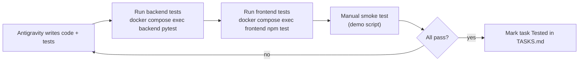
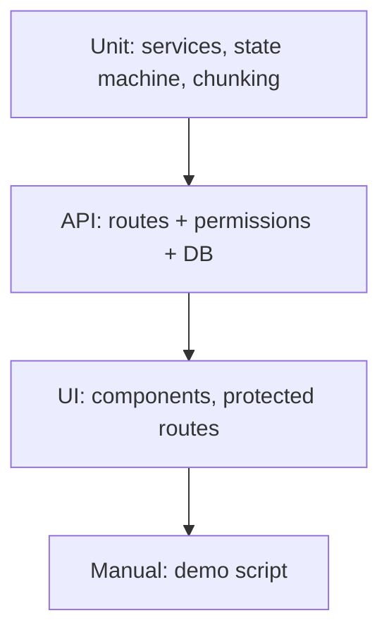

# Testing Strategy

**Status:** Planned (no tests have been run yet)

## 1. Full workflow diagram

## 2. Required tech stack and technologies
pytest, httpx `TestClient`, a separate test database, Vitest + React Testing Library (frontend), mocked LLM and STT providers **only in tests** (never in the running app).

## 3. System architecture of testing

## 4. Tech flow
Tests call the API through `TestClient` with a real test Postgres. AI providers are replaced by fakes via dependency override.

## 5. Steps and required tests

**Foundation:** valid login, invalid login (generic error), session restored, logout revokes, expired session rejected, two users independent, Trainee gets 403 on Expert API, deactivated user blocked, register cannot create Expert, CSRF missing gives 403, migrations apply from empty.

**M1:** create/edit own draft only, cannot edit another's draft, upload rejects bad type/size, trainee cannot see drafts.

**M6:** author cannot approve own version, trainee cannot approve, approve publishes and supersedes the previous version, reviewed content frozen, two concurrent approvals give one winner (409), withdraw removes from retrieval, audit rows written.

**M4:** failed STT leaves job `failed` and publishes nothing, structured output with a missing value is flagged, AI draft cannot be published without review, retry does not duplicate records.

**M2:** draft/withdrawn content never retrieved, no-source path does not call LLM, fabricated citation id is rejected, other user's conversation returns 404.

## 6. Other information
Definition of done per task: code, tests run with real output pasted, docs and `TASKS.md` updated, no unlabelled fake data. Say "not run" if a test was not run.
