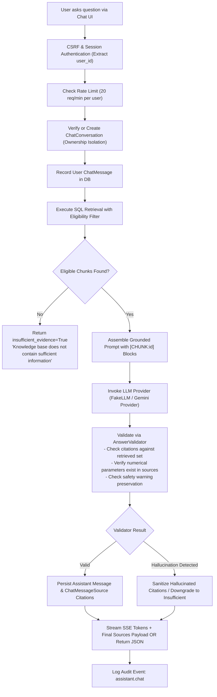

# Module 02 -- AI Knowledge Assistant (RAG System)

**Status:** IMPLEMENTED & TESTED | **Phase:** 3 | **Last Updated:** 2026-10-27 (TASK M02-D)

---

## 0. Overview

The AI Knowledge Assistant answers manufacturing questions using an industrial Retrieval-Augmented Generation (RAG) pipeline. Every answer is grounded exclusively in **approved, published, non-withdrawn** knowledge that the requesting user is permitted to see. No answer may contain invented machine settings, tolerances, corrective actions, or safety instructions.

The system features:
- Dual execution endpoints: Non-streaming JSON (`POST /chat`) and Server-Sent Events (`POST /chat/stream`).
- Complete conversational lifecycle management with strict user-level multi-tenant isolation.
- Answer grounding validation that blocks numerical and citation hallucinations.
- Feedback capture loop with categorized problem reports for continuous evaluation.
- Full two-column interactive frontend chat interface at `/app/assistant`.
- Trainee machine-audio upload in the chat composer, using Module 07's approved sound matching and then asking RAG to explain a matched published reference.

---

## 1. Module Dependencies

| Module | Role | Status |
|---|---|---|
| 00 Foundation | Auth, sessions, RBAC permissions, audit_logs, CSRF protection | Implemented & Tested |
| 01 Expert Knowledge Capture | knowledge_items, knowledge_versions, approval records | Implemented & Tested |
| 06 Validation and Versioning | publish/withdraw/supersede lifecycle enforcement | Implemented via `KnowledgeEligibilityPort` |
| 04 Voice-to-Knowledge | Transcripts & segments as indexable knowledge sources | Integrated via KnowledgeSource polymorphic model |
| 03 Guided Workflows | Workflow steps and execution guidelines as RAG context | Registered stub in KnowledgeSource model |
| 05 Troubleshooting | Fault trees and diagnostic nodes as retrieval context | Registered stub in KnowledgeSource model |
| 08 Knowledge Graph | Multi-hop contextual expansion | Deferred (Requires M08) |

---

## 2. RAG Architecture & Flow



---

## 3. Implemented API Endpoints

All endpoints are mounted under `/api/v1/assistant` and require active session authentication with permission `assistant.use`. Mutating endpoints require CSRF token validation via `X-CSRF-Token`.

| Method | Endpoint | Description | Auth / Permission | Request / Response |
|---|---|---|---|---|
| `POST` | `/api/v1/assistant/chat` | Submit question; returns grounded answer, citations, and conversation ID. | `assistant.use` + CSRF | Body: `ChatRequest`<br/>Resp: `ChatResponse` |
| `POST` | `/api/v1/assistant/chat/stream` | Server-Sent Events stream emitting `token` events, `sources` event, and `done`. | `assistant.use` + CSRF | Body: `ChatRequest`<br/>Resp: `text/event-stream` |
| `GET` | `/api/v1/assistant/conversations` | Lists current user's active conversations sorted by `updated_at DESC`. | `assistant.use` | Resp: `List[ConversationSummary]` |
| `GET` | `/api/v1/assistant/conversations/{id}` | Fetches full conversation history and source citations. Returns 404 for other users' chats. | `assistant.use` (Owner) | Resp: `ConversationDetail` |
| `DELETE` | `/api/v1/assistant/conversations/{id}` | Soft-deletes a conversation (`status='deleted'`). Returns 404 for non-owners. | `assistant.use` + CSRF (Owner) | Resp: `{"status": "deleted", "id": "..."}` |
| `POST` | `/api/v1/assistant/feedback` | Submits user feedback (rating 1-5, category enum, optional comment). | `assistant.use` + CSRF | Body: `FeedbackRequest`<br/>Resp: `FeedbackResponse` |
| `GET` | `/api/v1/assistant/sources/{id}` | Permission-checked inspection of published knowledge source and its active chunks. | `knowledge.view_published` | Resp: `SourceDetailResponse` |

### Request Parameters
- `message` (required, string, 1 to 1000 characters).
- `conversation_id` (optional, UUID): Continues an existing thread.
- `machine_id` (optional, string): Constrains retrieval ranking to a specific machine.
- `process_id` (optional, string): Constrains retrieval to a manufacturing process.
- `knowledge_item_id` (optional, UUID): Constrains retrieval to a specific SOP.

---

## 4. Database Schema & Tables

Migration `007_assistant_rag.py` defines the following tables:

### `chat_conversations`
- `id` (UUID, Primary Key)
- `user_id` (UUID, Foreign Key -> `users.id`, Indexed)
- `title` (String(255), Not Null)
- `machine_id` (String(64), Foreign Key -> `machines.id`, Nullable)
- `process_id` (String(64), Nullable)
- `status` (String(32), Default `'active'`, values: `active`, `archived`, `deleted`)
- `created_at` (DateTime, UTC, Default `now()`)
- `updated_at` (DateTime, UTC, Default `now()`, Indexed)

### `chat_messages`
- `id` (UUID, Primary Key)
- `conversation_id` (UUID, Foreign Key -> `chat_conversations.id`, OnDelete CASCADE, Indexed)
- `role` (String(16), Values: `'user'`, `'assistant'`)
- `content` (Text, Not Null)
- `is_ai_generated` (Boolean, Default `False`)
- `evidence_status` (String(32), Values: `sufficient`, `insufficient`, `clarification_needed`, `conflict`, `n_a`)
- `provider_name` (String(64), Nullable)
- `model_name` (String(64), Nullable)
- `prompt_version` (String(32), Nullable)
- `latency_ms` (Integer, Nullable)
- `request_id` (String(64), Nullable)
- `created_at` (DateTime, UTC, Default `now()`, Indexed)

### `knowledge_sources`
- `id` (UUID, Primary Key)
- `source_type` (String(64), Values: `knowledge_version`, `procedure_version`, `transcript`, etc.)
- `source_ref_id` (UUID, Indexed)
- `knowledge_version_id` (UUID, Foreign Key -> `knowledge_versions.id`, Nullable)
- `title` (String(255), Not Null)
- `machine_id` (String(64), Foreign Key -> `machines.id`, Nullable)
- `process_id` (String(64), Nullable)
- `product_family` (String(64), Nullable)
- `status` (String(32), Values: `'published'`, `'archived'`, `'withdrawn'`, `'draft'`)
- `access_policy_ref` (String(128), Nullable)
- `indexed_at` (DateTime, UTC, Default `now()`)
- `index_version` (Integer, Default 1)

### `knowledge_chunks`
- `id` (UUID, Primary Key)
- `source_id` (UUID, Foreign Key -> `knowledge_sources.id`, OnDelete CASCADE, Indexed)
- `chunk_index` (Integer, Not Null)
- `text` (Text, Not Null)
- `section_label` (String(128), Nullable)
- `timestamp_start` (Float, Nullable)
- `timestamp_end` (Float, Nullable)
- `token_count` (Integer, Not Null)
- `search_vector` (Text / TSVector, Indexed)
- `metadata_json` (JSON, Nullable)
- `is_active` (Boolean, Default `True`, Indexed)
- `created_at` (DateTime, UTC, Default `now()`)

### `chat_message_sources`
- `message_id` (UUID, Foreign Key -> `chat_messages.id`, Primary Key Component)
- `chunk_id` (UUID, Foreign Key -> `knowledge_chunks.id`, Primary Key Component)
- `source_id` (UUID, Foreign Key -> `knowledge_sources.id`)
- `rank` (Integer, Not Null)
- `score` (Float, Not Null)
- `cited` (Boolean, Default `False`)

### `assistant_feedback`
- `id` (UUID, Primary Key)
- `message_id` (UUID, Foreign Key -> `chat_messages.id`, Indexed)
- `user_id` (UUID, Foreign Key -> `users.id`, Indexed)
- `rating` (Integer, Nullable, 1-5)
- `category` (String(64), Enum: `incorrect`, `missing_source`, `outdated`, `irrelevant`, `conflicting`, `insufficient`, `helpful`)
- `comment` (Text, Nullable)
- `status` (String(32), Default `'new'`)
- `created_at` (DateTime, UTC, Default `now()`)

---

## 5. System Limits & Safeguards

1. **Rate Limiting:**
   - 20 requests per minute per authenticated user (`settings.CHAT_RATE_LIMIT_PER_MINUTE`).
   - Monitored per-user; returns HTTP 429 (`rate_limit_exceeded`) upon breach.
2. **Retrieval Thresholds:**
   - Top-K: Maximum 6 chunks retrieved (`settings.ASSISTANT_RETRIEVAL_TOP_K`).
   - Minimum Score: 0.05 keyword relevance cutoff (`settings.ASSISTANT_RETRIEVAL_MIN_SCORE`).
3. **Safety & Grounding Invariants:**
   - **Zero Knowledge Leakage:** Withdrawn, draft, or superseded versions return `insufficient_evidence=True` with 0 sources.
   - **Conversation Privacy:** Attempting to view or append to another user's conversation yields HTTP 404 (ID enumeration prevention).
   - **Hallucination Prevention:** Numerical parameters (PSI, RPM, mm, °C) are cross-checked against source chunk text. Mismatches degrade evidence status to `insufficient`.
   - **Direct Source Inspection:** `/sources/{id}` re-verifies that both the source and its underlying version are published.

---

## 6. Frontend Component Architecture

Located at `frontend/src/features/assistant/`:
- `AssistantPage.tsx`: Top-level two-column responsive layout.
- `ConversationList.tsx`: Sidebar listing user's chat history, New Chat trigger, and deletion confirm modal.
- `MessageList.tsx`: Thread rendering with auto-scroll and empty state fallback.
- `MessageBubble.tsx`: Individual user and assistant bubbles, pulsing streaming cursor, timestamp, and metadata tags.
- `SourceCitations.tsx`: Interactive source pills displaying title, section label, and relevance badge.
- `SourceDetailDrawer.tsx`: Slide-over drawer displaying verified source details and full chunk text.
- `MachineContextFilter.tsx`: Context selector populated from `/machines`.
- `SuggestedQuestions.tsx`: Generic starter questions on empty conversations.
- `InsufficientEvidenceNotice.tsx`: Warning banner when no verified SOP exists, with planned "Ask an Expert" link.
- `FeedbackButtons.tsx`: Helpful upvote and "Report Problem" modal with 6 issue categories.
- `SafeMarkdown.tsx`: Secure text and markdown formatter preventing raw HTML injection.
- `useAssistantChat.ts`: Custom streaming hook utilizing native `fetch` + `ReadableStream` with `AbortController` cancellation and fallback. State is maintained strictly in React memory (no `localStorage`).
- `TutorHandoffActions.tsx`: Shows only current, permission-eligible workflow/troubleshooting suggestions attached to a grounded answer. Starting a card is explicit; click-time checks happen on the backend.

## Tutor-to-module handoffs (Chunk 10)

- `/api/v1/assistant/chat` includes a `handoffs` array, and the SSE `sources` event carries the same field. Only cited source revisions are considered. Deterministic intent checks and source-to-target matching select at most one current target per module; the model does not select IDs or determine permissions.
- `GET /api/v1/assistant/conversations/{id}` reconstructs eligible actions from each prior user question and current citations. Stale or withdrawn evidence yields no action. Targets are returned only when the caller has the corresponding `procedure.execute` or `troubleshoot.use` permission.
- `POST /api/v1/assistant/handoffs/{workflow|troubleshooting}/{target_id}/start` accepts a conversation and assistant-message ID. The backend verifies ownership, assistant role, sufficient current citations, target association, publication, and permission again before using the existing session services.
- Workflow handoffs start or resume the operator's active run. Troubleshooting handoffs pin retrieval to the cited current knowledge item, store the originating conversation/message/source revision in the existing session `context` JSON, and resume only an active investigation for the same target and symptom.
- The frontend navigates to `/app/guided-workflows?run_id=...` or `/app/troubleshooting?session_id=...`. Opening or resuming does not record a completed workflow step or confirmed fault.
- No migration was necessary. `TroubleshootingSession.context` supports Tutor provenance. `ProcedureRun` has no suitable origin-reference field, so workflow runs retain their existing procedure/source revision provenance without a Tutor conversation/message link.
- Verification: `backend/app/tests/test_assistant_handoffs_chunk10.py` covers grounded suggestions, current history restoration, workflow/troubleshooting creation and resume, tampered IDs, cross-user access, permission revocation, streamed suggestions, and withdrawn-source handling. The focused frontend test covers user-initiated navigation. Full regression: backend 609 passed (17 warnings), frontend 87 passed, build/typecheck and Python compile passed.

---

## 7. Deferred Items

## 8. Gemini generation and knowledge-base folder ingestion (M02-E)

### Trainee machine-audio questions

The Tutor has separate controls for machine-sound matching and contextual media attachments. Sound matching accepts WAV, FLAC, MP3, M4A, AAC, AIFF/AIF, OGG/Opus, WebM, MP4, MOV, AVI, FLV, MPEG/MPG, WMV, and 3GP recordings (video must contain an audio track), up to the 100 MB audio upload limit. Compressed formats require FFmpeg in the backend runtime; the Docker image installs it and native installs fall back to the bundled `imageio-ffmpeg` binary. Matching compares the recording against current expert-approved references, shows the expert interpretation and linked knowledge titles on a reliable match, and does not claim a confirmed fault or safety determination. Query bytes are processed in memory and retained only if the operator separately submits the recording for expert review.

`POST /api/v1/assistant/chat/media` accepts one attachment up to 14 MiB: WAV, FLAC, MP3, M4A, AAC, AIFF/AIF, OGG/Opus, WEBA, WebM, MP4, MOV, AVI, FLV, MPEG/MPG, WMV, 3GP, BMP, PNG, JPEG, WebP, PDF, DOCX, PPTX, XLSX, CSV, TXT, or MD. The smaller inline limit leaves room for base64 and prompt overhead under Gemini's 20 MB total inline-audio request limit ([Gemini audio documentation](https://ai.google.dev/gemini-api/docs/audio)). Gemini supports the listed video containers and image types ([Gemini file input documentation](https://ai.google.dev/gemini-api/docs/file-input-methods)). The server extracts bounded text from supported documents and sends supported media parts to the configured Gemini provider. It uses attachment observations to find relevant approved RAG chunks; final manufacturing guidance remains citation-validated against published knowledge. User attachments are untrusted input and do not become approved knowledge. Scanned PDFs rely on Gemini's PDF understanding. Attachments are not stored as conversation media; only the attachment filename is recorded in chat history. Actual image/audio/video understanding requires a configured Gemini multimodal model and valid backend API credentials.

Matched audio follow-ups persist only the analysis-job ID on the assistant chat message (`014_chat_audio_analysis_link`). When history is opened, the result card is reconstructed for the conversation owner from the job and current approved reference. If audio permission is absent or the reference has been withdrawn or superseded, the old answer and citations are suppressed and a current-guidance notice is shown. Unmatched analysis cards remain in the current page state and are not saved as chat turns.

The runtime LLM provider is selected by `LLM_PROVIDER` (`gemini` for live generation; `mock` for deterministic test suites). Active models verified with the Gemini SDK:
- Generation Model: `gemini-3.5-flash` (or `gemini-3.8-flash` / `gemini-2.5-flash` where enabled)
- Embedding Model: `gemini-embedding-001` (3072 dimensions)

The API key is strictly backend-managed via `settings.GEMINI_API_KEY` and never exposed to clients or logged. `ASSISTANT_MAX_HISTORY_TURNS` bounds recent messages passed to generation. `.env` is ignored by Git.

### Knowledge Base Ingestion
Local technical reference documents are ingested with:
```bash
cd backend
python -m app.modules.assistant.ingest --path "../Knowledge Base"
```
Supported formats: PDF, DOCX, TXT, Markdown, and CSV. Files above `MAX_INGEST_FILE_BYTES` (50MB) are skipped. Ingestion is content-hash idempotent (SHA-256).

Currently indexed: **29 files, 377 total chunks** across the comprehensive engineering, surgical, and digital portfolios of:
- **Ethosh Digital**: 3D interactive learning, WebGL digital twins, AR/VR simulation, life sciences training compliance (GAMP 5, 21 CFR Part 11).
- **Biorad Medisys**: Complete clinical catalogs, surgical guides, implant kinetics, and ISO cleanroom SOPs across all three divisions:
  - **Orthovasive**: Genuin PS/CR, OURO TiNbN gold knee, Excel MPK medial pivot kinematics, Evocon revision, SIGNATURE NX 3D trabecular hip system (Ti6Al4V ELI, 60-70% porosity, 650 µm pore size), SIGNATURE Duo dual mobility, and BIOLOX delta ceramic heads.
  - **Indovasive**: Double 'J' stents (Standard, Bioflex mid-term, Pretoflex long-term up to 365 days, Pediatric, Endopyelotomy), PCNL Dilatron/Amplatz sets, Retrivo stone baskets, UroSheath access sheaths, Zebra guidewires, and GI endoscopy SEMS / Xpand balloon dilators.
  - **Neurovasive**: Olympia mechanical stroke aspiration system (-27.5 in/Hg vacuum, 0.071" large-bore catheter), intracranial flow diverters with checkerboard dual-wire braid, microcatheters, and 3D embolic coiling.
  - **Cleanrooms & Quality Systems**: ISO Class 7/5 cleanrooms, CNC Swiss 5-axis machining, ASTM A967 passivation, EtO (ISO 11135) and Gamma (ISO 11137) sterilization validation, and ISO 14243 knee wear simulation.

### Live Smoke Test & Automated Test Results
- **Automated Backend Tests:** 74/74 passed (`pytest app/modules/assistant/tests app/tests/test_assistant.py app/tests/test_assistant_e2e.py`).
- **Automated Frontend Tests:** 82/82 passed (`npm test -- --run`).
- **Frontend Production Build:** Passed cleanly (`npm run build`).
- **Live Smoke Test (Real Gemini API):**
  1. *Excel MPK Kinematics & Flexion:* Answered with 1,779 characters citing 3 ground-truth chunks; `insufficient_evidence=False`.
  2. *Pretoflex DJ Stent Duration & Material:* Answered with 1,654 characters citing 3 ground-truth chunks; `insufficient_evidence=False`.
  3. *Sourdough Bread Recipe (Out-of-domain):* Correctly rejected with `"The verified technical knowledge base does not contain sufficient information..."`; `insufficient_evidence=True`.

## 9. Deferred Items

1. **Dense Vector Embeddings & Reranking:**
   - Upgrading from SQL keyword search to hybrid dense vector retrieval with pgvector and ColBERT / Cross-Encoder reranking.
2. **Automated Conversation Retention Worker:**
   - Background retention policy worker to archive or permanently delete conversations older than `CHAT_RETENTION_DAYS`.
3. **Graph-Guided Retrieval (Module 08 Dependency):**
   - Traversing machine component ontologies and failure mode graphs for multi-hop diagnostic reasoning.
