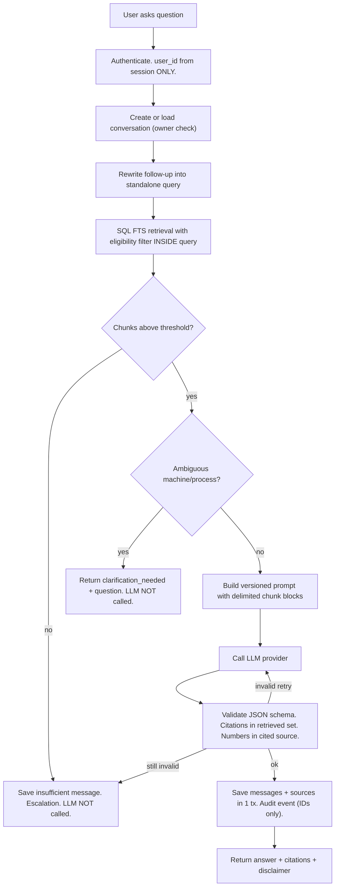

# Module 02 -- AI Knowledge Assistant (RAG Backend)

**Status:** PLANNED | **Phase:** 3 | **Last Updated:** Task C0 Inspection

---

## 0. Overview

The AI Knowledge Assistant answers manufacturing questions using a retrieval-augmented generation
(RAG) pipeline. Every answer is grounded exclusively in **approved, published, non-withdrawn**
knowledge that the requesting user is permitted to see. No answer may contain invented machine
settings, tolerances, corrective actions or safety instructions.

---

## 1. Module Dependencies

| Module | Role | Status |
|---|---|---|
| 00 Foundation | Auth, sessions, permissions, audit_logs, notifications | Tested |
| 01 Expert Knowledge Capture | knowledge_items, knowledge_versions, approval_records | Partially implemented |
| 06 Validation and Versioning | publish/withdraw/supersede lifecycle hooks | PLANNED -- KnowledgeEligibilityPort used as fallback |
| 04 Voice-to-Knowledge | transcripts, transcript_segments as indexable sources | PLANNED hook |
| 03, 05 | Workflow steps, troubleshooting nodes as future sources | PLANNED stubs |
| 07, 08 | Sound reports as context; graph expansion of candidates | PLANNED stubs |

Module 06 is not yet implemented as a separate service.
Task C3 introduces KnowledgeEligibilityPort -- a single-function interface implemented against the
status columns on knowledge_versions. It is swappable when Module 06 exposes events.

---

## 2. Workflow (Mermaid)



---

## 3. Target File Structure

```
backend/app/modules/assistant/
  __init__.py
  models.py
  api/
    __init__.py
    router.py
    schemas.py
    dependencies.py
  services/
    __init__.py
    chat_service.py
    retrieval_service.py
    indexing_service.py
    conversation_service.py
    feedback_service.py
    prompt_builder.py
    answer_validator.py
    eligibility.py
  providers/
    __init__.py
    llm_base.py
    llm_fake.py
    embedding_base.py
    embedding_fake.py
  chunking/
    __init__.py
    chunker.py
  tests/
    __init__.py
    test_c1_models_migration.py
    test_c2_providers.py
    test_c3_eligibility.py
    test_c4_chunking_indexing.py
    test_c5_retrieval.py
    test_c6_prompt_validator.py
    test_c7_chat_endpoint.py
    test_c8_source_open.py
    test_c9_feedback.py

backend/evals/assistant/
  illustrative_eval_set.jsonl    (ILLUSTRATIVE -- NOT A REAL PROCEDURE)
  run_eval.py
```

---

## 4. Data Model (Migration 007_assistant_rag)

### chat_conversations
id PK, user_id FK users, title, machine_id FK nullable, process_id FK nullable,
status (active/archived/deleted), created_at, updated_at

### chat_messages
id PK, conversation_id FK, role (user/assistant), content, is_ai_generated bool,
evidence_status (sufficient/insufficient/clarification_needed/conflict/n_a),
provider_name, model_name, prompt_version, latency_ms, request_id, created_at

### knowledge_sources
id PK, source_type (knowledge_version/procedure_version/transcript/workflow_version/
troubleshooting_version), source_ref_id, knowledge_version_id FK nullable,
title, machine_id FK nullable, process_id FK nullable, product_family,
status, access_policy_ref, indexed_at, index_version

### knowledge_chunks
id PK, source_id FK knowledge_sources, chunk_index int, text, section_label nullable,
timestamp_start float nullable (transcripts), timestamp_end float nullable,
token_count int, search_vector (TSVector on PostgreSQL / Text on SQLite -- GIN indexed on PG),
metadata_json, is_active bool default True, created_at

### chat_message_sources
message_id FK PK, chunk_id FK knowledge_chunks PK, source_id FK,
rank int, score float, cited bool

### assistant_feedback
id PK, message_id FK, user_id FK, rating int nullable (1-5),
category (incorrect/missing_source/outdated/irrelevant/conflicting/insufficient/helpful),
comment, status (new/triaged/closed), created_at

knowledge_embeddings: C10 only, behind RETRIEVAL_MODE=hybrid flag.

---

## 5. Permissions

| Permission | EXPERT | TRAINEE | OPERATOR | How Granted |
|---|---|---|---|---|
| assistant.use | role | role | role | Role-level (already seeded) |
| assistant.index | user grant only | no | no | Per-user via user_permissions |
| assistant.review_feedback | user grant only | no | no | Per-user via user_permissions |

assistant.use (PERM_ASSISTANT_USE) already exists and is seeded.
assistant.index and assistant.review_feedback are new -- added to permissions table in C1.

---

## 6. API Endpoints (all /api/v1, all authenticated)

| Method | Path | Purpose | Permission |
|---|---|---|---|
| POST | /assistant/chat | Ask question; answer + citations | assistant.use |
| GET | /assistant/conversations | List MY conversations (paginated) | assistant.use |
| GET | /assistant/conversations/{id} | Get MY conversation | assistant.use + owner |
| DELETE | /assistant/conversations/{id} | Archive/delete | owner only |
| POST | /assistant/feedback | Submit feedback on a message | assistant.use |
| GET | /assistant/sources/{id} | Open source/chunk (eligibility re-checked) | assistant.use + source access |
| POST | /knowledge/index | Start reindexing a version | assistant.index |
| GET | /assistant/index/status/{job_id} | Job status | assistant.index |
| GET | /assistant/feedback | Review queue | assistant.review_feedback |

Chat request fields: conversation_id (optional), question (max 1000 chars),
machine_id (optional), process_id (optional), knowledge_item_id (optional).
user_id is NEVER accepted in the request body.

---

## 7. Safety Rules Implementation Map

| Rule | Location | Status |
|---|---|---|
| Only published, not withdrawn/superseded | eligibility.py -- SQL fragment, single source | PLANNED C3 |
| Filter inside SQL before ranking and LLM | retrieval_service.py WHERE clause | PLANNED C5 |
| user_id from session only | api/dependencies.py + chat endpoint | PLANNED C7 |
| Retrieved text wrapped in delimiters | prompt_builder.py [CHUNK:id]...[/CHUNK] | PLANNED C6 |
| No invented numbers/settings | answer_validator.py number-in-source check | PLANNED C6 |
| No LLM if no evidence | chat_service.py threshold check | PLANNED C7 |
| Citations validated against retrieved set | answer_validator.py | PLANNED C6 |
| AI answers stored separately | chat_messages.is_ai_generated=True | PLANNED C1 |
| No credentials in logs | providers/ server-side only, redacted in audit | PLANNED C2 |
| No full text logged at INFO | Log IDs, counts, latency only | PLANNED C7 |
| LLM writes text only, no data mutations | Architecture: result through validator only | Design |

---

## 8. Configuration Flags (New Settings)

```
ASSISTANT_LLM_PROVIDER=fake
ALLOW_EXTERNAL_LLM=false
ASSISTANT_LLM_MODEL=claude-3-5-sonnet-20241022
ASSISTANT_LLM_TIMEOUT_S=30
ASSISTANT_LLM_MAX_RETRIES=2
ASSISTANT_RETRIEVAL_TOP_K=6
ASSISTANT_RETRIEVAL_MIN_SCORE=0.05
ASSISTANT_QUESTION_MAX_CHARS=1000
ASSISTANT_PROMPT_VERSION=v1
RETRIEVAL_MODE=keyword
CHAT_RETENTION_DAYS=365
CHAT_RATE_LIMIT_PER_MINUTE=20
```

---

## 9. Integration Hooks

| Target | Hook | Status |
|---|---|---|
| 01/06 | on_publish(version_id) triggers indexing job | PLANNED stub |
| 01/06 | on_withdraw/on_supersede deactivates chunks | PLANNED stub |
| 04 | Index approved transcripts with timestamps | PLANNED stub |
| 03 | Workflow step source_type registered | PLANNED stub |
| 05 | Troubleshooting node explain calls retrieval | PLANNED stub |
| 07 | Sound report as context (not confirmed fault) | PLANNED stub |
| 08 | Graph traversal expands candidates; eligibility still applied | PLANNED stub |

---

## 10. Task Build Order

| Task | Description | Status |
|---|---|---|
| C0 | Inspect repo, write this doc, no code changes | COMPLETE |
| C1 | Models, migration 007, permissions | PLANNED |
| C2 | Provider interfaces + fakes | PLANNED |
| C3 | Eligibility and access filter | PLANNED |
| C4 | Chunking and indexing service | PLANNED |
| C5 | Retrieval (keyword FTS) | PLANNED |
| C6 | Prompt builder and answer validator | PLANNED |
| C7 | Chat service and endpoint | PLANNED |
| C8 | Source open and history re-check | PLANNED |
| C9 | Feedback and review queue | PLANNED |
| C10 | Hybrid retrieval with embeddings (pgvector, requires approval) | PLANNED |
| C11 | Evaluation harness and quality gates | PLANNED |
| C12 | Hardening, security review, final docs | PLANNED |

---

## 11. Known Limitations (at C0)

- SQLite today. TSVector/GIN is PostgreSQL-only; SQLite tests use LIKE fallback.
- No streaming responses (not in scope).
- English only.
- Keyword retrieval only (C1-C9). Hybrid (C10) requires pgvector approval.
- processing_jobs.media_id is currently NOT NULL -- must be relaxed in migration 007 for indexing jobs.
- Notification model exists; no service wrapper yet. C9 uses model directly.
- Rate limiting is in-memory (consistent with Module 00).

---

## 12. Source Priority Rule

No project-wide rule exists in the codebase.
Decision: none -- report conflict.
When two eligible sources disagree, set evidence_status=conflict, list both, point to owner.

---

## 13. Decisions Needed Before C1

1. processing_jobs.media_id nullable: Yes -- relax in migration 007. Confirm?
2. Source priority rule: confirmed as none/conflict unless overridden.
3. LLM provider: fake for all tests. Real provider only when ALLOW_EXTERNAL_LLM=true is confirmed and data-privacy terms approved.
