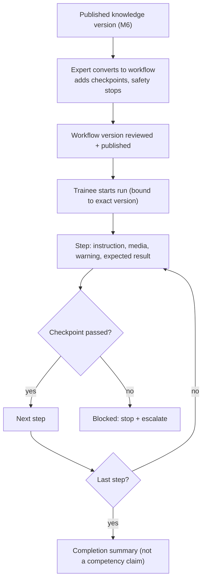
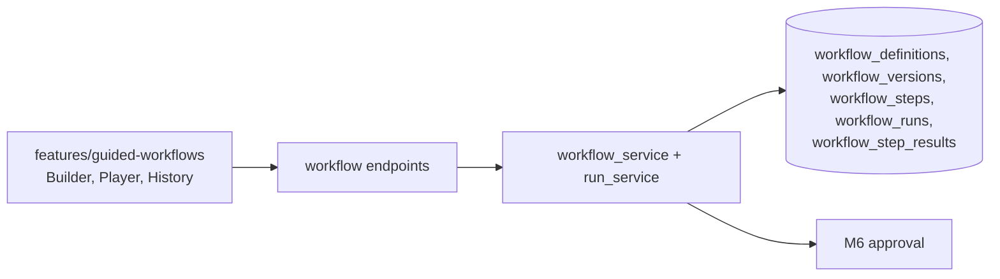
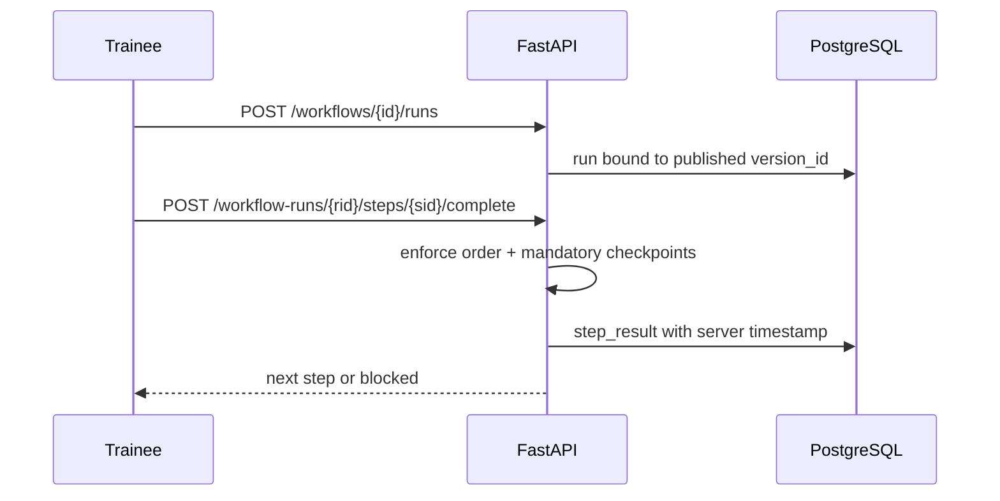

# Module 03 — Step-by-Step Guided Workflows

**Status:** Planned (placeholder page only in hackathon) · **Phase:** 3

## 1. Full workflow diagram

## 2. Required tech stack and technologies
React + TypeScript (stepper UI), FastAPI, PostgreSQL, SQLAlchemy/Alembic, server-side timestamps. Reuses M6 versioning.
## 3. System architecture of this feature

## 4. Tech flow

## 5. Steps
1. Tables and migration. 2. Builder from a published knowledge version. 3. Review via M6. 4. Player with progress. 5. Run history and expert view.
## 6. Other information
Backend enforces order and mandatory checkpoints. A step click is not proof of competency. Runs keep their original version when a new one is published. **Dependencies:** 00, 01, 06. **Hackathon:** labelled placeholder page.
