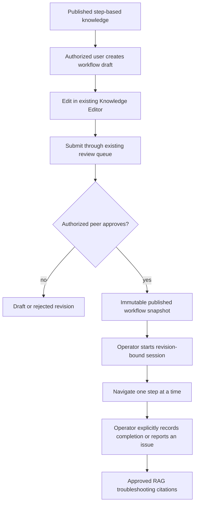

# Module 03 — Guided Workflows

**Status:** Chunk 5 implemented · **Phase:** 3

## Scope

Guided workflows turn approved, step-based knowledge into operator sessions while retaining the existing knowledge authoring, peer review, RAG, authentication, and media systems.

## Lifecycle

## API

- `GET /api/v1/procedures/sources?q=...` — authorized source search for published knowledge with ordered steps.
- `POST /api/v1/procedures/drafts/from-knowledge/{source_version_id}` — create a workflow knowledge draft from an approved source.
- `GET /api/v1/procedures?q=...` — find currently published workflows.
- Existing knowledge update, submit, review, and approval endpoints edit and publish workflow revisions.
- Existing `POST /api/v1/procedures/{id}/start` starts a run tied to its immutable procedure snapshot.
- `PATCH /api/v1/procedures/runs/{id}/current-step` changes navigation without recording physical completion.
- `POST /api/v1/procedures/runs/{id}/step/{step_id}` records operator-reported completion.
- `POST /api/v1/procedures/runs/{id}/issues` records an issue and searches the published RAG index for citations.
- Existing `GET /api/v1/procedures/runs/{id}` and `/runs/my/all` expose session status and revision-bound workflow details.
- Tutor action cards call `POST /api/v1/assistant/handoffs/workflow/{procedure_id}/start`; this reuses the same current-publication validation and active-run service as the normal start path, then opens the existing run page with `run_id`.

## Safety and revision behavior

- New workflow snapshots are generated only after an approved knowledge revision is published and contain explicit source and media references.
- Draft and in-review workflow knowledge never appears in the runnable workflow list.
- A workflow cannot be submitted if its upstream source is no longer published; snapshots with unavailable cited revisions are hidden from discovery and cannot be started.
- Newer approved revisions archive the earlier workflow snapshot. Existing runs continue to reference their original revision.
- RAG issue guidance is sourced through the shared retrieval service; when there are no matches, the response says no approved guidance was found.
- Moving between steps does not mark a step complete. Completion is only recorded by the operator action.
- Starting from Tutor reuses the operator's active run for the same procedure; otherwise it creates a run with all completion flags unset. A run stores no Tutor conversation/message origin because `ProcedureRun` has no suitable provenance field; its approved procedure revision and sources remain traceable.
- Existing legacy approved procedures remain discoverable for compatibility; they do not gain linked knowledge revision metadata retroactively.

## Storage and verification

Migration `008_guided_workflow_publication` adds knowledge source references, links procedure snapshots to knowledge revisions, retains per-step details, and stores current step plus reported session issues.

Automated tests cover draft creation, submission, approval and publication, source citations, revision archiving, run snapshots, navigation versus completion, issue retrieval, and role permissions.
