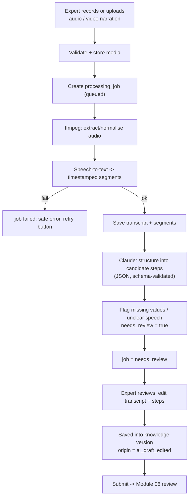
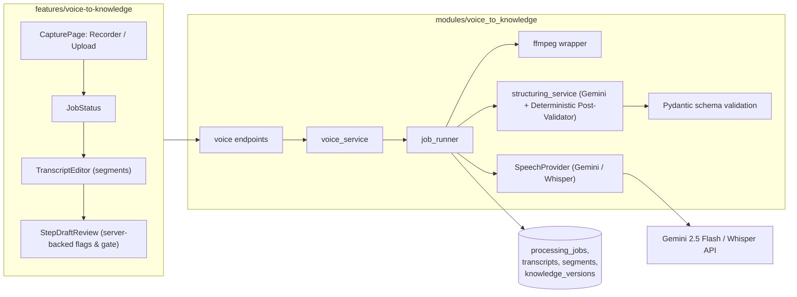

# Module 04 — Voice-to-Knowledge Conversion

**Status:** Planned · **Phase:** 3 · **Hackathon:** Build (Day 4, the "wow" feature)

## 1. Full workflow diagram



## 2. Required tech stack and technologies
- Browser `MediaRecorder` (webm/opus) for recording.
- ffmpeg inside the backend container.
- `SpeechProvider` interface with implementations:
  - **Google Gemini Multimodal STT** (`gemini-2.5-flash` via `GEMINI_API_KEY`, default in production).
  - **OpenAI Whisper API** (`whisper-1` via `OPENAI_API_KEY`).
  - **Quarantined Mock Provider** (strictly gated behind `DEMO_MODE=true` or unit tests; all synthetic outputs are marked `[ILLUSTRATIVE — NOT A REAL PROCEDURE]`).
- `LLMProvider` interface with Gemini and Claude implementations for schema-validated procedural step structuring.
- Pydantic models to validate the structured LLM output and deterministic post-validation flags for tolerances/parameters.
- FastAPI `BackgroundTasks` + `processing_jobs` table; React polling every 2 seconds for status.

## 3. System architecture of this feature



## 4. Tech flow

```mermaid
sequenceDiagram
  participant UI as React
  participant API as FastAPI
  participant JR as job_runner (background)
  participant STT as GeminiSpeechProvider
  participant LLM as GeminiStructuring
  participant DB as SQLite / PostgreSQL
  UI->>API: POST /api/v1/voice/upload (audio file)
  API->>DB: media_asset (stored on disk ./data/media) + job(queued)
  API-->>UI: 200 {media, job}
  JR->>DB: job processing
  JR->>JR: ffmpeg -> 16kHz mono wav
  JR->>STT: transcribe(wav)
  STT-->>JR: segments [{idx, start_s, end_s, text}]
  JR->>DB: transcript + segments (flagged via deterministic validator)
  JR->>LLM: segments + strict extraction prompt
  LLM-->>JR: JSON steps
  JR->>JR: validate schema, flag numbers/units/safety/negations with needs_review
  JR->>DB: steps into draft version (origin ai_draft); job needs_review
  UI->>API: GET /processing-jobs/{id} (polling)
  API-->>UI: status needs_review
  UI->>API: PATCH /voice/assets/{id}/steps/{idx}/verify (expert verification)
  API-->>DB: update step needs_review=false, note="Verified by Expert Author", origin=ai_draft_edited, audit_log
  UI->>API: POST /knowledge/{id}/submit (submission gate checks all flags cleared)
  API-->>DB: status in_review -> Module 06 review
```

## 5. Steps
1. Migration 003: processing_jobs, transcripts, transcript_segments (T4.1).
2. ffmpeg in backend; Gemini Multimodal STT provider + OpenAI Whisper + quarantined demo mock (T4.1).
3. Job runner with idempotency key and retry limit of 2 (T4.1).
4. Structuring prompt + Pydantic schema + deterministic gap/number flagging (T4.2).
5. Capture page, job status, transcript editor, step draft review with server-backed submission gate (T4.3).

## 6. Other information

**Structuring prompt rules (must be in the system prompt):**
- Use only what is in the transcript. Quote the segment IDs each step comes from.
- Never invent settings, values, tolerances, tools or warnings.
- If a value is referred to but not stated, output the step with `needs_review: true` and a `missing: "value not stated"` note.
- Keep warnings. Do not drop repeated ones.
- Output JSON only, matching the schema.

**Output schema:** `{ summary, keywords[], steps[{title, instruction, tools[], safety_warning, expected_result, stop_condition, source_segment_ids[], needs_review, note}], unclear_segments[] }`.

**Status & Submission Gate rules:**
- Job lifecycle: `queued → processing → needs_review → completed`, or `failed`.
- AI steps start with `origin = "ai_draft"`.
- Server-side submission gate: `POST /api/v1/knowledge/{id}/submit` verifies that `KnowledgeVersion.steps` contains zero steps with `needs_review == true`. If unverified flags remain, returns HTTP 422 (`unverified_parameters_remain`).
- Step parameter verification: `PATCH /api/v1/voice/assets/{media_id}/steps/{step_idx}/verify` updates `needs_review = false`, sets `origin = "ai_draft_edited"`, updates `note = "Verified by Expert Author"`, and writes an immutable audit log entry.
- Offline Demo Mode: when `DEMO_MODE=true` is set or when running in test mode without cloud credentials, synthetic segments are prefixed with `[ILLUSTRATIVE — NOT A REAL PROCEDURE]` and the UI renders a prominent warning banner.

**Permissions & IDOR Protection:**
- `knowledge.create` (Expert / Admin only). Trainees are strictly blocked (HTTP 403 `trainee_draft_forbidden`).
- IDOR checks enforce that only the author who uploaded the audio narration (or admin) can view or modify the draft before publication.

**Media Storage:**
- Audio recordings are saved to secure filesystem storage (`./data/media/{storage_key}`), referenced by `media_assets.storage_key` and streamable via `GET /api/v1/voice/stream/{media_id}`. Audio is not stored as an in-database BLOB.

**Acceptance:**
- A real audio narration becomes a dynamic transcript and flagged draft steps.
- Canary Test: Distinct audio files (Audio A vs Audio B) yield distinct, dynamic transcripts matching the spoken words.
- Expert verifies parameters and submits; nothing publishes without Module 06 approval.
