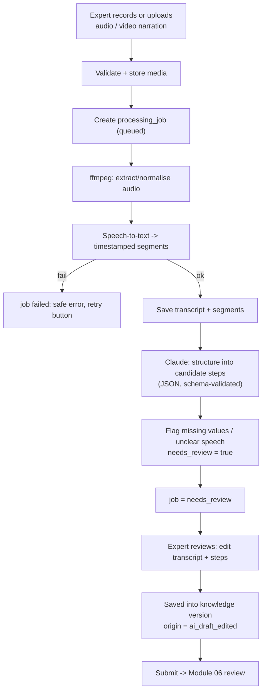
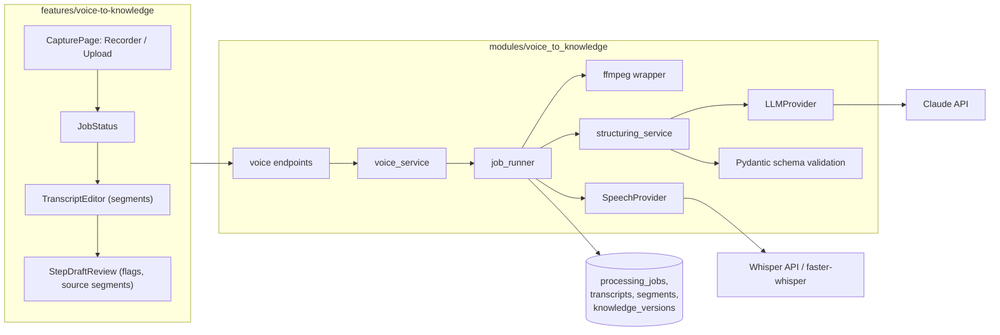

# Module 04 — Voice-to-Knowledge Conversion

**Status:** Planned · **Phase:** 3 · **Hackathon:** Build (Day 4, the "wow" feature)

## 1. Full workflow diagram



## 2. Required tech stack and technologies
- Browser `MediaRecorder` (webm/opus) for recording.
- ffmpeg inside the backend container.
- `SpeechProvider` interface with two implementations: **OpenAI Whisper API** (needs `OPENAI_API_KEY`) or **local faster-whisper** (CPU, model downloaded on first use). Chosen by `STT_PROVIDER`.
- `LLMProvider` interface with a Claude implementation (`ANTHROPIC_API_KEY`, `ANTHROPIC_MODEL`).
- Pydantic models to validate the structured LLM output.
- FastAPI `BackgroundTasks` + `processing_jobs` table; React polling every 2 seconds for status.

## 3. System architecture of this feature



## 4. Tech flow

```mermaid
sequenceDiagram
  participant UI as React
  participant API as FastAPI
  participant JR as job_runner (background)
  participant STT as SpeechProvider
  participant LLM as Claude
  participant DB as PostgreSQL
  UI->>API: POST /voice-captures/{id}/upload (file)
  API->>DB: media_asset + job(queued)
  API-->>UI: 202 {job_id}
  JR->>DB: job processing
  JR->>JR: ffmpeg -> 16kHz mono wav
  JR->>STT: transcribe(wav)
  STT-->>JR: segments [{start,end,text}]
  JR->>DB: transcript + segments
  JR->>LLM: segments + strict extraction prompt
  LLM-->>JR: JSON steps
  JR->>JR: validate schema, mark gaps needs_review
  JR->>DB: steps into draft version (origin ai_draft); job needs_review
  UI->>API: GET /processing-jobs/{id} (polling)
  API-->>UI: status needs_review
  UI->>API: PATCH segments / steps (expert edits)
```

## 5. Steps
1. Migration 003: processing_jobs, transcripts, transcript_segments (T4.1).
2. ffmpeg in Dockerfile; speech adapter with both providers (T4.1).
3. Job runner with idempotency key and retry limit of 2 (T4.1).
4. Structuring prompt + Pydantic schema + gap flagging (T4.2).
5. Capture page, job status, transcript editor, step draft review (T4.3).

## 6. Other information

**Structuring prompt rules (must be in the system prompt):**
- Use only what is in the transcript. Quote the segment IDs each step comes from.
- Never invent settings, values, tolerances, tools or warnings.
- If a value is referred to but not stated, output the step with `needs_review: true` and a `missing: "value not stated"` note.
- Keep warnings. Do not drop repeated ones.
- Output JSON only, matching the schema.

**Output schema:** `{ summary, keywords[], steps[{title, instruction, tools[], safety_warning, expected_result, stop_condition, source_segment_ids[], needs_review, note}], unclear_segments[] }`.

**Status rules:** job lifecycle `queued → processing → needs_review → completed`, or `failed`. A failed transcript can never be submitted. AI steps start as `ai_generated: true`; an Expert edit keeps the flag but changes `origin` to `ai_draft_edited`. Submission is blocked while any step has `needs_review: true`.

**Edge cases:** silent or empty audio gives a clear error; unsupported language gives a message; very long files rejected by duration limit (hackathon: 5 minutes); duplicate click reuses the same job via idempotency key; refresh does not restart processing.

**Permissions:** `knowledge.create`. Transcript and media visible only to the author and reviewers until published.

**Acceptance:** a 1 to 2 minute demo narration becomes a transcript and flagged draft steps; Expert edits and submits; nothing publishes without Module 06 approval.
**Dependencies:** 00, 01, 06. **Feeds:** 02, 03, 11. **Limitations:** English only, no live streaming, no speaker separation, accuracy depends on audio quality. Numbers and units must be checked by the Expert.
