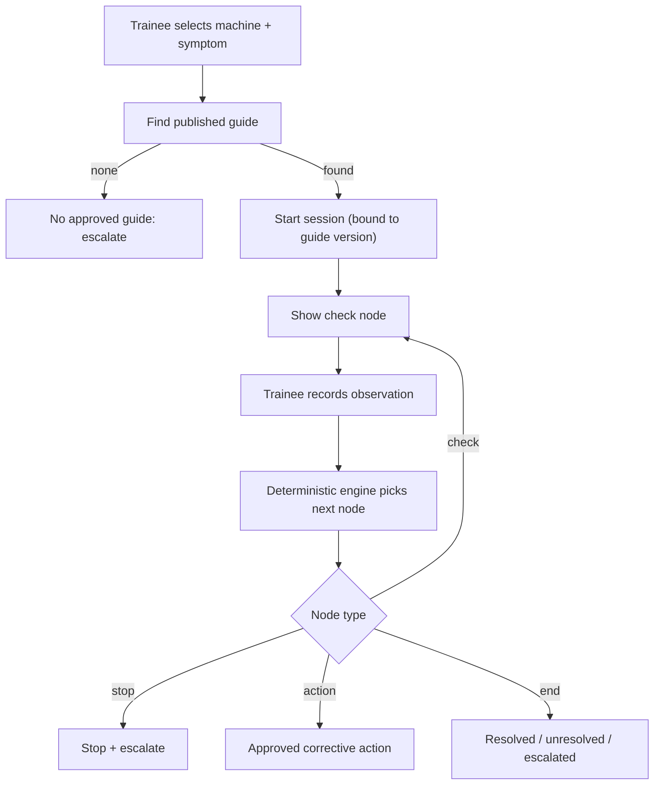
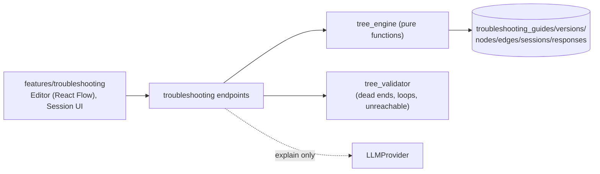
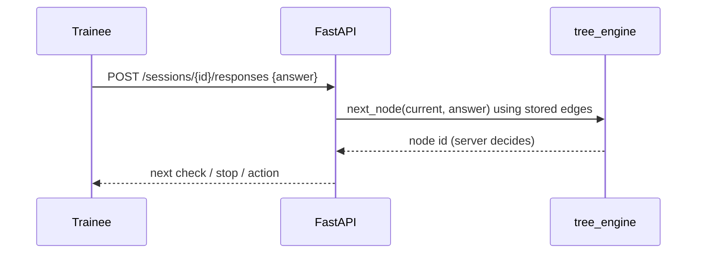

# Module 05 — Troubleshooting and Decision Trees

**Status:** In Progress (Task A1 Placeholder + Task B1 Models + Task B2 Engine/Validator Implemented & Tested) · **Phase:** 4 · **Implementation:** B2 COMPLETED

## 1. Full workflow diagram

## 2. Required tech stack and technologies
FastAPI deterministic rule engine (no LLM in branching), PostgreSQL (nodes, edges), React Flow for the expert tree editor, React stepper for trainees. LLM (optional) only explains the current approved node.
## 3. System architecture of this feature

## 4. Tech flow

## 5. Steps
1. Models + validator. 2. Engine with unit tests. 3. Expert editor. 4. Trainee session UI. 5. Escalation records. 6. Optional explanation via M2 sources.
## 6. Other information
The server rejects any attempt to jump to an arbitrary node. Suspected causes are never shown as confirmed. **Dependencies:** 00, 01, 06 (03 optional). **Hackathon:** labelled placeholder.
