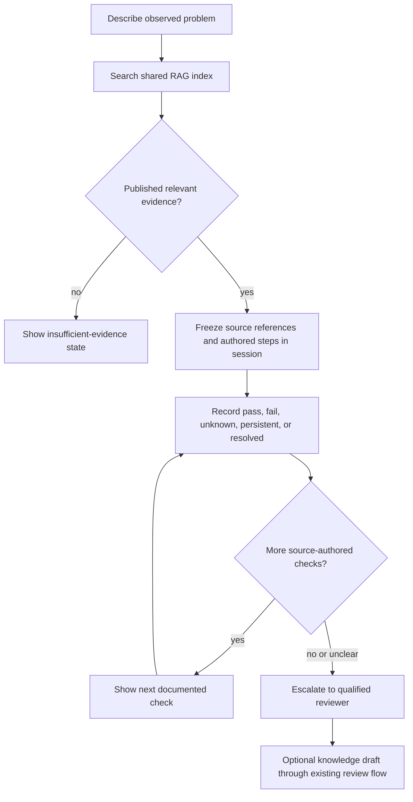

# Module 05 — Troubleshooting and Decision Trees

**Status:** Chunk 6 implemented · **Phase:** 4

## Operator flow

## Architecture and safety

- Search and issue guidance use the existing `RetrievalService`, including its published-source eligibility checks and citations. There is no second retrieval or LLM service.
- This chunk uses deterministic, extractive guidance from retrieved published sources. It does not ask an LLM to diagnose faults or create instructions.
- Investigation checks are copied from ordered authored source steps. Outcome recording advances sequentially; fail, unknown, and issue-persist outcomes never establish a root cause. No documented steps means no generated check sequence.
- The operator is told to perform only checks authorized for their role and to escalate unclear or maintenance work. The interface does not certify a machine as safe.
- Sessions retain the exact source text/revision references and recorded outcomes for historical continuity.
- Workflow issue integration verifies ownership and the issue-to-step relationship, then stores run, workflow revision, issue, and step context. It does not update workflow completion.
- A legacy decision tree is visible only when each node links to a currently published knowledge version. Unlinked demo procedures are not exposed.
- Escalated session details are available to the owner and an authorized reviewer who claims the case. Draft creation copies the case into the existing knowledge pipeline as `TROUBLESHOOTING`; normal peer review is still required for publication.

## API

- `GET /api/v1/troubleshooting/topics?q=...&machine_id=...` — search published, permission-eligible evidence.
- `GET /api/v1/troubleshooting/processes` — choose from existing process entities.
- `POST /api/v1/troubleshooting/sessions` — start and persist an investigation, optionally linked to a workflow issue.
- `GET /api/v1/troubleshooting/sessions/my/all` and `GET /api/v1/troubleshooting/sessions/{id}` — list/resume owned sessions with object-level access control.
- `POST /api/v1/troubleshooting/sessions/{id}/checks/{index}/outcome` — record a source-authored check outcome and observation.
- `PATCH /api/v1/troubleshooting/sessions/{id}/current-check` — revisit a prior check without changing its recorded outcome.
- `POST /api/v1/troubleshooting/sessions/{id}/escalate` — create an escalation record.
- `GET /api/v1/troubleshooting/escalations/queue`, `POST /api/v1/troubleshooting/escalations/{id}/claim`, and `POST /api/v1/troubleshooting/escalations/{id}/disposition` — reviewer workflow guarded by existing knowledge approval permission.
- `POST /api/v1/troubleshooting/sessions/{id}/knowledge-draft` — prepare a draft in the normal knowledge review pipeline.
- Tutor action cards call `POST /api/v1/assistant/handoffs/troubleshooting/{knowledge_version_id}/start`; the backend revalidates the cited current revision and uses the existing troubleshooting session service with retrieval restricted to that source's knowledge item.
- Active sessions for the same source and reported symptom are resumed. New sessions retain the Tutor conversation/message and source revision in `context.tutor_handoff`; the existing `/api/v1/troubleshooting/sessions/{id}` endpoint remains owner checked and the UI opens it with `session_id`.

The existing `/api/v1/troubleshooting` legacy tree endpoints remain for compatibility but filter out trees with missing or unpublished source links.

## Persistence

Migration `009_troubleshooting_sessions` extends the existing troubleshooting session/response tables with process and workflow issue links, source and check snapshots, current check index, and recorded outcome fields. `guide_version_id` and response `node_id` become nullable so RAG-backed sessions can use the existing session records without manufacturing an approved guide.

## Verification

Tests cover published citations, no-evidence fallback, ordered outcome recording, lack of root-cause inference, workflow issue links without workflow completion, source revision history, object-level access, expert escalation review, knowledge draft creation, and legacy unverified-tree filtering. Existing deterministic tree engine and validator tests remain in place.
