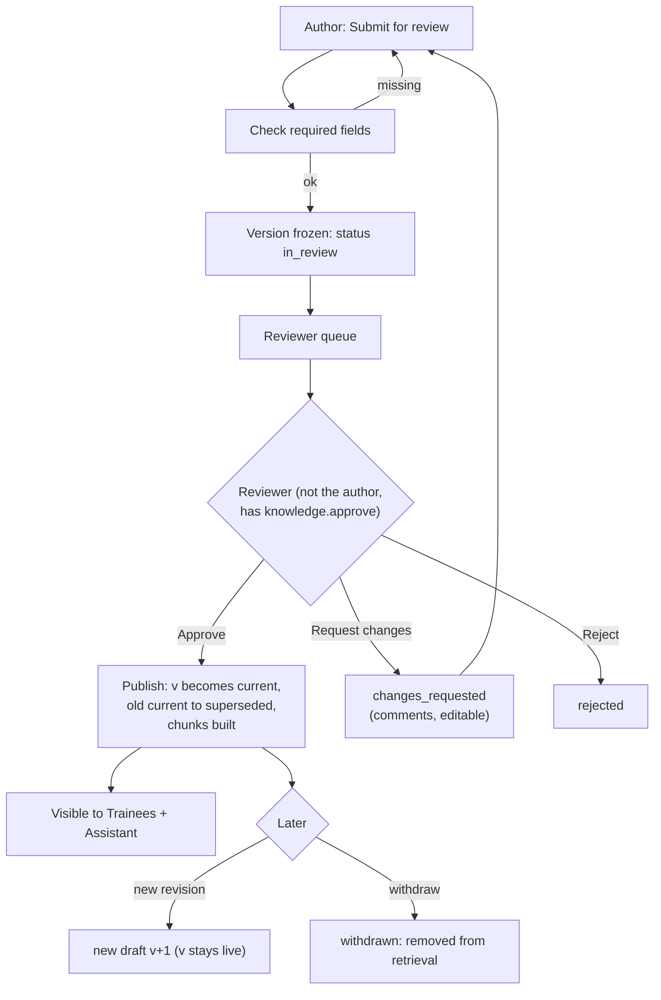
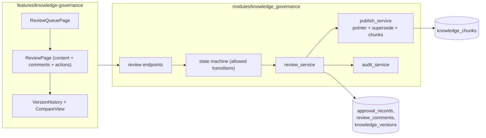

# Module 06 — Knowledge Validation and Versioning

**Status:** Implemented and tested · **Phase:** 2 · **Hackathon:** Build (Day 3)

## 1. Full workflow diagram



## 2. Required tech stack and technologies
PostgreSQL transactions with `SELECT ... FOR UPDATE`, SQLAlchemy, Python `difflib` for step/text diff, React with a simple side-by-side diff view.

## 3. System architecture of this feature



## 4. Tech flow

```mermaid
sequenceDiagram
  participant R as Reviewer UI
  participant API as FastAPI
  participant DB as PostgreSQL
  R->>API: POST /knowledge-versions/{vid}/approve (CSRF + cookie)
  API->>API: require knowledge.approve
  API->>DB: BEGIN; SELECT version FOR UPDATE
  API->>API: status == in_review? author != reviewer?
  alt invalid
    API-->>R: 409 invalid_state / 403 self_approval
  else valid
    API->>DB: insert approval_record(version, reviewer, decision)
    API->>DB: previous published -> superseded; chunks inactive
    API->>DB: version -> published; item.current_published_version_id = vid
    API->>DB: build knowledge_chunks (module 02 indexer)
    API->>DB: insert audit_log; COMMIT
    API-->>R: 200
  end
```

## 5. Steps
1. State machine with a table of allowed transitions and unit tests (T3.1).
2. Submit, approve, reject, request-changes, withdraw endpoints (T3.1).
3. Version list, version detail, compare endpoint (T3.1). Version detail and snapshot comparison are implemented; comparison returns changed field names and the saved snapshots.
4. Concurrency and self-approval tests (T3.2).
5. Review queue, review page, comments, history, badges (T3.3).

## 6. Other information

**Allowed transitions:** draft→in_review · changes_requested→in_review · in_review→published / changes_requested / rejected · published→superseded / withdrawn.

**Rules:** frozen content during review; published content immutable; approval record stores the exact version ID; withdraw requires a reason; every transition writes an audit row.

**Permissions:** submit = `knowledge.submit_review` (author only); approve/reject/changes/withdraw = `knowledge.approve` and not author.

**Compare view:** the editor allows selecting two visible saved versions and shows both snapshots with changed fields labeled. Granular added/removed/changed step diff remains incomplete. No AI summary in the hackathon.

**Errors:** 409 on wrong state or concurrent decision; 403 on self-approval; 404 on invisible item.

**Acceptance:** Expert B approves Expert A's draft; Trainee then sees v1; a new revision does not change v1 until approved; withdrawn content disappears from Trainee and assistant views.
**Dependencies:** 00, 01. **Feeds:** 02 (indexer hook). **Limitations:** approve and publish are one step; no scheduled publication or review intervals.
