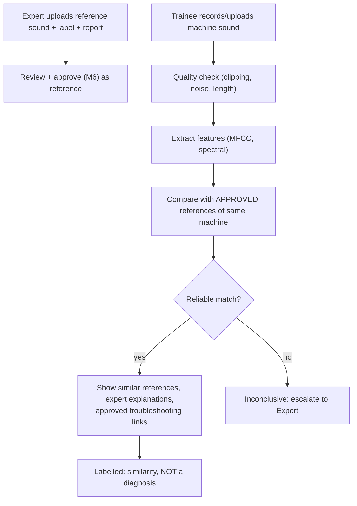
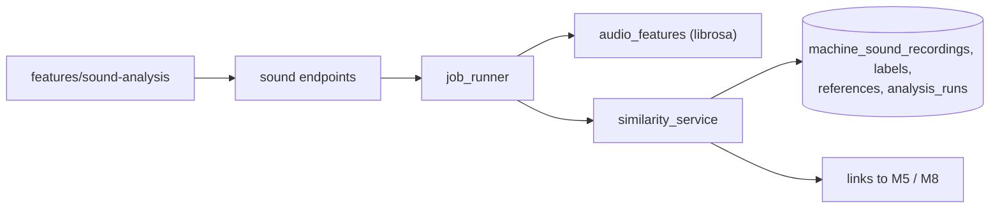
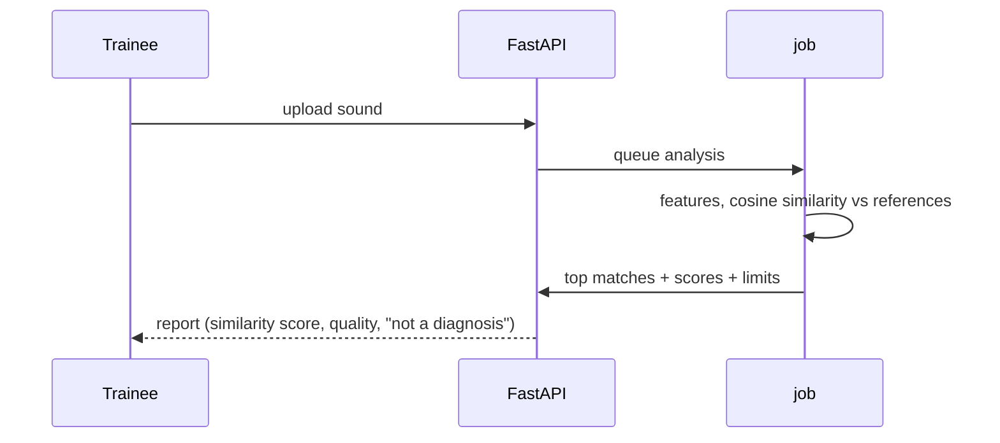

# Module 07 — Machine Sound Analysis (similarity search)

**Status:** Planned (placeholder in hackathon) · **Phase:** 5

## 1. Full workflow diagram

## 2. Required tech stack and technologies
Python, librosa, NumPy, soundfile, PostgreSQL (feature vectors as arrays; pgvector later), React with waveform/spectrogram display (wavesurfer.js), protected storage.
## 3. System architecture of this feature

## 4. Tech flow

## 5. Steps
1. Reference library with review. 2. Upload + quality checks. 3. Feature extraction. 4. Similarity with thresholds validated on real recordings. 5. Report and escalation.
## 6. Other information
Needs real recordings from the same machine and microphone setup; without them results are not meaningful. Four separate numbers are shown: audio quality, classification score, reference similarity, expert-verified outcome. **Dependencies:** 00, 06 (05 and 08 optional).
