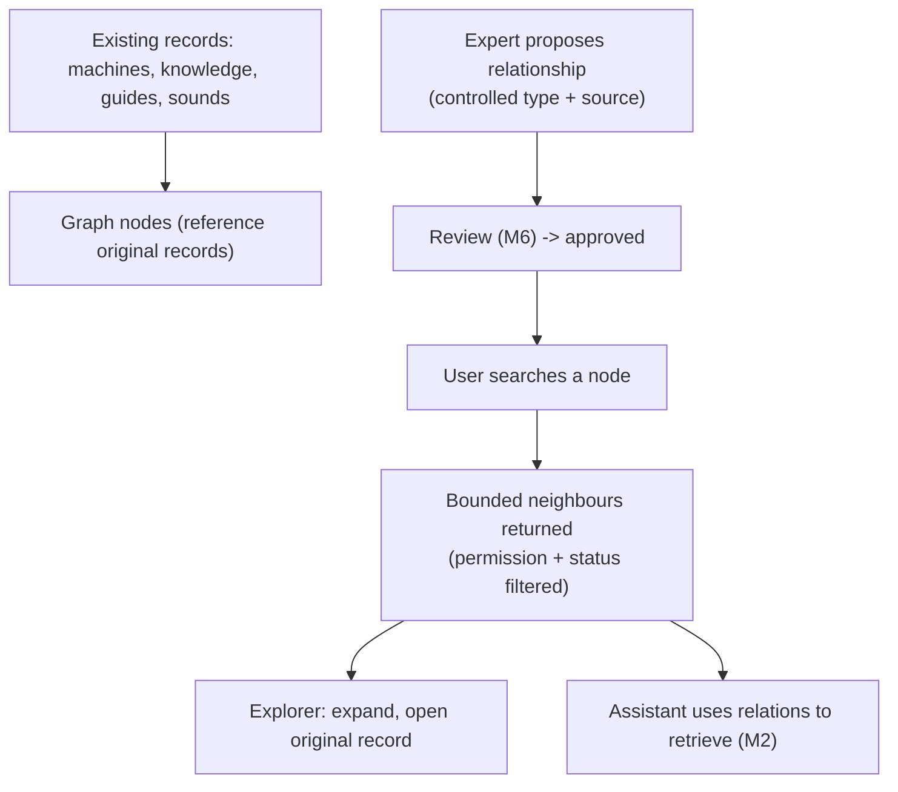
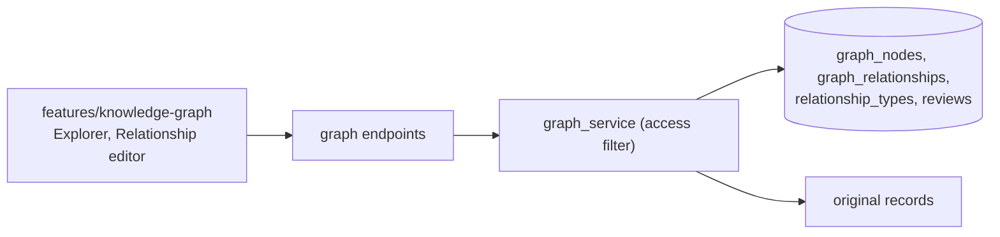
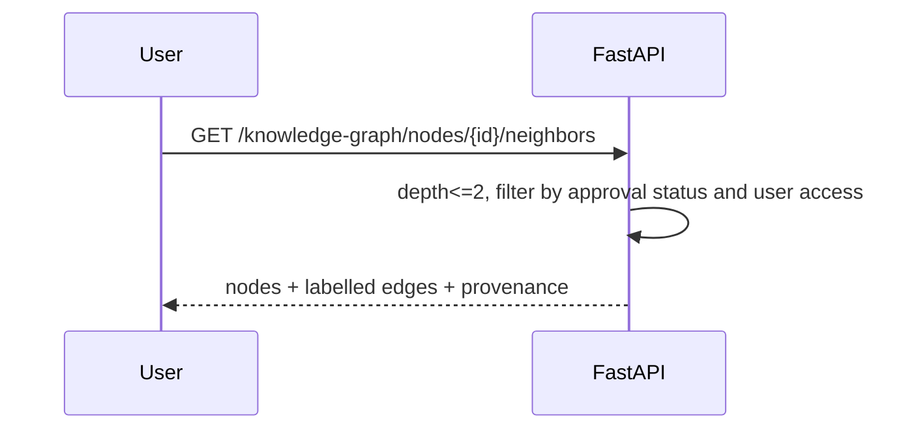

# Module 08 — Manufacturing Knowledge Graph

**Status:** Planned (placeholder in hackathon) · **Phase:** 5

## 1. Full workflow diagram

## 2. Required tech stack and technologies
PostgreSQL tables + recursive queries (depth-limited), NetworkX for analysis later, Cytoscape.js for the explorer, FastAPI, React + TypeScript.
## 3. System architecture of this feature

## 4. Tech flow

## 5. Steps
1. Node and relationship model with controlled types. 2. Read-only explorer. 3. Search and filters. 4. Expert relationship editor with review. 5. Link to assistant retrieval.
## 6. Other information
A relationship is not proof of a fault cause (`POSSIBLE_CAUSE_OF` is shown as "possible"). Withdrawn or superseded targets are flagged. **Dependencies:** 00, 01, 06.
