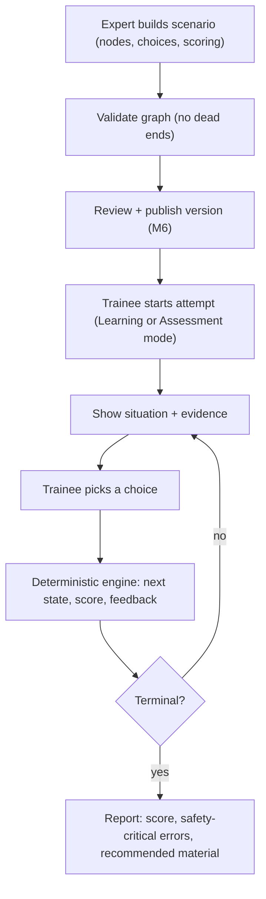
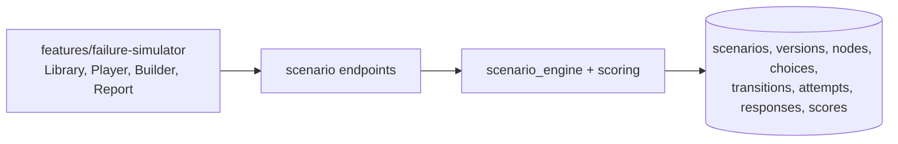
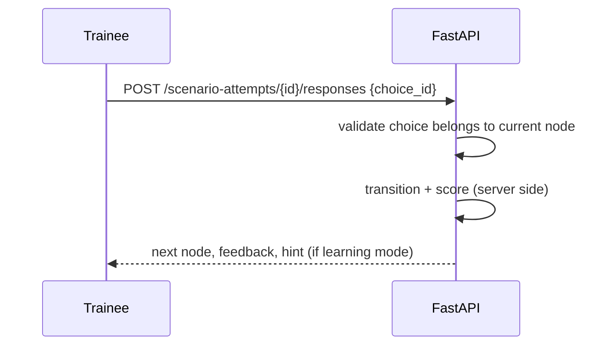

# Module 09 — Interactive Failure Simulator

**Status:** Planned (placeholder in hackathon) · **Phase:** 4

## 1. Full workflow diagram

## 2. Required tech stack and technologies
FastAPI rule engine and scoring (backend only), PostgreSQL, React Flow (builder), React player UI. LLM only for optional explanations from approved sources.
## 3. System architecture of this feature

## 4. Tech flow

## 5. Steps
1. Models + validator. 2. Engine and scoring tests. 3. Player. 4. Builder. 5. Reports. 6. Optional AI explanation.
## 6. Other information
Safety-critical mistakes are reported separately from the numeric score. Simulated data is always labelled. Never connected to real machine controls. **Dependencies:** 00, 06 (03 and 05 helpful).
