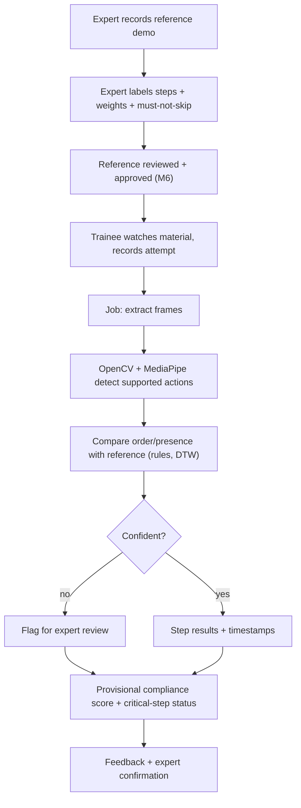
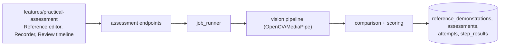
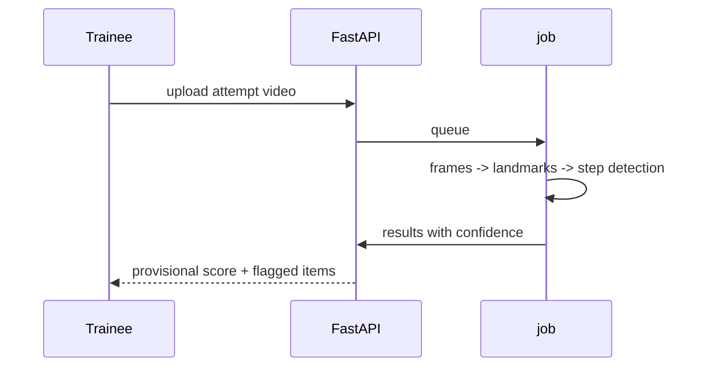

# Module 10 — AI-Based Practical Task Monitoring and Skill Verification

**Status:** Planned (placeholder in hackathon) · **Phase:** 6

## 1. Full workflow diagram

## 2. Required tech stack and technologies
Python, OpenCV, MediaPipe, NumPy, DTW (e.g. `dtaidistance` or custom), optional PyTorch pretrained models later, FastAPI jobs, React video player with timeline markers.
## 3. System architecture of this feature

## 4. Tech flow

Score = 100 x sum(w_i c_i) / sum(w_i). Uncertain detections are not failures; critical steps are reported separately.
## 5. Steps
1. One controlled task. 2. Reference + step labelling. 3. Recording workflow. 4. Rule-based detection prototype. 5. Comparison and score. 6. Expert review loop.
## 6. Other information
Measures detected procedural compliance, not part quality. Needs a fixed camera setup and real recordings. Recording retention policy must be defined. **Dependencies:** 00, 03, 06, 09 helpful.
