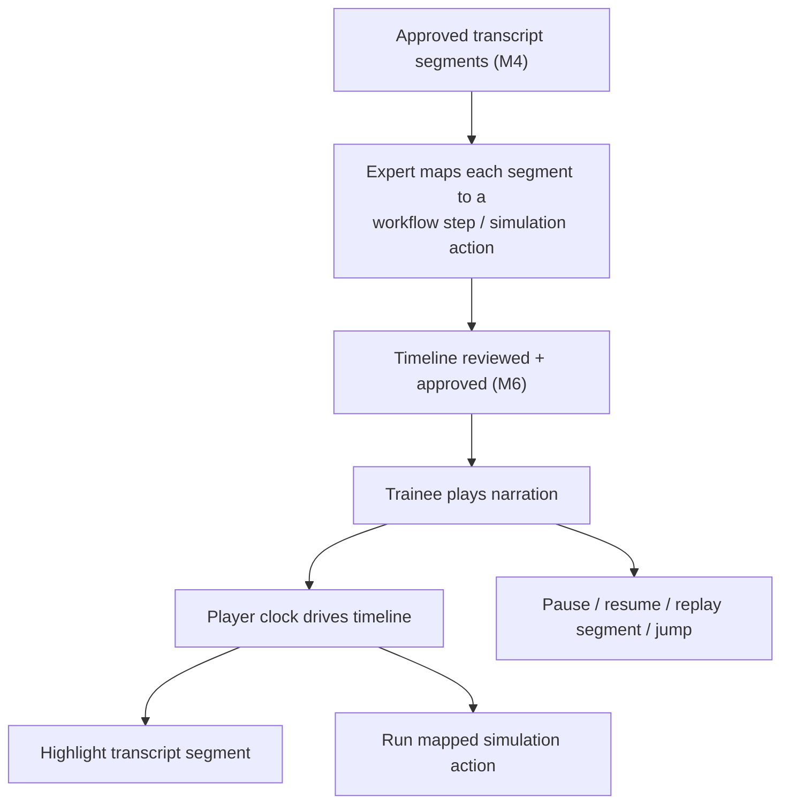
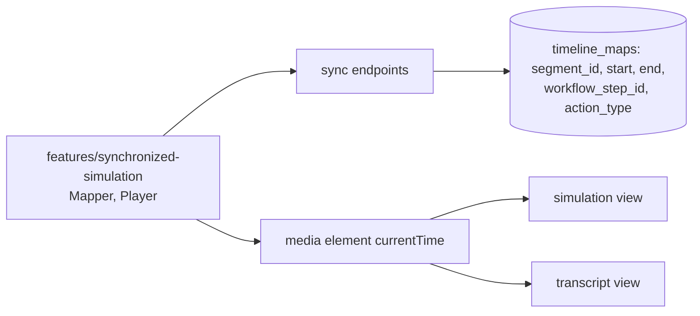
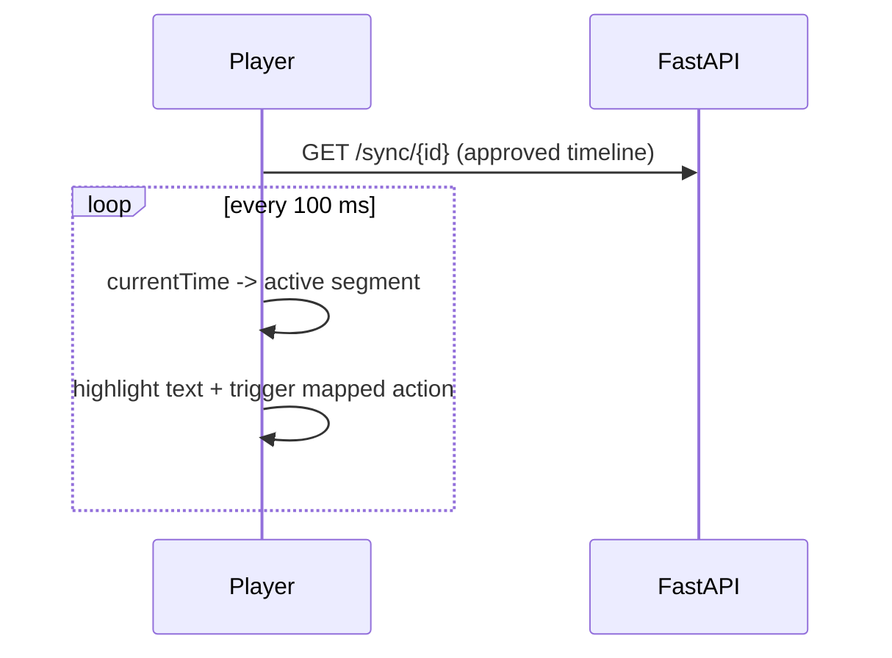

# Module 11 — Synchronized Narration and Simulation

**Status:** Planned (placeholder in hackathon) · **Phase:** 6

## 1. Full workflow diagram

## 2. Required tech stack and technologies
HTML5 audio/video element as the master clock, React timeline component, SVG or Canvas for a simple 2D step simulation (Three.js only if justified), FastAPI + PostgreSQL for the mapping table.
## 3. System architecture of this feature

## 4. Tech flow

## 5. Steps
1. Mapping model. 2. Mapper UI. 3. Player with seek, pause, replay. 4. Simple simulation actions. 5. Review and versioning.
## 6. Other information
Pre-recorded audio only; no live sync. Low-confidence segments require expert correction first. Simulation actions come from an allow-list; speech or LLM output can never trigger real machine operations. **Dependencies:** 00, 03, 04, 06.
