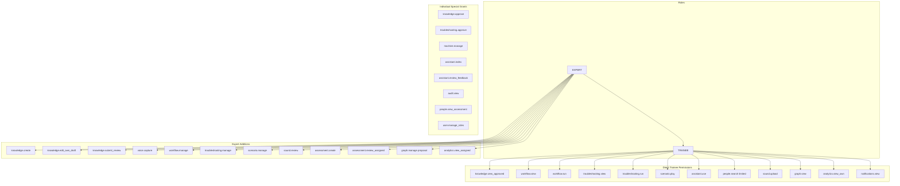

# Gurukul AI — Role-Based Access Control (RBAC) Matrix

## 1. Overview & Architectural Principles

Gurukul AI enforces strict dual-layer authorization across the platform:
1. **The Backend is the Single Source of Truth:** Every API endpoint validates credentials, active account status, role, and fine-grained permission codes on every incoming request. The server never trusts client-supplied user IDs, roles, or permission lists.
2. **The Frontend Reflects Backend Permissions:** The React application queries `GET /api/v1/auth/me` to discover the authenticated user's verified identity and effective permissions. Frontend guards prevent access to unauthorized pages (redirecting to `/403`), hide disallowed navigation items, and disable prohibited action controls.
3. **Two Application Roles Only:** `EXPERT` and `TRAINEE`. Role definitions are broad archetypes. Fine-grained permission codes are NOT separate roles.
4. **Individual Privilege Delegation:** High-impact administrative, governance, and compliance actions (`knowledge.approve`, `machine.manage`, `audit.view`, `user.manage_roles`) are **NOT** granted automatically to all Experts; they are granted individually to specific qualified users via the `user_permissions` join table.
5. **No Self-Escalation:** Public registration strictly provisions the `TRAINEE` role. No user can escalate their own role or permissions. Role alterations must execute via a controlled admin pathway with an immutable audit event.

---

## 2. Permission Codes Specification

### A. Core Project Permissions
| Permission Code | Category | Description |
| :--- | :--- | :--- |
| `knowledge.create` | Knowledge Capture (M01) | Author new knowledge items, initial drafts, and revisions |
| `knowledge.edit_own_draft` | Knowledge Capture (M01) | Edit draft SOPs owned by the authenticated caller |
| `knowledge.submit_review` | Knowledge Capture (M01) | Submit own draft SOPs to the peer review queue |
| `knowledge.approve` | Governance (M06) | Peer-review, approve, or reject submitted knowledge versions |
| `workflow.view` | Guided Workflows (M03) | View verified standard operating procedures and workflows |
| `assessment.create` | Assessments (M10) | Formulate assessment checkpoints and practical rubrics |
| `assessment.review_assigned` | Assessments (M10) | Review and grade assigned trainee assessment attempts |
| `people.search` | Directory (M00) | Search personnel directory and view expert contacts |
| `people.view_assessment` | Directory (M00) | Inspect personnel training records and skill certifications |
| `machine.manage` | Assets (M00) | Register, update, and configure physical machine assets |

### B. Extended Operational Permissions (*)
*Codes marked with `(*)` represent extensions required for full lifecycle coverage.*

| Permission Code | Category | Description |
| :--- | :--- | :--- |
| `knowledge.view_approved` (*) | Knowledge Capture (M01) | Access published, verified knowledge articles and media |
| `workflow.manage` (*) | Guided Workflows (M03) | Create, edit, and configure procedural workflows |
| `workflow.run` (*) | Guided Workflows (M03) | Execute and record interactive checklist procedure runs |
| `troubleshooting.view` (*) | Diagnostics (M05) | Browse diagnostic decision trees and fault symptoms |
| `troubleshooting.manage` (*) | Diagnostics (M05) | Author and modify diagnostic nodes, branches, and trees |
| `troubleshooting.run` (*) | Diagnostics (M05) | Traverse diagnostic trees and record resolution attempts |
| `troubleshooting.approve` (*) | Governance (M06) | Approve and publish diagnostic decision trees |
| `scenario.play` (*) | Simulation (M09/M11) | Participate in failure simulations and scenario attempts |
| `scenario.manage` (*) | Simulation (M09/M11) | Author failure scenarios, parameters, and inject faults |
| `assistant.use` (*) | AI Assistant (M02) | Query grounded AI RAG assistant for cited SOP guidance |
| `assistant.index` (*) | AI Assistant (M02) | Trigger vector re-indexing of knowledge chunks |
| `assistant.review_feedback` (*) | AI Assistant (M02) | Inspect trainee AI citations, flags, and chat ratings |
| `voice.capture` (*) | Voice Capture (M04) | Record expert voice narrations, upload audio, edit transcripts |
| `sound.upload` (*) | Sound Analysis (M07) | Upload operational machine audio for acoustic matching |
| `sound.review` (*) | Sound Analysis (M07) | Verify acoustic fault labels, manage reference baselines |
| `graph.view` (*) | Knowledge Graph (M08) | Visualize machine-procedure-symptom ontological links |
| `graph.manage` (*) | Knowledge Graph (M08) | Propose and curate knowledge graph entity relationships |
| `analytics.view_own` (*) | Analytics (M03) | Inspect personal learning metrics, runs, and completions |
| `analytics.view_assigned` (*) | Analytics (M03/M10) | Inspect metrics for trainees assigned under expert supervision |
| `notifications.view` (*) | Notifications | View and manage user system alerts and notifications |
| `audit.view` (*) | Compliance | Inspect immutable security audit trails and access logs |
| `user.manage_roles` (*) | Administration | Reassign user roles, grant permissions, revoke sessions |

---

## 3. Role-to-Permission Mapping



### Mapping Summary
- **TRAINEE Role:** Base permissions enabling learning, execution, guided troubleshooting, simulation participation, voice search, and personal progress tracking. Own records only.
- **EXPERT Role:** All Trainee permissions, plus knowledge authoring, revision drafting, voice recording/transcription, procedure design, scenario engineering, sound verification, and assigned trainee assessment reviews.
- **INDIVIDUALLY GRANTED PERMISSIONS:** Granted strictly on a per-user basis via `user_permissions` table (not inherited by role alone):
  - `knowledge.approve`: Assigned to qualified Peer Reviewers (e.g., Bhavna Patel / Expert B).
  - `machine.manage`: Assigned to Facility Managers / Asset Stewards.
  - `audit.view`: Assigned to Compliance / Quality Officers.
  - `user.manage_roles`: Assigned to System Administrators.
  - `troubleshooting.approve`, `assistant.index`, `assistant.review_feedback`, `people.view_assessment`.

---

## 4. Frontend Page-Level Access & Route Guards

| Route Path | Page Component | Required Permission / Role | Trainee Access | Expert Access | Denied Action | Sidebar Visibility |
| :--- | :--- | :--- | :--- | :--- | :--- | :--- |
| `/app` | `DashboardPage` | Authenticated | Trainee View | Expert View | Redirect `/login` | Always Visible |
| `/app/knowledge` | `LibraryPage` | `knowledge.view_approved` | Read Published | Read All & Own Drafts | Redirect `/403` | Always Visible |
| `/app/knowledge/new` | `KnowledgeEditorPage` | `knowledge.create` | Denied | Allowed | Redirect `/403` | Hidden for Trainee |
| `/app/knowledge/:id` | `KnowledgeEditorPage` | `knowledge.view_approved` | View Published | View & Edit (if author) | Redirect `/403` | Hidden for Trainee if Draft |
| `/app/reviews` | `ReviewsPage` | `knowledge.approve` | Denied | Allowed (if granted) | Redirect `/403` | Hidden if missing permission |
| `/app/guided-workflows` | `GuidedWorkflowsPage` | `workflow.view` | Execute Runs | Design & Execute | Redirect `/403` | Always Visible |
| `/app/sound-analysis` | `SoundAnalysisPage` | `sound.upload` | Upload & Match | Verify Baselines | Redirect `/403` | Always Visible |
| `/app/voice-capture` | `VoiceToKnowledgePage` | `voice.capture` | Denied | Record & Transcribe | Redirect `/403` | Hidden for Trainee |
| `/app/assistant` | `ModulePlaceholderPage` | `assistant.use` | Allowed | Allowed | Redirect `/403` | Always Visible |
| `/app/troubleshooting` | `ModulePlaceholderPage` | `troubleshooting.view`| Traversal Only | Author & Traverse | Redirect `/403` | Always Visible |
| `/app/knowledge-graph` | `ModulePlaceholderPage` | `graph.view` | View Links | Propose Links | Redirect `/403` | Always Visible |
| `/app/failure-simulator`| `ModulePlaceholderPage` | `scenario.play` | Attempt Scenarios | Manage Scenarios | Redirect `/403` | Always Visible |
| `/app/skill-verification`| `ModulePlaceholderPage`| `assessment.review_assigned` | Own Checklists | Grade Assigned | Redirect `/403` | Read-only for Trainee |
| `/app/machines` | `MachinesPage` | Authenticated | View Catalog | View Catalog | Redirect `/403` | Always Visible (Create button hidden unless `machine.manage`) |
| `/app/security/audit` | `AuditLogPage` | `audit.view` | Denied | Allowed (if granted) | Redirect `/403` | Hidden if missing permission |

---

## 5. Record-Level Rules & Invariants

1. **Procedural Execution Runs (`ProcedureRun`):**
   - A Trainee can ONLY query, start, and complete checklist steps on runs where `run.operator_id == current_user.id`.
   - An Expert can view a Trainee's procedure run ONLY if explicitly assigned or possessing oversight privileges.
2. **Knowledge Drafts (`KnowledgeVersion`):**
   - Draft and `changes_requested` versions are returned ONLY to the version's original author (`created_by == current_user.id`) or a user with `knowledge.approve` once submitted into review.
   - Trainees querying `/api/v1/knowledge` receive ONLY authoritative `published` versions. Draft existence is never leaked.
3. **Voice Narration Assets (`MediaAsset` / `Transcript`):**
   - Voice uploads attached to a version are restricted to the draft author.
4. **Learning Assignments & Notifications (`LearningAssignment`, `Notification`):**
   - Strictly scoped to `user_id == current_user.id` in database query `WHERE` clauses. Trainees cannot inspect or update other users' notifications.
5. **Separation of Duty (Author-Approver Separation):**
   - When policy `ENFORCE_AUTHOR_APPROVER_SEPARATION` is enabled, an author can NEVER review, approve, or reject their own submitted version:
     ```python
     if article.author_id == auth_ctx.user.id:
         raise ForbiddenError(code="self_review_forbidden", message="Authors cannot review their own submissions.")
     ```

---

## 6. Seeded Test Users & Baseline Permissions

| Role | Email | Password | Assigned Permissions |
| :--- | :--- | :--- | :--- |
| **Expert Author** (`EXPERT`) | `expert.a@demo.local` | `ExpertA@Gurukul2026!` | All Expert permissions (authoring, voice, workflow design). No approve permission. |
| **Lead Reviewer** (`EXPERT`) | `expert.b@demo.local` | `ExpertB@Gurukul2026!` | All Expert permissions + **`knowledge.approve`**, `troubleshooting.approve` |
| **Workshop Trainee** (`TRAINEE`) | `trainee@demo.local` | `Trainee@Gurukul2026!` | Trainee base permissions (read approved, run workflows, execute simulator) |
