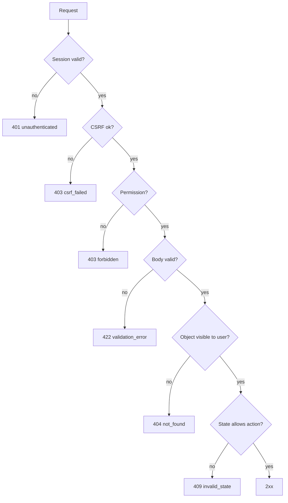

# API Conventions

**Status:** Planned

## 1. Full workflow diagram (request lifecycle and error mapping)

## 2. Required tech stack
FastAPI, Pydantic v2 schemas, generated OpenAPI docs at `/docs`, typed TypeScript client in `frontend/src/lib/api`.

## 3. System architecture
Routers in `backend/app/api/v1/endpoints/*`; schemas in `schemas/`; services hold rules. Frontend calls only through `lib/api/client.ts` (credentials included, CSRF header added).

## 4. Tech flow
Browser, then client wrapper, then router dependency chain (session, CSRF, permission), then service, then repository. See `SYSTEM_ARCHITECTURE.md`.

## 5. Steps / rules
1. Prefix `/api/v1`, plural nouns, snake_case JSON.
2. Identify the user from the session only. Never accept a user ID from the body for authorization.
3. Error body: `{"error": {"code": "...", "message": "...", "details": null, "request_id": "..."}}`.
4. Lists: `?page=1&page_size=20` returning `{items, total, page, page_size}`.
5. State changes are explicit `POST .../{action}` calls inside one transaction.
6. Long jobs return `202` with a job ID, polled via `GET /processing-jobs/{id}`.
7. Hide objects the user may not see with 404, not 403.

## 6. Hackathon endpoint list (proposed, not yet built)

| Area | Method + path | Permission |
|---|---|---|
| Health | GET /health | public |
| Auth | POST /auth/register (Trainee only), POST /auth/login, POST /auth/logout, GET /auth/me | public / session |
| Machines | GET/POST /machines | read: any; write: `machine.manage` |
| Knowledge | GET/POST /knowledge, GET/PATCH /knowledge/{id}, POST /knowledge/{id}/versions | `knowledge.create`, `knowledge.edit_own_draft` |
| Media | POST /knowledge-versions/{vid}/media, GET /media/{id} | owner or published-access |
| Review (M6) | POST /knowledge-versions/{vid}/submit-review, /approve, /request-changes, /reject, /withdraw; GET /reviews/queue; GET /knowledge/{id}/versions; POST /knowledge-versions/{vid}/comments | `knowledge.submit_review`, `knowledge.approve` |
| Voice (M4) | POST /voice-captures, POST /voice-captures/{id}/upload, GET /processing-jobs/{id}, GET/PATCH /transcripts/{id}, PATCH /transcripts/{id}/segments/{sid}, POST /transcripts/{id}/structure | `knowledge.create` |
| Assistant (M2) | POST /assistant/chat, GET /assistant/conversations, GET /assistant/conversations/{id}, POST /assistant/feedback | `assistant.use` |
| Search | GET /knowledge/published (trainee-visible list) | any signed-in |
