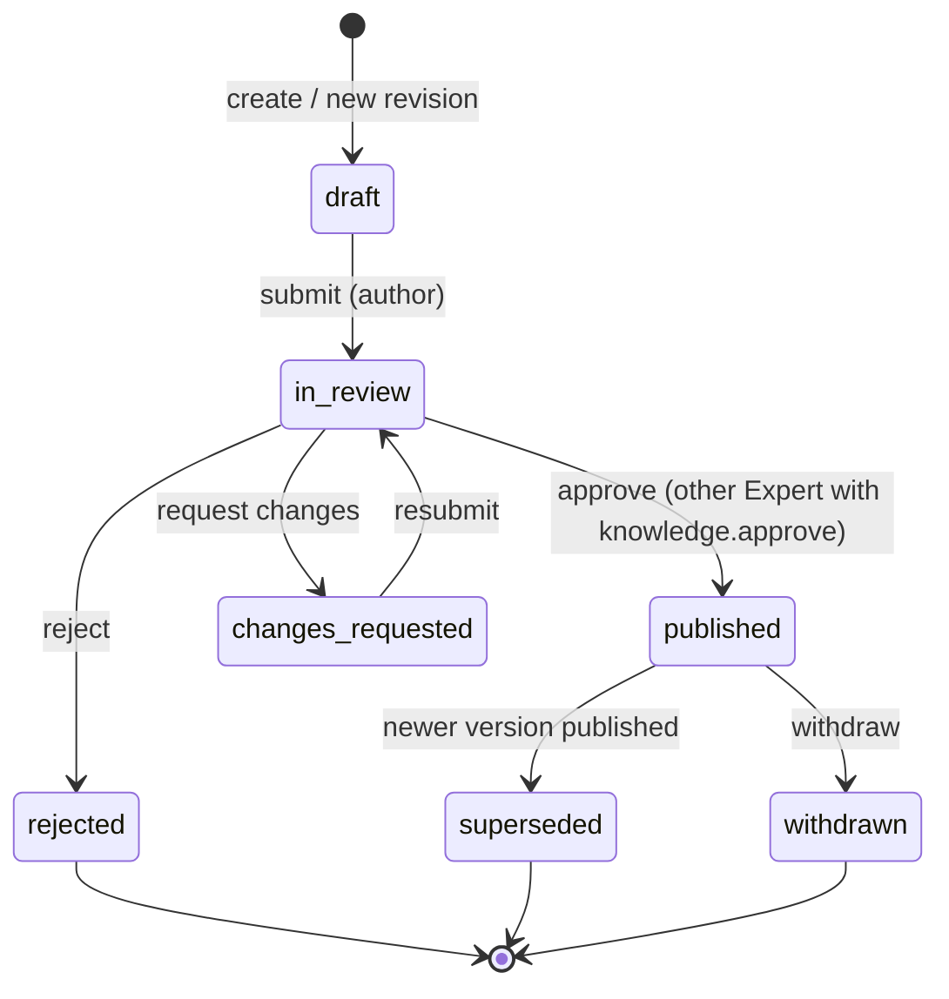
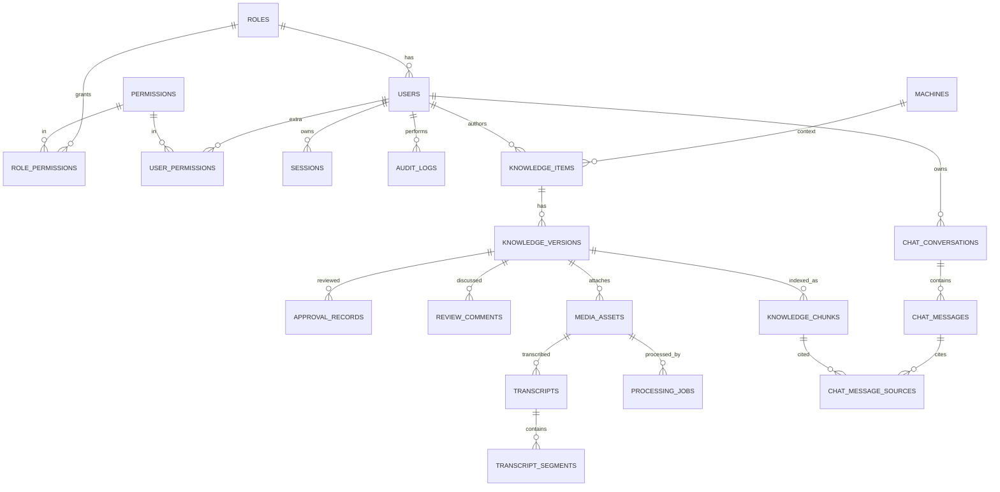
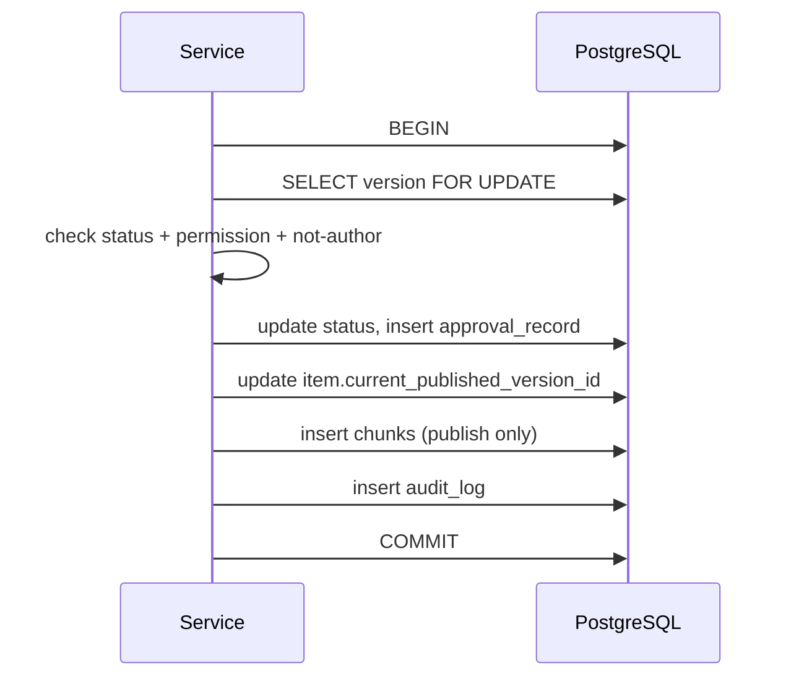

# Database Design

**Status:** Planned

## 1. Full workflow diagram (data lifecycle of one knowledge record)

Hackathon: approve and publish happen in one transaction. The separate `approved` status exists in the enum for later.

## 2. Required tech stack
PostgreSQL 16, SQLAlchemy 2.x (typed models), Alembic migrations, `tsvector` + GIN index for search, JSONB for step snapshots.

## 3. System architecture (ER diagram)

## 4. Tech flow (how modules write data)

## 5. Steps (migrations, in order)
1. `001_foundation`: roles, permissions, role_permissions, user_permissions, users, sessions, audit_logs
2. `002_knowledge`: machines, knowledge_items, knowledge_versions (with circular FK from items)
3. `003_media_assets`: media_assets (FK to versions ON DELETE RESTRICT, unique storage_key, CHECK constraints on kind and positive size, indexes on version_id and uploaded_by)
4. `004_voice`: processing_jobs, transcripts, transcript_segments
5. `005_assistant`: knowledge_chunks (+ GIN index), chat_conversations, chat_messages, chat_message_sources

## 6. Other information

**Key columns (not exhaustive)**

| Table | Important columns |
|---|---|
| users | id, email (unique), name, password_hash, role_id, is_active |
| sessions | id, user_id, token_hash, created_at, last_seen_at, expires_at, revoked_at |
| audit_logs | id, actor_id, action, entity_type, entity_id, detail (JSONB, no secrets), created_at (append-only) |
| machines | id, name, code, category, is_demo |
| knowledge_items | id, title (mirror), machine_id (mirror FK), author_id, current_published_version_id (nullable, deferrable FK), is_demo |
| knowledge_versions | id, item_id, version_no, title (snapshot), machine_id (snapshot FK), status (CHECK 8 states), origin (`expert` / `ai_draft` / `ai_draft_edited`), summary, steps (JSONB), revision_reason, submitted_at, published_at (CHECK) |
| approval_records | id, item_id, version_id, reviewer_id, decision (CHECK), comment (CHECK required for non-approval), created_at (append-only) |
| review_comments | id, version_id, author_id, body (CHECK 1..4000), step_order, created_at (append-only) |
| media_assets | id, version_id, kind (audio/video/image/doc), storage_key, mime, size_bytes, uploaded_by |
| processing_jobs | id, type, media_id, status (`queued/processing/needs_review/completed/failed`), error_safe, attempts, idempotency_key |
| transcript_segments | id, transcript_id, idx, start_s, end_s, original_text, edited_text, needs_review |
| knowledge_chunks | id, version_id, item_id, text, tsv (tsvector), is_active |
| chat_message_sources | message_id, chunk_id, version_id |

**Rules & Governance Constraints**
- **Snapshot Architecture:** `title` and `machine_id` live as immutable snapshots on each `knowledge_version`. `knowledge_items.title` and `machine_id` mirror the currently published version (or initial draft at v1 creation). Editing a draft never alters the published item mirror seen by Trainees.
- **Partial Unique Indexes:**
  - `uq_versions_one_published_per_item`: At most one version per item with `status = 'published'`.
  - `uq_versions_one_open_per_item`: At most one version per item with `status IN ('draft', 'changes_requested', 'in_review')`.
- **Frozen Content Trigger (`fn_versions_freeze_content`):** Once a version moves outside editable statuses (`draft`, `changes_requested`), any UPDATE to content columns (`title`, `machine_id`, `summary`, `steps`, `item_id`, `version_no`, `created_by`) is rejected at DB level. Status and timestamp transitions remain permitted.
- **Append-Only Triggers:** `approval_records` and `review_comments` reject UPDATE and DELETE operations.
- `current_published_version_id` is the only definition of "current".
- Withdraw or supersede sets chunks `is_active = false`.
- Every training or chat reference stores the exact version ID.
- `is_demo` marks seeded data so the UI can label it.
- Foreign keys everywhere; indexes on status, item_id, user_id, and the GIN index on `tsv`.
