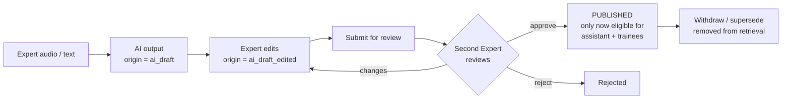
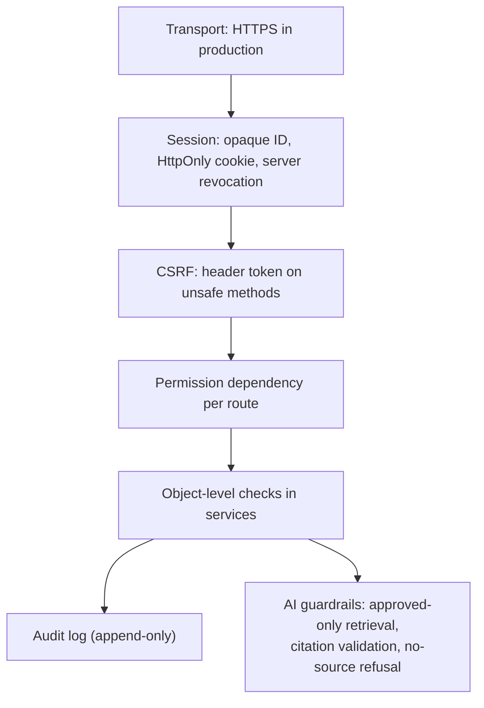
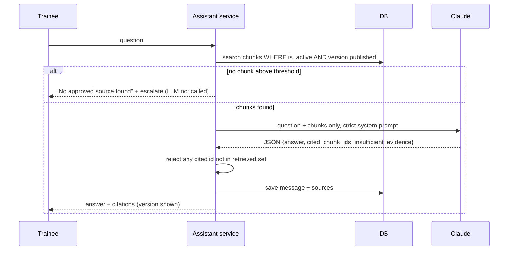

# Security and AI Governance

**Status:** Planned

## 1. Full workflow diagram (AI content to trusted content)

## 2. Required tech stack and technologies
Argon2id (argon2-cffi), server-side sessions in PostgreSQL, SameSite cookies, CSRF header check, Pydantic validation, structured logging with redaction, pytest security tests.

## 3. System architecture (security layers)

## 4. Tech flow (assistant guardrail path)

## 5. Steps (rules to implement)
**Security**
1. Passwords: Argon2id. Never log passwords, tokens or API keys.
2. Session: random 32-byte token in an HttpOnly, SameSite=Lax cookie; store only its hash; 30 min idle and 8 h absolute timeout (proposed defaults, not company policy); logout revokes server-side.
3. CSRF: double-submit token, header `X-CSRF-Token` required on POST/PATCH/PUT/DELETE.
4. Registration creates Trainee only. Experts come from the seed script.
5. Block self-approval in the service, not just the UI.
6. Uploads: allow-list of MIME types, size limit, random storage keys, never trust filenames.
7. Media downloads go through an authorized endpoint.
8. Keys only in environment variables. Nothing in localStorage.

**AI governance**
1. AI output is stored with `origin` and provider/model name.
2. AI cannot move content to published. Only the approval endpoint can.
3. Prompts forbid inventing values. Missing values must be flagged `needs_review`.
4. Retrieval uses only published, active, non-withdrawn chunks.
5. The server validates citations. The model cannot cite a source it was not given.
6. No machine control exists anywhere in the product.
7. Demo data is labelled "Demo data" in the UI.

## 6. Other information
Not covered in the hackathon: password reset, rate-limit persistence, upload malware scanning, retention policy, e-signatures or regulatory validation (these need the company's quality team). Do not claim compliance.
