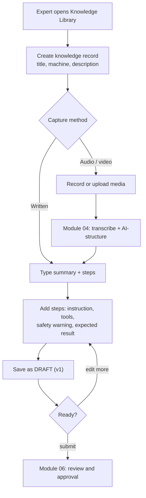
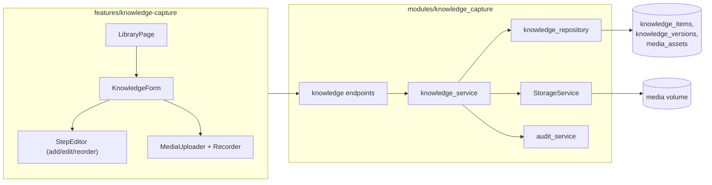
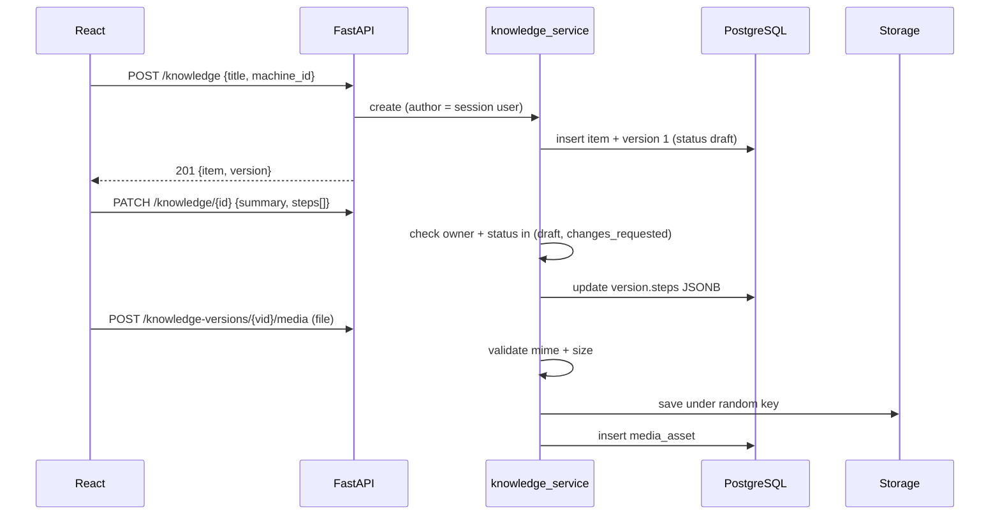

# Module 01 — Expert Knowledge Capture

**Status:** Planned · **Phase:** 2 · **Hackathon:** Build (Day 2)

## 1. Full workflow diagram

## 2. Required tech stack and technologies
- Backend: FastAPI, SQLAlchemy, Alembic, PostgreSQL JSONB (steps), `StorageService` (local disk), python-multipart.
- Frontend: React, TypeScript, TanStack Query, Tailwind, browser `MediaRecorder` API for recording.

## 3. System architecture of this feature

## 4. Tech flow

## 5. Steps
1. Migration 002 (machines, items, versions, media_assets) (T2.1).
2. Machine list/create endpoints and seed demo machines.
3. Knowledge item/version CRUD with ownership rules (T2.1).
4. Storage service and upload validation (T2.2).
5. Library, form, step editor screens (T2.3).
6. Uploader and audio recorder (T2.4).

## 6. Other information

**Step JSON shape** (inside `knowledge_versions.steps`):
`{ "order": 1, "title": "...", "instruction": "...", "tools": [], "safety_warning": "", "expected_result": "", "stop_condition": "", "needs_review": false, "source_segment_ids": [], "ai_generated": false }`

**Permissions:** create/edit own draft: `knowledge.create`. Trainees see only published versions. Drafts are visible to the author and reviewers.

**Rules:** editing allowed only in `draft` or `changes_requested`. Editing a published item creates a new draft version (v2) and leaves v1 live.

**Validation and errors:** missing title (422), unsupported file type (415), file too large (413), editing a frozen version (409), foreign draft (404).

**Allowed uploads (hackathon):** audio webm/mp3/wav/m4a, video mp4/webm, image png/jpg, PDF. Max `MAX_UPLOAD_MB` (default 100).

**Acceptance:** Expert creates, edits, reorders steps, uploads media, saves draft; Trainee cannot see the draft.
**Dependencies:** 00. **Feeds:** 04, 06, 02. **Limitations:** no resumable uploads, no virus scan.
