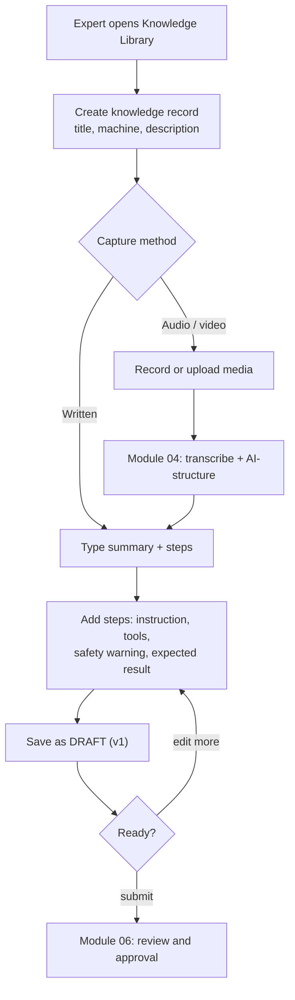
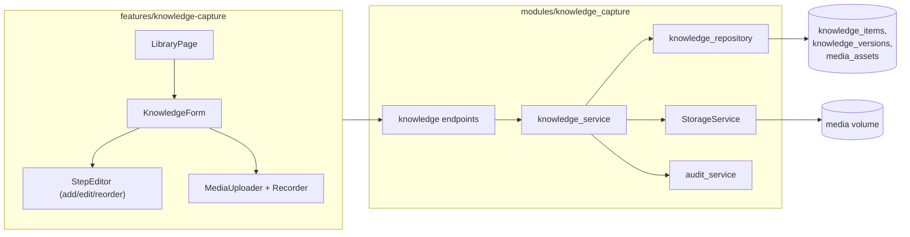

# Module 01 — Expert Knowledge Capture

**Status:** Planned · **Phase:** 2 · **Hackathon:** Build (Day 2)

## 1. Full workflow diagram



## 2. Required tech stack and technologies
- Backend: FastAPI, SQLAlchemy, Alembic, PostgreSQL JSONB (steps), `StorageService` (local disk), python-multipart.
- Frontend: React, TypeScript, TanStack Query, Tailwind, browser `MediaRecorder` API for recording.

## 3. System architecture of this feature



## 4. Tech flow

```mermaid
sequenceDiagram
  participant UI as React
  participant API as FastAPI
  participant S as knowledge_service
  participant DB as PostgreSQL
  participant FS as Storage
  UI->>API: POST /knowledge {title, machine_id}
  API->>S: create (author = session user)
  S->>DB: insert item + version 1 (status draft)
  API-->>UI: 201 {item, version}
  UI->>API: PATCH /knowledge/{id} {title, machine_id, summary, steps[]}
  S->>S: check owner + status in (draft, changes_requested)
  S->>DB: update editable version snapshot (title, machine_id, summary, steps); item mirror unchanged
  UI->>API: POST /knowledge-versions/{vid}/media (file)
  S->>S: validate mime + size
  S->>FS: save under random key
  S->>DB: insert media_asset
```

## 5. Steps
1. Migration 002 (machines, items, versions, media_assets) (T2.1).
2. Machine list/create endpoints and seed demo machines.
3. Knowledge item/version CRUD with ownership rules (T2.1).
4. Storage service and upload validation (T2.2).
5. Library, form, step editor screens (T2.3).
6. Uploader and audio recorder (T2.4).

## 6. Other information

**Step JSON shape** (inside `knowledge_versions.steps`):
`{ "order": 1, "title": "...", "instruction": "...", "tools": [], "safety_warning": "", "expected_result": "", "stop_condition": "", "needs_review": false, "source_segment_ids": [], "ai_generated": false }`

**Permissions:** create/edit own draft: `knowledge.create`. Trainees see only published versions. Drafts are visible to the author and reviewers.

**Rules:** editing allowed only in `draft` or `changes_requested`. `PATCH /knowledge/{id}` modifies `title`, `machine_id`, `summary`, and `steps` on the caller's open editable version only. The `knowledge_items` title and machine_id mirror remains untouched until formal publish, guaranteeing Trainees never see unreviewed draft changes. Editing a published item creates a new draft version (v2) and leaves v1 live.

**Validation and errors:** missing title (422), unsupported file type (415), file too large (413), editing a frozen version (409), foreign draft (404).

**Allowed uploads (hackathon):** audio webm/mp3/wav/m4a, video mp4/webm, image png/jpg, PDF. Max `MAX_UPLOAD_MB` (default 100).

**Acceptance:** Expert creates, edits, reorders steps, uploads media, saves draft; Trainee cannot see the draft.
**Dependencies:** 00. **Feeds:** 04, 06, 02. **Limitations:** no resumable uploads, no virus scan.

## 7. Media Architecture & Design Decisions (T2.2)

### 7.1 Key Decisions Applied
1. **Revisions do not carry media:** When creating a new revision from a published version, only the title, summary, description, and steps are copied into the new draft version. Media assets from the parent version are NOT copied or referenced. *(Known limitation and open product question for future sprint consideration).*
2. **Kind is derived from validated content:** The asset's `kind` (`audio`, `video`, `image`, `document`) is derived strictly from the canonical verified MIME type. An optional `kind` parameter in the upload form must match the derived kind, otherwise rejected with `422 Unprocessable Content` (`code="kind_mismatch"`).
3. **Additions beyond original spec:**
   - `GET /api/v1/knowledge-versions/{vid}/media`: Lists all media assets for a visible version.
   - `GET /api/v1/media/config`: Authenticated endpoint returning maximum upload size, allowed MIME types, and per-version asset cap so the frontend mirrors server constraints.
4. **Per-version quota:** Configurable limit of 20 media assets per version (`MAX_MEDIA_PER_VERSION`). Exceeding it returns `409 Conflict` (`code="media_cap_reached"`).
5. **Zero-byte uploads:** Rejected with `422 Unprocessable Content` (`code="empty_file"`).
6. **Hard delete:** Deleting a media asset deletes the database record in a transaction and unlinks the file from storage.

### 7.2 Storage Configuration
- `MEDIA_ROOT`: Filesystem directory for asset storage. Default for Docker: `/data/media` (backed by persistent `media_volume`); for local dev: `./data/media`.
- `MAX_UPLOAD_BYTES`: Maximum upload payload size (default `104857600` bytes / 100 MB).
- `MAX_MEDIA_PER_VERSION`: Maximum attached assets per version (default `20`).

### 7.3 Module 04 (Voice-to-Knowledge) Integration Interface
- Method: `MediaService.get_asset_for_processing(db: Session, media_id: str) -> Tuple[MediaAsset, Iterator[bytes]]`
- **Security Caveat:** This is an internal server-side interface that performs NO end-user authorization checks. Module 04 services must call this interface only from trusted worker contexts after performing their own authorization and validation.

### 7.4 WebM and MP4 Container Ambiguity
- The WebM EBML header (`1A 45 DF A3`) and MP4 `ftyp` header identify the container format, but cannot definitively separate pure audio streams from video without full container parsing. Gurukul AI accepts the client's declared MIME type within the allow-list provided the signature matches the container, derives `kind` accordingly, and verifies size boundaries.

## 8. Media Panel & Browser Audio Recorder (T2.4)

### 8.1 Key Design Decisions Applied
1. **Panel Props and Version Scoping:**
   `MediaPanel` receives `versionId`, `canEdit` (derived editor flag: author + draft/changes_requested + `knowledge.create`), `versionNo`, and an optional integration callback `onUploaded(media: MediaAsset) => void`. The panel is keyed by `versionId` in `KnowledgeEditorPage` so switching revisions immediately resets recorder state, upload queue, and object previews.
2. **Immediate Media Persistence:**
   Media uploads and deletes are executed and persisted immediately on the backend, independently of the editor form's Save button. Form dirty state is untouched by media operations. A visible helper text ("Files are saved as soon as they upload") informs the user.
3. **Panel Placement & Read-Only Gating:**
   Mounted in the reserved region of the knowledge editor. In read-only or trainee views (`canEdit === false`), the panel renders only attached media items and players. The audio recorder, drag-and-drop uploader, and delete buttons are completely omitted.
4. **Omission of Form `kind` Field:**
   Uploads send multipart form data with the `file` parameter only. The server derives the asset's canonical `kind` (`audio`, `video`, `image`, `document`) directly from validated content signatures, preventing 422 kind mismatch errors.
5. **Sequential Upload Queue:**
   Queue processes files one by one. Each item shows filename, formatted size, real progress bar, percent, processing state, Cancel, Retry, and Dismiss.
6. **PDF Presentation:**
   PDF files display an "Open PDF Document" button that opens `/media/{id}` in a new tab (`target="_blank"`, `rel="noopener noreferrer"`). Inline iframe embedding is avoided to prevent CSP sandbox conflicts.
7. **Revision Media Note:**
   When `version_no > 1` and no media is attached, a disclaimer is displayed: *"Media from earlier versions is not copied to new revisions."*
8. **Client-Side Recording Filenames:**
   Recorded audio files are named client-side using `recording-YYYYMMDD-HHmmss.<ext>` generated from local system time.

### 8.2 Browser Audio Recorder & Capabilities
- **Capability Checks:** Requires `window.isSecureContext` (HTTPS or localhost), `navigator.mediaDevices?.getUserMedia`, and `window.MediaRecorder`. If any is missing, an actionable unsupported message is displayed and file upload remains available.
- **MIME Candidate Selection:** Candidates tested in preference order:
  1. `audio/webm;codecs=opus`
  2. `audio/webm`
  3. `audio/ogg;codecs=opus`
  4. `audio/mp4`
  Candidates are normalized and intersected with the server's allowed audio MIME types from `GET /media/config`. Extension mapped according to actual type (`webm` -> `.webm`, `ogg` -> `.ogg`, `mp4` -> `.m4a`).
- **State Machine:**
  `idle` → `requesting` → `recording` ⇄ `paused` → `stopped` (preview) → `uploading` → `idle`, with `error` reachable from requesting, recording, and uploading.
- **Visual Status & Audio Meter:** Persistent visible "Recording live…" text + pulsing recording icon (not color alone). Live volume meter driven by `AudioContext` + `AnalyserNode` via `requestAnimationFrame` (`aria-hidden="true"`).
- **Chrome WebM Duration Limitation:** Chrome's native `MediaRecorder` WebM output lacks duration metadata headers (`Infinity` duration). Elapsed recording duration is measured by client-side interval timer tracking active recording time (excluding paused periods) and displayed as `mm:ss`.
- **Resource Cleanup Guarantees:** A comprehensive `cleanup()` routine:
  - Invokes `track.stop()` on every track of the live `MediaStream`
  - Stops `MediaRecorder` if active
  - Closes `AudioContext`
  - Cancels animation frames and timer intervals
  - Revokes object URLs via `URL.revokeObjectURL()`
  Cleanups occur on Stop, Discard, error, upload success, component unmount, and `window.pagehide`. Tab recording indicator disappears immediately after Stop.
- **Unsaved Recording Protection:** A `beforeunload` listener is registered while recording, paused, or holding an unsaved preview.

### 8.3 Module 04 Integration Contract
- `MediaPanel` accepts `onUploaded?: (media: MediaAsset) => void`.
- The callback fires once per successful upload (whether uploaded from file picker, drag-and-drop, or recorded audio).
- Fired after list invalidation is scheduled. Module 04 can consume `media.id`, `media.version_id`, `media.kind`, and `media.mime` to trigger automated transcription pipelines.
- No transcription UI or artificial step generation exists in Module 01.

### 8.4 Verification Environment
- **Verified in:** Google Chrome 133.0 on Windows 11 (tested with active microphone, upload progress, preview playback, seeking, Range requests, and delete).
- **Untested browsers:** Firefox, Safari (desktop/iOS).


