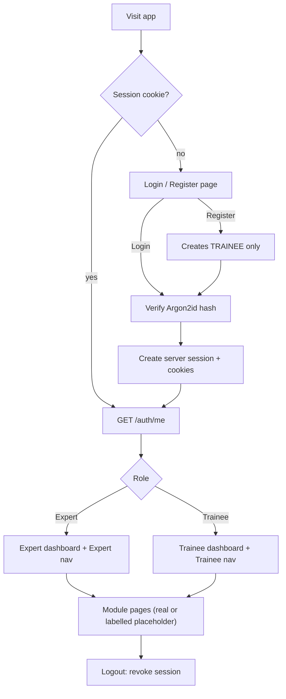
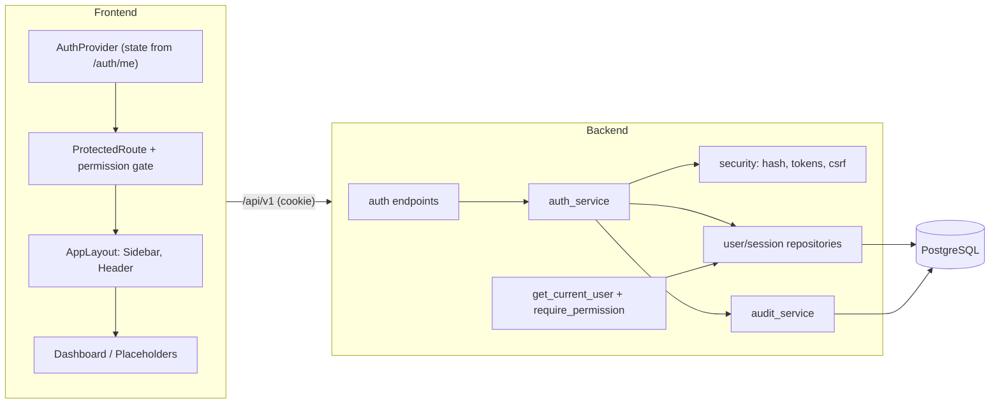

# Module 00 — Foundation (Auth, Roles, Layout)

**Status:** Planned · **Phase:** 1 · **Hackathon:** Build (Day 1)

## 1. Full workflow diagram



## 2. Required tech stack and technologies
- Backend: FastAPI, SQLAlchemy 2, Alembic, PostgreSQL 16, argon2-cffi, pydantic-settings, pytest, httpx.
- Frontend: React, TypeScript, Vite, React Router, Tailwind CSS, TanStack Query, lucide-react icons.
- Infra: Docker Compose (`db`, `backend`, `frontend`).

## 3. System architecture of this feature



## 4. Tech flow

```mermaid
sequenceDiagram
  participant UI as Login page
  participant API as FastAPI
  participant DB as PostgreSQL
  UI->>API: POST /auth/login
  API->>API: rate-limit check (in-memory)
  API->>DB: user by email, verify hash
  alt bad credentials
    API-->>UI: 401 generic "Invalid email or password"
    API->>DB: audit login_failed
  else ok
    API->>DB: insert session(token_hash, expires)
    API->>DB: audit login_success
    API-->>UI: Set-Cookie session + csrf; body {user, permissions}
  end
```

## 5. Steps (implementation order)
1. Compose + backend skeleton + `/health` (T1.1).
2. Alembic + models + migration 001 + seed (T1.2).
3. Security helpers, auth service/endpoints, `require_permission`, audit service (T1.3).
4. Frontend skeleton + API client with CSRF header (T1.4).
5. Auth UI, protected routes, layout, dashboards, placeholders (T1.5).
6. Tests run and recorded (T1.6).

## 6. Other information

**Permissions seeded**
| Permission | Expert | Trainee |
|---|---|---|
| knowledge.create, knowledge.edit_own_draft, knowledge.submit_review | yes | no |
| knowledge.approve | per-user grant (user_permissions) | no |
| machine.manage | Expert | no |
| knowledge.view_published, assistant.use | yes | yes |
| audit.view | per-user grant | no |

**Seed accounts (demo only, labelled):** `expert.a@demo.local`, `expert.b@demo.local` (has `knowledge.approve`), `trainee@demo.local`. Passwords come from `.env`, not code.

**Frontend pages:** `/login`, `/register`, `/403`, `*` (404), `/app` dashboard, `/app/<module>` for all modules. Placeholders show "Planned, not implemented" and fake nothing. Dashboards show empty states, not invented statistics.

**Edge cases:** expired session goes to login with a message; deactivated user is blocked and sessions revoked; duplicate email gives 409; weak password gives 422.

**Acceptance:** all foundation tests in `TESTING_STRATEGY.md` pass; `docker compose up` works from a clean clone.

**Files:** see `ANTIGRAVITY_IMPLEMENTATION_GUIDE.md` layout. **Dependencies:** none.
**Limitations:** no password reset, in-memory rate limiting.
