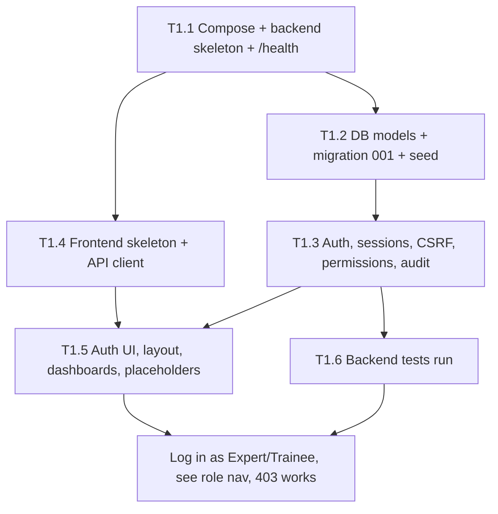
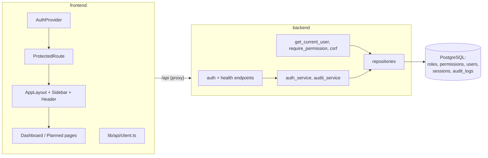

# 01 — Foundation Prompts (Module 00)

**Status:** Planned · Day 1 · Tasks T1.1 → T1.6

## 1. Full workflow diagram



## 2. Required tech stack and technologies
FastAPI, SQLAlchemy 2, Alembic, PostgreSQL 16, argon2-cffi, pydantic-settings, pytest/httpx; React, TypeScript, Vite, React Router, Tailwind, TanStack Query, lucide-react, Vitest + React Testing Library; Docker Compose.

## 3. System architecture of this module



## 4. Tech flow
Login: form -> `POST /auth/login` -> rate-limit -> verify Argon2id -> insert session (token hash) -> `Set-Cookie gk_session` (HttpOnly) + `gk_csrf` -> `GET /auth/me` -> role + permissions -> role-aware navigation.

## 5. Module context block (paste with every task below)

````text
MODULE: 00 Foundation. Goal: a running full-stack skeleton with real auth, two roles, role-aware UI, and labelled placeholders for all other modules.
FLOW: browser -> Vite proxy /api -> FastAPI -> dependency chain (session -> csrf -> permission) -> service -> repository -> PostgreSQL. Cookies: gk_session (HttpOnly, SameSite=Lax), gk_csrf (readable by JS). Unsafe methods need header X-CSRF-Token equal to gk_csrf cookie.
SESSIONS: random 32-byte token; store only SHA-256 hash; idle timeout 30 min (sliding, update last_seen_at at most once per minute); absolute 8 h; logout revokes (revoked_at). Configurable via env.
READ FIRST: docs/modules/00-foundation.md, docs/SYSTEM_ARCHITECTURE.md, docs/SECURITY_AND_AI_GOVERNANCE.md.
````

## 6. Prompts

### T1.1 — Repo skeleton, Docker Compose, backend skeleton, health check (Owner A)

````text
TASK T1.1 — Repo skeleton, Docker Compose, backend skeleton, /health

1. OBJECTIVE
Create the repository skeleton so `docker compose up --build` starts PostgreSQL and a FastAPI backend, and GET /api/v1/health reports app and database status.

2. PREREQUISITES
Empty repo. Docker installed. docs/ folder already copied into the repo.

3. FILES TO CREATE (inspect the repo first; create only what is missing)
- docker-compose.yml  (services: db, backend)
- .env.example, .gitignore, README.md (short setup instructions)
- backend/Dockerfile (python:3.12-slim, install ffmpeg, install deps, run uvicorn with --reload on 0.0.0.0:8000)
- backend/pyproject.toml (fastapi, uvicorn[standard], sqlalchemy>=2, alembic, psycopg[binary], pydantic-settings, argon2-cffi, python-multipart, anthropic, openai, faster-whisper; dev: pytest, httpx)
- backend/app/main.py (create_app, include router, exception handlers, request-id middleware)
- backend/app/core/config.py (pydantic-settings; fields: DATABASE_URL, TEST_DATABASE_URL, SESSION_SECRET, COOKIE_SECURE=false, SESSION_IDLE_MINUTES=30, SESSION_ABSOLUTE_HOURS=8, ANTHROPIC_API_KEY, ANTHROPIC_MODEL=claude-sonnet-5-5, STT_PROVIDER=openai|local, OPENAI_API_KEY, WHISPER_MODEL_SIZE=base, MEDIA_DIR=/data/media, MAX_UPLOAD_MB=100)
- backend/app/core/logging.py (structured logging, redact passwords/tokens/api keys)
- backend/app/core/exceptions.py (AppError with code/status/message, handlers producing the standard error body incl. request_id; handle validation errors as 422 in the same shape)
- backend/app/api/v1/router.py, backend/app/api/v1/endpoints/health.py
- backend/app/db/session.py (engine + SessionLocal + get_db)
- backend/app/tests/test_health.py

4. REQUIREMENTS
- db: postgres:16 with healthcheck, named volume, env from .env. backend depends_on db healthy. Mount ./backend into the container for reload. Add named volumes for media (/data/media) and the Hugging Face cache.
- GET /api/v1/health returns {"status":"ok","database":"ok"} and {"status":"degraded","database":"error"} (HTTP 503) when the DB is unreachable. No auth needed.
- Config reads from environment only. .env.example lists every variable with safe placeholder values and comments. Real .env is git-ignored.
- Every error response uses the standard error body.

5. ACCEPTANCE CRITERIA
- `docker compose up --build` starts cleanly from a fresh clone (after copying .env.example to .env).
- http://localhost:8000/docs loads. /api/v1/health returns ok.
- Stopping the db container makes /health return 503 degraded.
- No secrets are committed.

6. TESTS TO RUN
`docker compose exec backend pytest` (test_health: ok case; error-shape case for an unknown route returns the standard 404 body).

7. EXPECTED RESULT
A running backend and database, a health endpoint, and the folder structure other tasks will extend.

8. DOCS TO UPDATE
README.md (setup steps), docs/TASKS.md (T1.1 status), docs/ANTIGRAVITY_IMPLEMENTATION_GUIDE.md (confirm run commands match reality).
````

### T1.2 — SQLAlchemy models, Alembic, migration 001, seed (Owner A)

````text
TASK T1.2 — Models, Alembic, migration 001, seed script

1. OBJECTIVE
Create the foundation tables, a working Alembic setup, and an idempotent seed script.

2. PREREQUISITES
T1.1 done and running.

3. FILES TO CREATE / MODIFY
- backend/alembic.ini, backend/alembic/env.py (reads DATABASE_URL from settings), backend/alembic/versions/001_foundation.py
- backend/app/db/base.py (declarative Base with naming convention)
- backend/app/models/{role.py, permission.py, user.py, session.py, audit_log.py, __init__.py}
- backend/app/scripts/seed.py (run with: python -m app.scripts.seed)
- backend/app/tests/conftest.py (create test DB gurukul_test via TEST_DATABASE_URL, run migrations, per-test cleanup using TRUNCATE ... CASCADE, a client fixture)
- backend/app/tests/test_migrations.py

4. REQUIREMENTS
Tables:
- roles(id, name unique: expert|trainee)
- permissions(id, code unique, description)
- role_permissions(role_id, permission_id) composite PK
- user_permissions(user_id, permission_id, granted_by, granted_at) composite PK
- users(id, email unique lowercase, name, password_hash, role_id FK, is_active default true, is_demo default false, created_at, updated_at)
- sessions(id uuid PK, user_id FK, token_hash unique, csrf_token_hash, created_at, last_seen_at, expires_at, revoked_at null, user_agent null, ip null)
- audit_logs(id, actor_id null FK, action, entity_type, entity_id null, detail JSONB, ip null, created_at). Append-only: add a database trigger that raises an exception on UPDATE or DELETE (TRUNCATE for tests is allowed).
Indexes: users.email, sessions.token_hash, sessions.user_id, audit_logs(entity_type, entity_id), audit_logs(created_at).
Seed (idempotent, safe to run twice):
- Roles expert, trainee. All 8 permissions from the master context. Role-permission mapping from the master context.
- Users (is_demo=true): expert.a@demo.local ("Expert A"), expert.b@demo.local ("Expert B", also granted knowledge.approve and audit.view via user_permissions), trainee@demo.local ("Demo Trainee").
- Passwords come from env vars SEED_EXPERT_PASSWORD and SEED_TRAINEE_PASSWORD (add to .env.example, min 10 chars). Never hardcode passwords. If the vars are missing, exit with a clear message.
Do NOT create tables for later modules.

5. ACCEPTANCE CRITERIA
- `alembic upgrade head` works on an empty DB; `alembic downgrade base` then `upgrade head` works again.
- Seed runs twice without errors or duplicates.
- UPDATE or DELETE on audit_logs fails at DB level.

6. TESTS TO RUN
`docker compose exec backend pytest` — migration up/down test, seed idempotency test, audit-log immutability test.

7. EXPECTED RESULT
A migrated database with roles, permissions and three demo accounts.

8. DOCS TO UPDATE
docs/DATABASE_DESIGN.md (note any column differences), docs/TASKS.md, README.md (migrate + seed commands).
````

### T1.3 — Authentication, sessions, CSRF, permissions, audit (Owner A)

````text
TASK T1.3 — Auth backend

1. OBJECTIVE
Implement real registration (Trainee only), login, logout, current-user, server-side sessions, CSRF protection, permission dependency, in-memory login rate limiting and an audit service.

2. PREREQUISITES
T1.2 done (migrations applied, seed run).

3. FILES TO CREATE / MODIFY
- backend/app/core/security.py (Argon2id hasher, token generation, SHA-256 token hashing, constant-time compare, dummy-hash verification for unknown emails)
- backend/app/core/permissions.py (get_current_user, get_current_session, require_csrf, require_permission(code), require_any_permission)
- backend/app/core/rate_limit.py (in-memory: 5 failed logins per 15 min per email+IP, returns 429 with error body)
- backend/app/repositories/{user_repository.py, session_repository.py}
- backend/app/services/{auth_service.py, audit_service.py}
- backend/app/schemas/auth.py
- backend/app/api/v1/endpoints/auth.py and register in router.py
- backend/app/tests/{test_auth.py, test_permissions.py, test_csrf.py, test_sessions.py}

4. REQUIREMENTS
Endpoints:
- POST /api/v1/auth/register {email,name,password} -> creates TRAINEE only. Role must never be accepted from the body. Email lowercased; duplicate -> 409; password min 10 chars -> 422. Does not log the user in.
- POST /api/v1/auth/login {email,password} -> generic 401 "Invalid email or password" for unknown email, wrong password or inactive user (same message, similar timing). On success: create session, set cookies gk_session (HttpOnly, SameSite=Lax, Secure from COOKIE_SECURE, Path=/) and gk_csrf (not HttpOnly), return {user:{id,email,name,role,is_demo},permissions:[...]}.
- POST /api/v1/auth/logout (CSRF required) -> set revoked_at, clear cookies.
- GET /api/v1/auth/me -> current user + permissions (role permissions + user_permissions). 401 if no/invalid/expired/revoked session or inactive user.
Session rules: validate idle (SESSION_IDLE_MINUTES) and absolute (SESSION_ABSOLUTE_HOURS) expiry on every request; update last_seen_at at most once per minute. Deactivating a user (is_active=false) must make existing sessions fail.
CSRF: all POST/PUT/PATCH/DELETE (except /auth/login and /auth/register) require header X-CSRF-Token equal to the gk_csrf cookie AND to the value bound to the session (compare hash). Missing/mismatch -> 403 code csrf_failed.
Audit events (no secrets in detail): login_success, login_failed (store the attempted email in lowercase and the IP; never the password), logout, register, permission_denied.
Add a temporary protected test route only inside tests (not in the app) to prove require_permission works.

5. ACCEPTANCE CRITERIA
- All behaviours above work through the real database.
- Registering with a body containing "role":"expert" still creates a Trainee.
- Trainee calling an Expert-only dependency gets 403; no-session gets 401.
- Passwords and tokens never appear in logs or audit detail.

6. TESTS TO RUN
`docker compose exec backend pytest`. Required tests: valid login; invalid login generic message; refresh via /me; logout revokes; idle-expired and absolute-expired sessions rejected (manipulate timestamps in the test DB); two users concurrently independent; deactivated user blocked; register cannot create Expert; duplicate email 409; CSRF missing 403; rate limit 429 after 5 failures; permission 403.

7. EXPECTED RESULT
Working, tested backend authentication and authorization primitives that every later module reuses.

8. DOCS TO UPDATE
docs/API_CONVENTIONS.md (auth endpoints as built), docs/modules/00-foundation.md (status), docs/TASKS.md, README.md (demo accounts + login via /docs note).
````

### T1.4 — Frontend skeleton and API client (Owner B)

````text
TASK T1.4 — Frontend skeleton

1. OBJECTIVE
Create the React + TypeScript + Vite + Tailwind app, running in Docker, proxying /api to the backend, with a typed API client that handles cookies and CSRF.

2. PREREQUISITES
T1.1 done. (T1.3 is needed only to test authenticated calls.)

3. FILES TO CREATE / MODIFY
- frontend/{package.json, tsconfig.json, vite.config.ts, tailwind.config.js, postcss.config.js, index.html, Dockerfile}
- docker-compose.yml (add service frontend: node:20, port 5173, mount ./frontend, depends_on backend)
- frontend/src/{main.tsx, app/App.tsx, app/queryClient.ts, routes/index.tsx, index.css}
- frontend/src/lib/api/{client.ts, errors.ts, types.ts}
- frontend/src/components/ui/{Button.tsx, Input.tsx, Card.tsx, Badge.tsx, Spinner.tsx}
- frontend/src/features/system/StatusPage.tsx (route /status shows backend health)
- frontend/src/tests/{client.test.ts}

4. REQUIREMENTS
- Vite dev server on 0.0.0.0:5173 with proxy: '/api' -> 'http://backend:8000' (same origin, so cookies work).
- client.ts: fetch wrapper with credentials 'include'; reads cookie gk_csrf and sends X-CSRF-Token on POST/PUT/PATCH/DELETE; parses the standard error body into ApiError(code,message,status,details); handles empty 204; supports JSON and FormData (do not set Content-Type for FormData).
- No tokens in localStorage or sessionStorage.
- TanStack Query configured with sensible defaults (no retry on 401/403/404).
- Tailwind configured; basic design tokens (primary color, neutral grays) in tailwind config.
- Vitest + React Testing Library configured.

5. ACCEPTANCE CRITERIA
- `docker compose up --build` serves http://localhost:5173.
- /status page shows the backend health result from /api/v1/health.
- Client unit tests pass.

6. TESTS TO RUN
`docker compose exec frontend npm test` (CSRF header added on POST; not added on GET; error parsing; FormData handling).

7. EXPECTED RESULT
A running frontend talking to the real backend through one typed client.

8. DOCS TO UPDATE
README.md (frontend URL), docs/TASKS.md, docs/ANTIGRAVITY_IMPLEMENTATION_GUIDE.md if commands differ.
````

### T1.5 — Auth UI, layout, dashboards, placeholders (Owner B)

````text
TASK T1.5 — Auth UI, layout, role-aware navigation, dashboards, placeholders

1. OBJECTIVE
Build the user-facing foundation: login, register, protected routes, application shell with role-aware sidebar, dashboards with honest empty states, and labelled placeholder pages for every module.

2. PREREQUISITES
T1.3 (auth API) and T1.4 (frontend skeleton) done. Seed accounts exist.

3. FILES TO CREATE / MODIFY
- frontend/src/features/auth/{AuthProvider.tsx, useAuth.ts, LoginPage.tsx, RegisterPage.tsx, authApi.ts}
- frontend/src/routes/{ProtectedRoute.tsx, routes config}
- frontend/src/layouts/{AppLayout.tsx, Sidebar.tsx, Header.tsx}
- frontend/src/components/shared/{PageHeader.tsx, EmptyState.tsx, ErrorMessage.tsx, StatusBadge.tsx, PlannedModulePage.tsx, DemoDataTag.tsx, ErrorBoundary.tsx}
- frontend/src/features/dashboard/{ExpertDashboard.tsx, TraineeDashboard.tsx, DashboardPage.tsx}
- frontend/src/pages/{ForbiddenPage.tsx, NotFoundPage.tsx}
- frontend/src/tests/{ProtectedRoute.test.tsx, LoginPage.test.tsx, Sidebar.test.tsx}

4. REQUIREMENTS
- AuthProvider loads GET /auth/me on start; exposes user, permissions, login(), logout(); redirects to /login on 401; shows a loading state first.
- Routes: /login, /register (creates Trainee, then redirects to login with a success message), /403, * (404), /app (dashboard), plus /app/knowledge, /app/knowledge/new, /app/review, /app/assistant, /app/workflows, /app/troubleshooting, /app/sound-analysis, /app/knowledge-graph, /app/simulator, /app/assessments, /app/sync-training, /app/profile.
- ProtectedRoute(requiredPermission?) -> unauthenticated: /login; missing permission: /403.
- Sidebar items depend on permissions. Each item shows a status badge: "Live" (implemented) or "Planned". For now ALL module pages (even Knowledge, Review, Assistant) render <PlannedModulePage> stating "Planned, not implemented yet" with the module purpose in one sentence and its target phase. Later tasks replace these pages one by one.
- Dashboards: welcome with name and role; cards for quick actions that link to module pages; "Recent activity" and "Notifications" sections show EmptyState ("Nothing here yet"). NO invented numbers or fake activity.
- Header: user name, role badge, logout button (calls POST /auth/logout with CSRF). Demo accounts show a small "Demo account" tag.
- Loading, empty and error states use the shared components. Layout is responsive (sidebar collapses on narrow screens).
- Login errors display the server's generic message.

5. ACCEPTANCE CRITERIA
- Log in as expert.a@demo.local, expert.b@demo.local and trainee@demo.local; each lands on the right dashboard with role-appropriate navigation.
- Trainee cannot open an Expert-only route (redirect to /403); direct URL typing also blocked.
- Refreshing the page keeps the user signed in; logout returns to /login and a refresh stays signed out.
- Register creates a Trainee that can log in.

6. TESTS TO RUN
`docker compose exec frontend npm test` and a manual click-through of the three accounts. Report the manual results honestly.

7. EXPECTED RESULT
A navigable, secure application shell where every planned module is visible and truthfully labelled.

8. DOCS TO UPDATE
docs/TASKS.md, docs/modules/00-foundation.md (status), README.md (demo accounts and URLs).
````

### T1.6 — Foundation test pass (Owner A)

````text
TASK T1.6 — Foundation verification

1. OBJECTIVE
Run the complete foundation test suite and fix failures. Confirm a clean-clone start works.

2. PREREQUISITES
T1.1–T1.5 done.

3. FILES TO CREATE / MODIFY
Only test files and bug fixes needed. Add backend/app/tests/test_foundation_e2e.py if missing coverage.

4. REQUIREMENTS
Cover every item in docs/TESTING_STRATEGY.md under "Foundation". Add: /health with DB up, CSRF on logout, two sessions for one user, session revoked on deactivation. From a clean state run: `docker compose down -v && docker compose up --build`, migrate, seed, and verify login in the browser.

5. ACCEPTANCE CRITERIA
All foundation tests pass; clean start works; no secrets in git (`git status` shows no .env).

6. TESTS TO RUN
`docker compose exec backend pytest -q` and `docker compose exec frontend npm test`.

7. EXPECTED RESULT
Foundation marked Tested with real output pasted.

8. DOCS TO UPDATE
docs/TASKS.md, docs/MODULE_REGISTRY.md (Foundation: Tested), docs/TESTING_STRATEGY.md (results summary).
````
