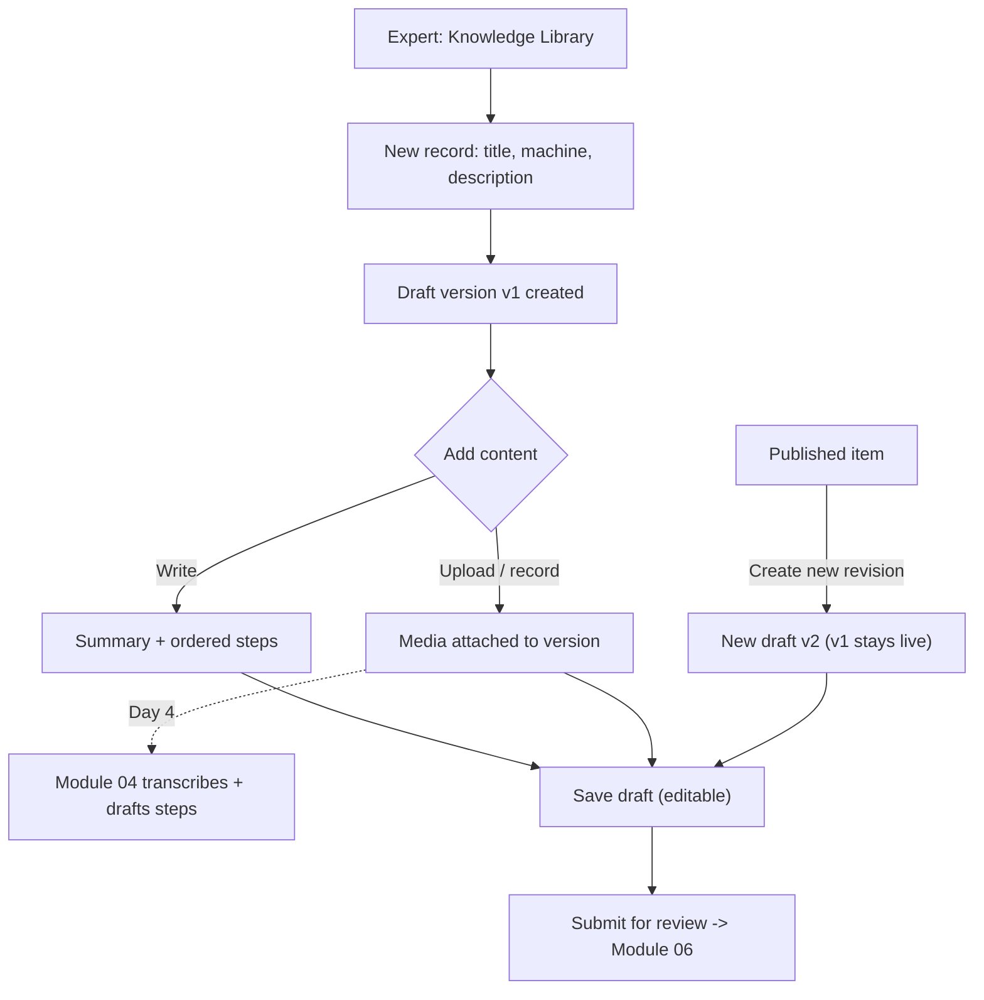
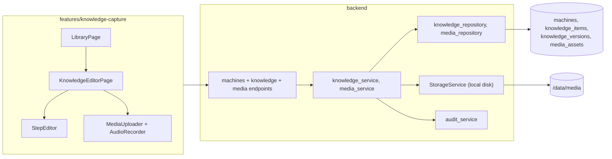

# 02 — Expert Knowledge Capture Prompts (Module 01)

**Status:** Planned · Day 2 · Tasks T2.1 → T2.4

## 1. Full workflow diagram



## 2. Required tech stack and technologies
FastAPI, SQLAlchemy 2 (JSONB steps), Alembic, python-multipart, `StorageService` (local disk), MIME allow-list; React, TypeScript, TanStack Query, Tailwind, browser `MediaRecorder`.

## 3. System architecture of this module



## 4. Tech flow
`POST /knowledge` -> item + version 1 (draft, author = session user) -> `PATCH /knowledge/{id}` (summary, steps; allowed only in draft/changes_requested and only by author) -> `POST /knowledge-versions/{vid}/media` (validate MIME + size, random storage key) -> `POST /knowledge-versions/{vid}/submit-review` (Module 06).

## 5. Module context block (paste with every task below)

````text
MODULE: 01 Expert Knowledge Capture. Goal: Experts create machine-linked knowledge records with ordered steps and media, saved as versioned drafts. Trainees never see drafts.
DATA: machines(id,name,code unique,category,is_demo); knowledge_items(id,title,machine_id,author_id,current_published_version_id null,is_demo,created_at); knowledge_versions(id,item_id,version_no,status,summary,steps JSONB,origin,revision_reason,created_by,submitted_at,published_at,created_at; unique(item_id,version_no)); media_assets(id,version_id,kind,storage_key,original_name,mime,size_bytes,uploaded_by,created_at).
STATUS ENUM: draft, in_review, changes_requested, rejected, approved, published, superseded, withdrawn. ORIGIN ENUM: expert, ai_draft, ai_draft_edited.
STEP JSON: {order:int, title, instruction, tools:[str], safety_warning, expected_result, stop_condition, needs_review:bool, source_segment_ids:[int], ai_generated:bool}.
RULES: edit only when status in (draft, changes_requested) and caller is the version author. Editing a published item = POST /knowledge/{id}/versions creates a new draft copying the published steps (409 if an open draft already exists). Trainees see only items with a published current version and only that version's content. Experts see own items (all versions) plus other experts' published items. Reviewers (knowledge.approve) can also view versions in status in_review.
READ FIRST: docs/modules/01-expert-knowledge-capture.md, docs/DATABASE_DESIGN.md.
````

## 6. Prompts

### T2.1 — Migration 002, machines and knowledge APIs (Owner A)

````text
TASK T2.1 — Knowledge models and APIs

1. OBJECTIVE
Add the knowledge tables and the endpoints to manage machines, knowledge items and draft versions.

2. PREREQUISITES
Foundation (T1.1–T1.3) done.

3. FILES TO CREATE / MODIFY
- backend/alembic/versions/002_knowledge.py
- backend/app/models/{machine.py, knowledge.py, media.py} (media_assets table is created now; upload logic comes in T2.2)
- backend/app/schemas/{machine.py, knowledge.py}
- backend/app/repositories/{machine_repository.py, knowledge_repository.py}
- backend/app/services/knowledge_service.py (include validate_for_submission(version) with basic rules: title not empty, summary not empty OR at least 1 step, every step has title and instruction)
- backend/app/api/v1/endpoints/{machines.py, knowledge.py}
- backend/app/scripts/seed.py (extend: 3 demo machines, is_demo=true, generic names such as "Demo Machine A (Lathe)", "Demo Machine B (Press)", "Demo Inspection Station")
- backend/app/tests/{test_machines.py, test_knowledge.py}

4. REQUIREMENTS
Endpoints (all need a session; writes need CSRF):
- GET /machines (any signed-in); POST /machines (machine.manage).
- POST /knowledge {title, machine_id?, description?} (knowledge.create) -> creates item + version 1 draft, origin expert.
- GET /knowledge?page&page_size&q&machine_id&status -> visibility rules from the context block; returns item summary with current published version info and, for the author, their latest version status.
- GET /knowledge/{id}?version_id= -> Trainee: published version only (version_id for non-published -> 404). Author: any of own versions. Reviewer: in_review versions.
- PATCH /knowledge/{id} {title?, machine_id?, summary?, steps?, revision_reason?} -> applies to the author's editable version. Validate steps shape; re-number "order" 1..n from array order. Frozen status -> 409 invalid_state.
- POST /knowledge/{id}/versions -> new draft from the current published version. Any Expert with knowledge.create may do this; the new version's created_by is that Expert, and only that Expert can then edit it.
- GET /knowledge/{id}/versions -> list versions the caller may see.
Write an audit event for create, update, new_version. Trainee calling write endpoints gets 403; another Expert editing someone else's draft gets 404.

5. ACCEPTANCE CRITERIA
Expert A can create, edit and list own drafts; Trainee list is empty (no published items yet); Expert B cannot see or edit Expert A's draft; frozen versions reject edits.

6. TESTS TO RUN
`docker compose exec backend pytest`: ownership, visibility, step validation, frozen status 409, trainee 403, new revision rules, pagination.

7. EXPECTED RESULT
Working knowledge draft APIs with correct visibility.

8. DOCS TO UPDATE
docs/DATABASE_DESIGN.md, docs/API_CONVENTIONS.md (endpoints as built), docs/modules/01-expert-knowledge-capture.md (status), docs/TASKS.md.
````

### T2.2 — Storage service and media upload (Owner A)

````text
TASK T2.2 — Media storage and upload endpoints

1. OBJECTIVE
Implement protected media upload and authorized download for knowledge versions.

2. PREREQUISITES
T2.1 done.

3. FILES TO CREATE / MODIFY
- backend/app/integrations/storage/{base.py (StorageService interface: save, open, delete, exists), local.py}
- backend/app/services/media_service.py
- backend/app/repositories/media_repository.py
- backend/app/api/v1/endpoints/media.py
- backend/app/tests/test_media.py

4. REQUIREMENTS
- POST /knowledge-versions/{vid}/media (multipart: file, kind optional) -> only the author, only while the version is editable. Stream the file to disk in chunks, enforce MAX_UPLOAD_MB while streaming (413), allow-list MIME by sniffing the first bytes where practical AND checking the declared type: audio (webm, mpeg, wav, mp4/m4a, ogg), video (mp4, webm), image (png, jpeg), application/pdf. Others -> 415. Storage key is random (uuid) + safe extension; never use the user's filename for the path; keep original_name as metadata only (sanitised).
- GET /media/{id} -> streams the file only if the caller may see its version (author, reviewer for in_review, anyone allowed to view the published version). Others 404. Support HTTP Range requests so audio/video can seek.
- DELETE /media/{id} -> author, editable version only.
- Audit upload and delete.

5. ACCEPTANCE CRITERIA
Upload and playback work for an audio file; a Trainee cannot fetch a draft's media; oversize and wrong-type files are rejected with clear errors; files live under MEDIA_DIR with random names.

6. TESTS TO RUN
`docker compose exec backend pytest`: type reject, size reject, ownership, frozen version, trainee access to draft media 404, Range request returns 206.

7. EXPECTED RESULT
Secure media handling reused by Module 04.

8. DOCS TO UPDATE
docs/API_CONVENTIONS.md, docs/SECURITY_AND_AI_GOVERNANCE.md (upload rules as built), docs/TASKS.md.
````

### T2.3 — Library, editor and step editor UI (Owner B)

````text
TASK T2.3 — Knowledge Library and Editor screens

1. OBJECTIVE
Replace the Knowledge placeholder pages with real screens wired to the backend.

2. PREREQUISITES
T1.5 and T2.1 done (T2.2 for uploader later).

3. FILES TO CREATE / MODIFY
- frontend/src/features/knowledge-capture/{LibraryPage.tsx, KnowledgeEditorPage.tsx, StepEditor.tsx, StepCard.tsx, knowledgeApi.ts, types.ts, hooks.ts}
- frontend/src/routes (replace the /app/knowledge and /app/knowledge/new placeholders; add /app/knowledge/:id)
- frontend/src/components/shared/StatusBadge.tsx (statuses with distinct colors)
- Sidebar: mark Knowledge as "Live"
- frontend/src/tests/{StepEditor.test.tsx, LibraryPage.test.tsx}

4. REQUIREMENTS
- LibraryPage: table/cards with title, machine, status badge, version, updated date, "Demo data" tag when is_demo; search box, machine filter, status filter, pagination; "New knowledge" button visible only with knowledge.create; empty, loading and error states.
- KnowledgeEditorPage (create + edit): fields title, machine (select from /machines), description, summary; StepEditor to add, edit, delete, reorder (up/down buttons are enough) and duplicate steps; each step has title, instruction, tools (tag input), safety warning, expected result, stop condition. Steps with needs_review=true show a warning badge and a "I have verified this" checkbox that clears the flag. Save button (PATCH), unsaved-changes warning, inline validation. Fields are read-only when the version is not editable, with a banner explaining why.
- Detail view for Trainees: read-only published content with step list and a clear "Approved version N" label.
- "Submit for review" button appears (disabled until Module 06 is built, with tooltip "Planned: Module 06") — do not fake the action.
- Use the typed API client. No mock data.

5. ACCEPTANCE CRITERIA
Expert A creates a record with 3 steps, saves, reloads and sees the same data; Trainee sees no drafts; reorder and delete work; read-only mode works.

6. TESTS TO RUN
`docker compose exec frontend npm test` + manual click-through (report honestly).

7. EXPECTED RESULT
A usable capture UI for text-based knowledge.

8. DOCS TO UPDATE
docs/TASKS.md, docs/modules/01-expert-knowledge-capture.md (status).
````

### T2.4 — Media uploader and audio recorder (Owner B)

````text
TASK T2.4 — Upload and record components

1. OBJECTIVE
Let Experts attach files and record audio in the browser to a draft version.

2. PREREQUISITES
T2.2 and T2.3 done.

3. FILES TO CREATE / MODIFY
- frontend/src/features/knowledge-capture/{MediaPanel.tsx, MediaUploader.tsx, AudioRecorder.tsx, MediaList.tsx, useMediaRecorder.ts}
- frontend/src/tests/{MediaUploader.test.tsx}

4. REQUIREMENTS
- MediaUploader: file picker + drag-drop, client-side type and size pre-check (mirrors server limits; server remains the authority), upload progress (XMLHttpRequest or fetch with progress), error messages from the standard error body, retry button.
- AudioRecorder: uses MediaRecorder (prefer audio/webm;codecs=opus); request microphone permission; Start/Pause/Resume/Stop; timer and simple level indicator; preview playback; Discard; "Use this recording" uploads it as a media asset. Show a clear message if permission is denied or MediaRecorder is unsupported.
- MediaList: shows attached files with an HTML audio/video player (src = /api/v1/media/{id}) and a delete button (editable versions only).
- Exposes an optional prop onUploaded(media) so Module 04 can hook "Convert to knowledge".

5. ACCEPTANCE CRITERIA
Record 10 seconds of audio, preview it, upload it, see it in the list and play it back after reload; wrong file types and oversize files show clear errors.

6. TESTS TO RUN
`docker compose exec frontend npm test` + manual test in Chrome (microphone) — report browser used.

7. EXPECTED RESULT
Media capture ready for Voice-to-Knowledge.

8. DOCS TO UPDATE
docs/TASKS.md, docs/modules/01-expert-knowledge-capture.md.
````
