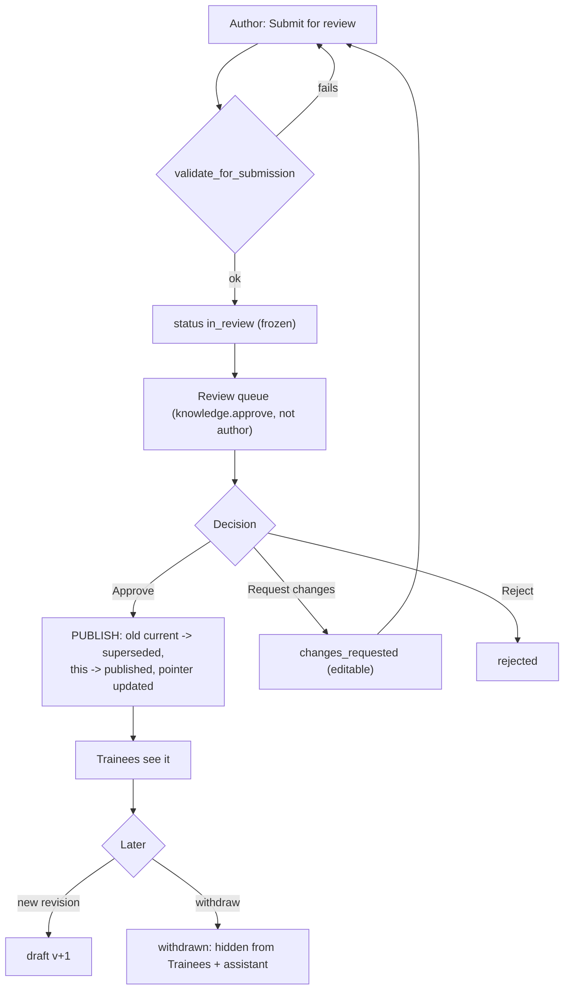
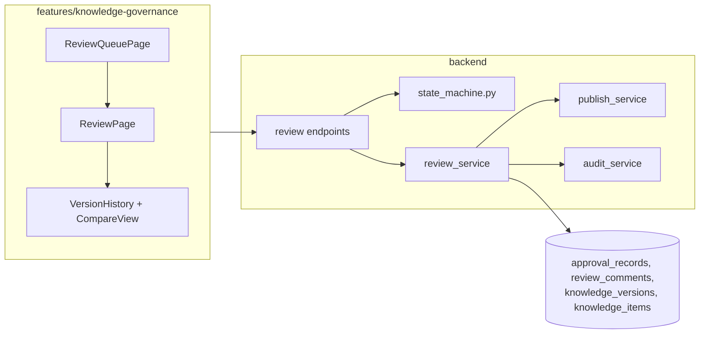

# 03 — Knowledge Validation and Versioning Prompts (Module 06)

**Status:** Planned · Day 3 · Tasks T3.1 → T3.3

## 1. Full workflow diagram



## 2. Required tech stack and technologies
PostgreSQL transactions with `SELECT ... FOR UPDATE`; SQLAlchemy; Python `difflib`; a pure-Python transition table (unit-testable); React for queue, review and compare views.

## 3. System architecture of this module



## 4. Tech flow
`POST /knowledge-versions/{vid}/approve` -> require knowledge.approve + CSRF -> BEGIN -> `SELECT version FOR UPDATE` -> status == in_review? reviewer != author? -> insert approval_record -> previous current published -> superseded -> version -> published, item pointer updated -> audit -> COMMIT.

## 5. Module context block (paste with every task below)

````text
MODULE: 06 Knowledge Validation and Versioning. Goal: controlled lifecycle so only approved, immutable versions are visible to Trainees.
TRANSITIONS (only these): draft->in_review; changes_requested->in_review; in_review->published | changes_requested | rejected; published->superseded | withdrawn. Hackathon simplification: approve = approve and publish in one transaction (still insert an approval_record with decision 'approved'). The enum value 'approved' stays unused for now.
RULES: author cannot approve/reject/request changes on own version (403 code self_review_forbidden). Reviewer needs knowledge.approve. Submitted version is frozen. Published is immutable. Withdraw requires a reason. Concurrent decisions: lock the row; the loser gets 409 invalid_state. Every transition writes an audit row and, where relevant, an approval_record.
TABLES (migration 002 additions or a new 002b if 002 is already applied — do NOT edit applied migrations): approval_records(id, version_id FK, reviewer_id FK, decision [approved|changes_requested|rejected|withdrawn], comment, created_at); review_comments(id, version_id FK, author_id FK, body, step_order null, created_at).
READ FIRST: docs/modules/06-knowledge-validation.md, docs/DATABASE_DESIGN.md.
````

## 6. Prompts

### T3.1 — Review state machine, endpoints, publish logic (Owner A)

````text
TASK T3.1 — Review workflow backend

1. OBJECTIVE
Implement submit, review decisions, publishing, supersede and withdraw with strict state rules, locking and audit.

2. PREREQUISITES
T2.1 done (knowledge models exist).

3. FILES TO CREATE / MODIFY
- backend/alembic/versions/ (new migration adding approval_records and review_comments; check whether they already exist before creating)
- backend/app/models/review.py
- backend/app/services/{state_machine.py, review_service.py, publish_service.py}
- backend/app/repositories/review_repository.py
- backend/app/schemas/review.py
- backend/app/api/v1/endpoints/review.py (register in router)
- backend/app/tests/{test_state_machine.py, test_review_flow.py}

4. REQUIREMENTS
Endpoints:
- POST /knowledge-versions/{vid}/submit-review (knowledge.submit_review; author only) -> runs knowledge_service.validate_for_submission; failure -> 422 with a list of problems; success -> in_review, submitted_at set.
- GET /reviews/queue (knowledge.approve) -> in_review versions, excluding ones the caller authored, oldest first, paginated; fields: item title, machine, author, version_no, submitted_at.
- POST /knowledge-versions/{vid}/approve {comment?} -> publish as described.
- POST /knowledge-versions/{vid}/request-changes {comment required}
- POST /knowledge-versions/{vid}/reject {comment required}
- POST /knowledge-versions/{vid}/withdraw {reason required} (knowledge.approve; allowed on a published version; clears item.current_published_version_id)
- POST /knowledge-versions/{vid}/comments {body, step_order?} (author or reviewer who can see the version)
- GET /knowledge-versions/{vid}/comments, GET /knowledge-versions/{vid}/approvals
- GET /knowledge/{id}/versions/compare?from=&to= -> structured diff per field and per step (added/removed/changed with old/new text via difflib). Only versions the caller can see.
Publish must: lock version row; check state and self-review; mark previous published version superseded; set version published, published_at; set item.current_published_version_id; write approval_record and audit. Leave a clearly named function hook `after_publish(db, version)` and `after_unpublish(db, version)` in publish_service that currently does nothing except log (Module 02 will implement indexing there). Document this in the file.
Rejected/changes_requested visible to author with reviewer comments.
Update knowledge_service so editing is blocked when status is not editable (already) and a Trainee never sees non-published versions.

5. ACCEPTANCE CRITERIA
Expert A submits; Expert B (knowledge.approve) approves; Trainee now sees v1; Expert A approving own version -> 403; Trainee approving -> 403; second approval attempt -> 409; withdraw hides it from Trainee; new revision does not change v1 until approved.

6. TESTS TO RUN
`docker compose exec backend pytest`: every allowed and disallowed transition; self-review; concurrency (two parallel approvals -> exactly one success); supersede; withdraw; frozen editing; compare output; audit rows exist.

7. EXPECTED RESULT
A tested governance backend.

8. DOCS TO UPDATE
docs/API_CONVENTIONS.md, docs/DATABASE_DESIGN.md, docs/modules/06-knowledge-validation.md, docs/TASKS.md.
````

### T3.2 — Governance tests and hardening (Owner A)

````text
TASK T3.2 — Module 06 test pass

1. OBJECTIVE
Prove the governance rules with tests and fix any gaps.

2. PREREQUISITES
T3.1 done.

3. FILES TO CREATE / MODIFY
backend/app/tests/test_governance_security.py and fixes in services if tests fail.

4. REQUIREMENTS
Add tests for: direct API calls by a Trainee to every review endpoint (all 403); IDs of invisible versions return 404; draft content never appears in GET /knowledge for a Trainee; withdrawn content never appears; approving a version that was edited after submission is impossible (frozen); comments by users who cannot see the version are rejected; audit rows exist for submit/approve/reject/changes/withdraw with the right actor.

5. ACCEPTANCE CRITERIA
All pass; no endpoint leaks unpublished content.

6. TESTS TO RUN
`docker compose exec backend pytest -q`.

7. EXPECTED RESULT
Module 06 backend marked Tested.

8. DOCS TO UPDATE
docs/TESTING_STRATEGY.md, docs/MODULE_REGISTRY.md, docs/TASKS.md.
````

### T3.3 — Review queue, review page, history, compare UI (Owner B)

````text
TASK T3.3 — Governance UI

1. OBJECTIVE
Build the review screens and enable "Submit for review" in the editor.

2. PREREQUISITES
T3.1 done, T2.3 done.

3. FILES TO CREATE / MODIFY
- frontend/src/features/knowledge-governance/{ReviewQueuePage.tsx, ReviewPage.tsx, VersionHistoryPage.tsx, CompareView.tsx, CommentsPanel.tsx, DecisionBar.tsx, governanceApi.ts}
- Modify knowledge-capture editor: enable "Submit for review" (shows 422 problems list), "Create new revision" button on published items, status banners (in review, changes requested with reviewer comments, rejected).
- Sidebar: "Review" visible only with knowledge.approve; mark Live.
- frontend/src/tests/{DecisionBar.test.tsx, ReviewQueuePage.test.tsx}

4. REQUIREMENTS
- ReviewQueuePage: list from /reviews/queue with empty state.
- ReviewPage: read-only content (summary, steps with warnings), media players, comments panel, DecisionBar with Approve / Request changes / Reject (comment required for the last two, confirmation dialog for Approve showing the version number). Show backend errors (self-review, 409) clearly.
- VersionHistory: list of versions with status, author, dates; select two to open CompareView with added/removed/changed highlighting per step.
- Withdraw action on published items for reviewers with a required reason.
- Never show action buttons the user lacks permission for, but rely on backend errors as the truth.

5. ACCEPTANCE CRITERIA
Full loop in the browser: Expert A submits, Expert B approves, Trainee sees the item; request-changes returns it to Expert A with comments; compare shows an edit between v1 and v2.

6. TESTS TO RUN
`docker compose exec frontend npm test` + manual loop with the three demo accounts (report honestly).

7. EXPECTED RESULT
End-to-end capture-to-publish flow.

8. DOCS TO UPDATE
docs/TASKS.md, docs/modules/06-knowledge-validation.md, README.md (demo loop instructions).
````
