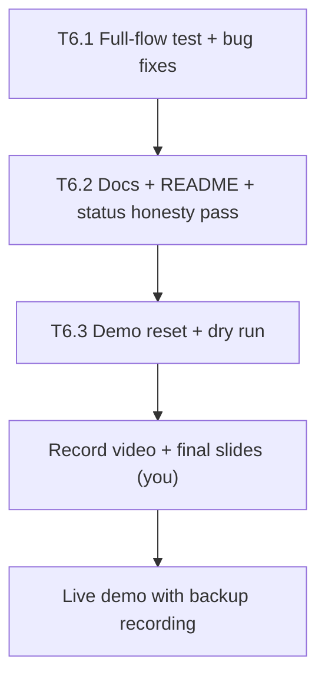

# 06 — Integration, Hardening and Demo Prompts

**Status:** Planned · Day 6 · Tasks T6.1 → T6.3

## 1. Full workflow diagram



## 2. Required tech stack and technologies
Docker Compose, pytest, Vitest, shell/Python scripts for reset, the existing app. No new dependencies.

## 3. System architecture
No new components. This stage exercises the whole path: React -> FastAPI -> PostgreSQL + media volume -> Whisper -> Claude.

## 4. Tech flow (demo path to verify)
Expert A logs in -> records narration -> convert -> review transcript and steps -> submit -> logout -> Expert B logs in -> review queue -> approve -> logout -> Trainee logs in -> sees published item -> asks covered question (cited) -> asks uncovered question (no source).

## 5. Module context block

````text
MODULE: Integration and Demo. Goal: make the whole demo path reliable and the documentation truthful. No new features. Fix bugs, remove dead UI, and keep every planned module clearly labelled as planned.
````

## 6. Prompts

### T6.1 — Full-flow verification and bug fixes (both)

````text
TASK T6.1 — End-to-end verification

1. OBJECTIVE
Verify the complete demo path and fix defects found.

2. PREREQUISITES
T1–T5 done.

3. FILES TO CREATE / MODIFY
Bug fixes only, plus backend/app/tests/test_full_flow.py (API-level run of the demo path using fake speech/LLM providers) and a written manual checklist in docs/DEMO_CHECKLIST.md.

4. REQUIREMENTS
- The API-level test performs: login Expert A, create item, add steps, submit, login Expert B, approve, login Trainee, list published, chat (fake LLM) with citation, uncovered question without LLM call, withdraw then confirm retrieval no longer returns the content.
- Walk the manual checklist in the browser with the three demo accounts and the real providers; record each line as Pass/Fail with notes.
- Grep the codebase for TODO/FIXME/mock/fake outside tests and justify or remove each.
- Check every sidebar item: it must be Live and working, or labelled Planned.
- Check console and network for errors during the demo path.

5. ACCEPTANCE CRITERIA
The demo path passes twice in a row from a clean database (`docker compose down -v`, up, migrate, seed, seed_demo_knowledge).

6. TESTS TO RUN
`docker compose exec backend pytest -q`, `docker compose exec frontend npm test`, manual checklist.

7. EXPECTED RESULT
A reliable demo build with honest pass/fail records.

8. DOCS TO UPDATE
docs/TASKS.md, docs/MODULE_REGISTRY.md, docs/TESTING_STRATEGY.md, docs/DEMO_CHECKLIST.md.
````

### T6.2 — Documentation truthfulness pass (both)

````text
TASK T6.2 — Docs and README

1. OBJECTIVE
Make README and docs match what is really built and tested.

2. PREREQUISITES
T6.1 done.

3. FILES TO CREATE / MODIFY
README.md, docs/MODULE_REGISTRY.md, docs/TASKS.md, docs/modules/*.md (status lines), docs/API_CONVENTIONS.md, docs/DATABASE_DESIGN.md, docs/KNOWN_LIMITATIONS.md (new).

4. REQUIREMENTS
- README: what it is, prerequisites (Git, Docker), setup in numbered steps, env variables, demo accounts, demo script, test commands, project structure, screenshots placeholders, known limitations.
- Set each module status using exactly: Not started, Planned, In progress, Implemented, Tested, Integrated, Blocked. Use Tested only where tests were actually run and passed.
- KNOWN_LIMITATIONS.md: list every hackathon simplification (no password reset, in-memory rate limit, BackgroundTasks not Redis, keyword search not vectors, JSONB steps, approve=publish, no upload malware scan, English only, local disk storage, no regulatory validation) and the seven planned modules.
- Remove claims that are not true.

5. ACCEPTANCE CRITERIA
A new person can start the app from README alone; statuses match reality.

6. TESTS TO RUN
Follow the README on a clean checkout and report what failed.

7. EXPECTED RESULT
Trustworthy documentation for judges and teammates.

8. DOCS TO UPDATE
All files above.
````

### T6.3 — Demo reset and dry-run support (Owner A)

````text
TASK T6.3 — Demo reset

1. OBJECTIVE
Add a one-command reset so the demo can be repeated reliably.

2. PREREQUISITES
T5.4 and T6.1 done.

3. FILES TO CREATE / MODIFY
- backend/app/scripts/reset_demo.py (python -m app.scripts.reset_demo)
- README.md (command)
- backend/app/tests/test_reset_demo.py

4. REQUIREMENTS
- Deletes only is_demo data created during demos: non-seed knowledge items by demo users, their versions, media files on disk, jobs, transcripts, chunks, chat conversations of demo users. Keeps users, roles, machines, and the 3 seeded demo knowledge items (re-publishes them if they were withdrawn or edited).
- Refuses to run unless the environment variable ALLOW_DEMO_RESET=true.
- Never touches non-demo users' data. Writes an audit-style log line to stdout (not the append-only audit table, which must not be deleted).
- Idempotent and prints a summary of what was removed.

5. ACCEPTANCE CRITERIA
After a full demo run, the reset returns the system to the pre-demo state in under a minute; seeded items remain searchable.

6. TESTS TO RUN
`docker compose exec backend pytest` (reset removes demo user data, keeps seeds, refuses without the env flag, does not touch a non-demo user).

7. EXPECTED RESULT
Repeatable rehearsals and a clean live demo.

8. DOCS TO UPDATE
README.md, docs/DEMO_CHECKLIST.md, docs/TASKS.md.
````

## Other information
Slides and the screen recording are manual work for you (Person B): record only after T6.1 passes twice, and keep the recording as the backup if the live demo fails.
