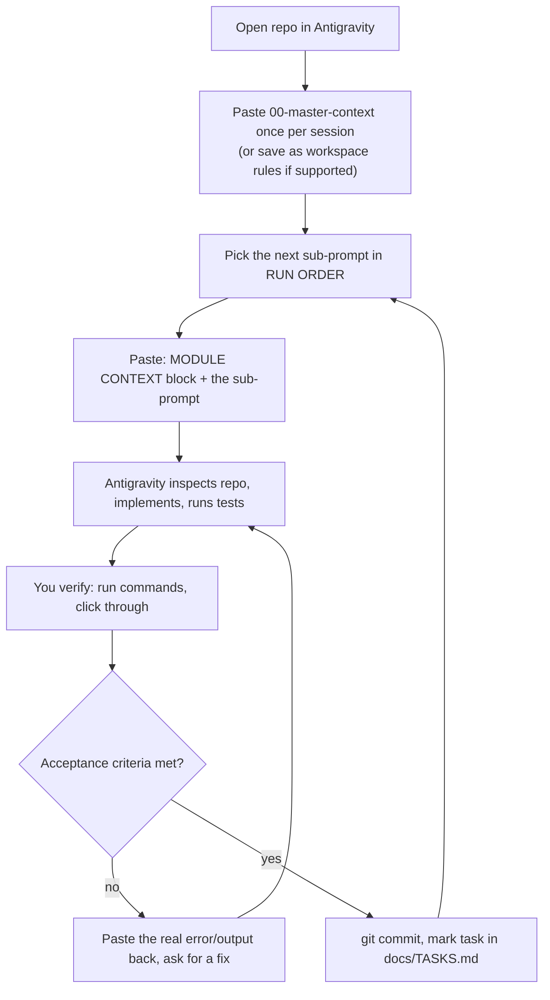
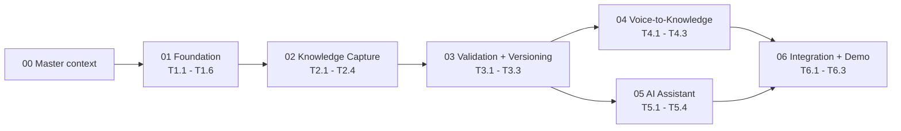

# Antigravity Prompt Pack — Gurukul AI

**Status:** Planned (no prompt has been run yet)

## 1. Full workflow diagram (how to use this pack)

## 2. Required tech stack and technologies
Docker + Compose, Python 3.12, FastAPI, SQLAlchemy 2, Alembic, PostgreSQL 16, React 18 + TypeScript + Vite + Tailwind + TanStack Query, Claude API, Whisper (API or local faster-whisper), ffmpeg. Details in `../ANTIGRAVITY_IMPLEMENTATION_GUIDE.md`.

## 3. System architecture of the prompt pack

## 4. Tech flow of one prompt
`Prompt -> Antigravity reads docs + inspects files -> edits files -> runs commands -> reports (files, commands, real test output, limits) -> you verify -> commit`.

## 5. Run order

| Order | File | Tasks | Owner | Day |
|---|---|---|---|---|
| 0 | 00-master-context.md | paste first | both | 0 |
| 1 | 01-foundation.md | T1.1, T1.2, T1.3, T1.6 | A | 1 |
| 1 | 01-foundation.md | T1.4, T1.5 | B | 1 |
| 2 | 02-knowledge-capture.md | T2.1, T2.2 (A); T2.3, T2.4 (B) | A/B | 2 |
| 3 | 03-validation-versioning.md | T3.1, T3.2 (A); T3.3 (B) | A/B | 3 |
| 4 | 04-voice-to-knowledge.md | T4.1, T4.2 (A); T4.3 (B) | A/B | 4 |
| 5 | 05-ai-assistant.md | T5.1, T5.2, T5.4 (A); T5.3 (B) | A/B | 5 |
| 6 | 06-integration-and-demo.md | T6.1, T6.2, T6.3 | both | 6 |

## 6. Other information
- Two people can work in parallel on two Antigravity sessions. Use separate git branches (`feat/backend-*`, `feat/frontend-*`) and merge at the end of each day.
- Never paste two sub-prompts at once. One task, verify, commit.
- If a prompt's output claims tests passed, run them yourself once.
- If Antigravity wants to change something outside the listed files, tell it to explain why first.
